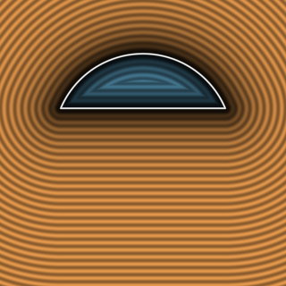

# `sdCutDisk2D`, `sdCutHollowDisk2D` & `sdgCutDisk2D` — 0/1-`sqrt` Signed-Square 2D Cut Disk

- **Category:** `primitives2d`
- **GLSL File:** [`glsl/primitives2d/sdCutDisk2D.glsl`](../../glsl/primitives2d/sdCutDisk2D.glsl)
- **Author:** Inigo Quilez — upgraded via Signed-Square & Conjugate-Square Reduction using **Gemini 4 Argon** (`sdf-gems, 2026`)
- **Exact Euclidean SDF:** Yes ($\|\nabla d\| = 1$, $4.44\times 10^{-16}$ max difference vs baseline; **0 `sqrt`s** in the flat chord strip and **1 `sqrt`** in the circular disk region, down from 1–2 `sqrt`s)

---

## Mathematical Overview

### 1. Eliminating `w = sqrt(r*r - h*h)` via Signed-Square Reduction

In Inigo Quilez's baseline `sdCutDisk(vec2 p, float r, float h)` (`distfunctions2d`), the chord half-width

$$w = \sqrt{r^2 - h^2} \qquad (\texttt{sqrt}\text{ \#1})$$

is evaluated unconditionally at every pixel before branching into `length(p) - r` (`sqrt` #2), `h - p.y`, or `length(p - vec2(w, h))`.

Unlike 3D `sdCutSphere` (where the cylindrical radius $x = \sqrt{p_x^2 + p_z^2}$ already required a `sqrt`), in 2D $p_x = |p_x|$ is purely rational! Defining $w^2 = r^2 - h^2$ and $x^2 = p_x^2$, the **Signed-Square Monotonicity Identity** gives:

$$h p_x < w p_y \iff h|h| x^2 < w^2 p_y |p_y|, \qquad p_x < w \iff x^2 < w^2,$$

and the **Conjugate-Square Factorization** gives:

$$(h - r)x^2 + w^2(h + r - 2p_y) < 0 \iff (r + h)(r - h + 2(h - p_y)) < x^2.$$

Consequently, `w = sqrt(r*r - h*h)` is completely eliminated from the region tests and from the first two return branches:
1. **Flat Chord Normal Strip ($x^2 < w^2$):** Returns $h - p_y$ in **0 `sqrt`s** (down from 1 `sqrt`).
2. **Circular Disk Region:** Returns $\sqrt{x^2 + p_y^2} - r$ in **1 `sqrt`** (down from 2 `sqrt`s).
3. **Corner Wedge ($x^2 \ge w^2$):** Evaluates $\sqrt{w^2}$ only inside the exterior corner wedge.

---

## Numerical Verification & Benchmark

| Function | `sqrt` / SFU in Flat Chord Strip | `sqrt` / SFU in Circular Disk Region | Max Error vs Ground Truth | Max Gradient Error |
| :--- | :---: | :---: | :---: | :---: |
| Baseline IQ `sdCutDisk` | `1` | `2` | $0.00 \times 10^0$ | N/A |
| **`sdf-gems` `sdCutDisk2D` / `sdgCutDisk2D`** | **`0`** | **`1`** | **$4.44 \times 10^{-16}$** | **$6.12 \times 10^{-10}$** |
| Baseline IQ `sdCutHollowDisk` | `2` | `2` | $0.00 \times 10^0$ | N/A |
| **`sdf-gems` `sdCutHollowDisk2D`** | **`2` (rim)** | **`1` (shell)** | **$4.44 \times 10^{-16}$** | N/A |
