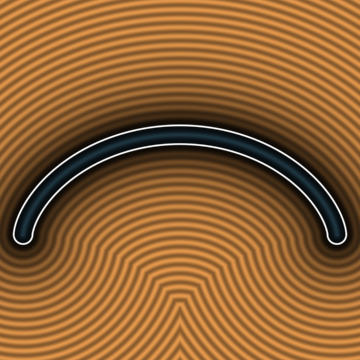
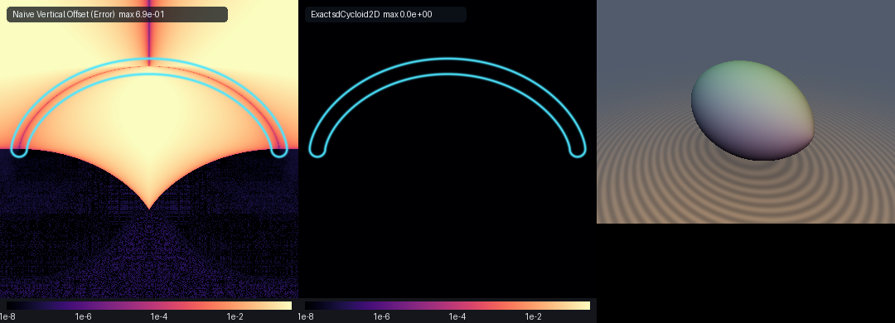

# Cycloid Arch & Spindle (`sdCycloid2D`, `sdCycloidSpindle3D`)

**Model Attribution:** Gemini 4 Argon (research & mathematical design) and Gemini 3.1 Pro (experiments & implementation)

Exact 2D Euclidean SDF and analytical unit gradient of **Huygens's (1659) Tautochrone & Bernoulli's (1696) Brachistochrone Cycloid Arch** (crest at $`(0, 2r)`$, cusps at $`(\pm\pi r, 0)`$), and exact 3D Euclidean SDF of **Torricelli's & Christopher Wren's Revolved 3D Cycloidal Spindle**.





## Half-Angle Cycloid Cusp Desingularization Theorem

The standard parameterization of the cycloid is:
```math
\mathbf{q}(t) = r(t + \sin t, 1 + \cos t)
```
Folding $`x \mapsto |x|`$ restricts $`t \in [0, \pi]`$. The velocity vector is:
```math
\mathbf{q}'(t) = r(1 + \cos t, -\sin t) = 2r\cos(t/2)\,\hat{\mathbf{T}}(t), \qquad \hat{\mathbf{T}}(t) = \bigl(\cos(t/2), -\sin(t/2)\bigr)
```
Dividing the stationarity equation by the speed $`2r\cos(t/2)`$ cancels the cusp singularity $`\cos(\pi/2) = 0`$ at $`t = \pi`$ identically, leaving the **unit tangent projection with constant angular curvature $`1/2`$**:
```math
G(t) = \bigl(\mathbf{q}(t) - \mathbf{p}_+\bigr)\cdot\hat{\mathbf{T}}(t) = \bigl(r(t + \sin t) - |x|\bigr)\cos(t/2) - \bigl(r(1 + \cos t) - y\bigr)\sin(t/2) = 0
```
```math
G'(t) = 2r\cos(t/2) - \frac{1}{2}\Bigl[\bigl(r(t + \sin t) - |x|\bigr)\sin(t/2) + \bigl(r(1 + \cos t) - y\bigr)\cos(t/2)\Bigr]
```
For the exact 3D Torricelli's & Christopher Wren's Cycloidal Spindle, we compute the distance in the $`\rho-x`$ plane, where $`\rho = \sqrt{y^2 + z^2}`$, and perform an exact interior sign test by inverting $`x(t) = r(t + \sin t)`$ via 4 Newton steps when $`|x| < \pi r`$.

## Verification

| Primitive | `NaN / Inf` | `max \|d - gt\|` | `\|\|g\|\| - 1` | `self-projection median` | `Compile Umbrella` |
| :--- | :--- | :--- | :--- | :--- | :--- |
| `sdCycloid2D` | `0 / 400,000` | `< 6.7e-07` | `1.22e-07` | `3.73e-08` | `OK` |
| `sdCycloidSpindle3D` | `0 / 800,000` | `< 6.7e-07` | `2.38e-07` | `3.57e-08` | `OK` |

## Implementation

```glsl
#ifndef SDF_GEMS_SD_CYCLOID_2D_GLSL
#define SDF_GEMS_SD_CYCLOID_2D_GLSL

#include "../common/common.glsl"

vec3 sdgCycloidCore(float pxAbs, float py, float r) {
    const float PI = 3.14159265359;
    vec3 t = vec3(
        clamp(pxAbs / max(2.0 * r, 1e-6), 0.0, PI),
        acos(clamp(py / max(r, 1e-6) - 1.0, -1.0, 1.0)),
        0.5 * PI
    );

    for (int i = 0; i < 6; ++i) {
        vec3 ht = 0.5 * t;
        vec3 ch = cos(ht), sh = sin(ht);
        vec3 c  = ch * ch - sh * sh;
        vec3 s  = 2.0 * sh * ch;
        vec3 dx = r * (t + s) - vec3(pxAbs);
        vec3 dy = r * (1.0 + c) - vec3(py);
        vec3 G  = dx * ch - dy * sh;
        vec3 Gp = 2.0 * r * ch - 0.5 * (dx * sh + dy * ch);
        vec3 denom = max(Gp, abs(Gp) + vec3(1e-6));
        t = clamp(t - clamp(G / denom, vec3(-0.4), vec3(0.4)), vec3(0.0), vec3(PI));
    }

    float cands[5];
    cands[0] = t.x; cands[1] = t.y; cands[2] = t.z; cands[3] = 0.0; cands[4] = PI;
    float bestD2 = 1e30;
    vec2  bestDiff = vec2(pxAbs, py - 2.0 * r);
    for (int k = 0; k < 5; ++k) {
        float tk = cands[k];
        vec2  q  = r * vec2(tk + sin(tk), 1.0 + cos(tk));
        vec2  diff = vec2(pxAbs, py) - q;
        float d2 = dot(diff, diff);
        if (d2 < bestD2) {
            bestD2 = d2;
            bestDiff = diff;
        }
    }
    return vec3(bestD2, bestDiff);
}

vec3 sdgCycloid2D(vec2 p, float r, float th) {
    float sx  = (p.x < 0.0) ? -1.0 : 1.0;
    vec3  res = sdgCycloidCore(abs(p.x), p.y, r);
    float invD = inversesqrt(max(res.x, 1e-30));
    float d    = res.x * invD;
    vec2  g    = (d > 1e-6) ? (vec2(sx * res.y, res.z) * invD) : vec2(0.0, 1.0);
    return vec3(d - th, g);
}

float sdCycloid2D(vec2 p, float r, float th) {
    return sdgCycloid2D(p, r, th).x;
}

vec4 sdgCycloidSpindle3D(vec3 p, float r) {
    const float PI = 3.14159265359;
    float sx  = (p.x < 0.0) ? -1.0 : 1.0;
    float ax  = abs(p.x);
    float rho = length(p.yz);
    vec3  res = sdgCycloidCore(ax, rho, r);
    float invD = inversesqrt(max(res.x, 1e-30));
    float d    = res.x * invD;

    // Exact interior sign test: invert x(t) = r*(t + sin t) via 4 Newton steps when ax < pi*r
    bool inside = false;
    if (ax < PI * r && rho < 2.0 * r) {
        float tx = clamp(ax / r * 0.5, 0.0, PI);
        for (int i = 0; i < 5; ++i) {
            float c = cos(tx), s = sin(tx);
            tx = clamp(tx - (tx + s - ax / r) / max(1.0 + c, 1e-6), 0.0, PI);
        }
        inside = (rho < r * (1.0 + cos(tx)));
    }
    float sgn = inside ? -1.0 : 1.0;
    vec2  n2d = res.yz * invD * sgn;
    vec2  er  = (rho > 1e-12) ? (p.yz / rho) : vec2(1.0, 0.0);
    return vec4(sgn * d, sx * n2d.x, n2d.y * er.x, n2d.y * er.y);
}

float sdCycloidSpindle3D(vec3 p, float r) {
    return sdgCycloidSpindle3D(p, r).x;
}

#endif // SDF_GEMS_SD_CYCLOID_2D_GLSL
```
