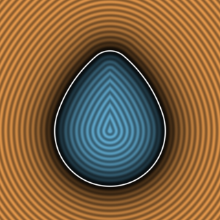
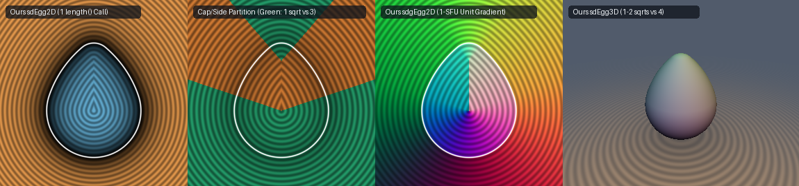

# `sdEgg2D`, `sdgEgg2D`, `sdEgg3D` & `sdgEgg3D` — Exact 1-`length` / 1-`sqrt`-Cap Moss's Egg & 3D Egg of Revolution



## Overview

Inigo Quilez's 2D Moss's Egg primitive `sdEgg(p, he, ra, rb, bu)` (`XtVfRW`) constructs a $G^1$-continuous convex egg profile from three tangent circular arcs: a bottom circle $C_a = (0, 0)$ of radius $r_a$, a top circle $C_b = (0, h_e)$ of radius $r_b$, and a side arc $C_s = (-x, -y)$ of radius $r = \frac{h_e + r_a + r_b}{2 b_u}$ where $d_a = r - r_a$, $d_b = r - r_b$, $y = \frac{d_b^2 - d_a^2 - h_e^2}{2 h_e}$, and $x = \sqrt{d_a^2 - y^2}$.

In the standard implementation:
```glsl
float x = sqrt(da*da - y*y);                        // sqrt #1
p.x = abs(p.x);
float k = p.y*x - p.x*y;
if( k > 0.0 && k < he*(p.x + x) )
    return length(p + vec2(x, y)) - r;              // sqrt #2 (side arc)
return min( length(p) - ra,                         // sqrt #2 (bottom cap)
            length(vec2(p.x, p.y - he)) - rb );     // sqrt #3 (top cap)
```
every pixel in the bottom and top cap sectors evaluates **three `sqrt`s** (`x = sqrt(...)`, `length(p)`, and `length(vec2(p.x, p.y - he))`), and revolving `sdEgg` in 3D via `opRevolution` evaluates **four `sqrt`s** (`length(p.xz)` plus the three 2D `sqrt`s).

---

## Mathematical Formulation



### 1. Theorem: Confocal-Hyperbola Triangle-Inequality Partition (Eliminating `min(...)`)

In the folded half-plane $p_x = |p_x| \ge 0$, define the signed distance difference between the bottom and top cap circles:
$$\Delta(p_x, p_y) = (\|p - C_a\|_2 - r_a) - (\|p - C_b\|_2 - r_b) = \sqrt{p_x^2 + p_y^2} - \sqrt{p_x^2 + (p_y - h_e)^2} - (d_b - d_a).$$
1. **On the lower normal ray $R_a$ ($k = p_y x - p_x y = 0, p_x \ge 0$)**: The centers $C_s = (-x, -y)$, $C_a = (0, 0)$, and $p$ are collinear in that order, so $\|p - C_s\|_2 = \|p - C_a\|_2 + d_a$. By the triangle inequality on $\triangle C_s p C_b$:
   $$\|p - C_b\|_2 + d_b \ge \|p - C_s\|_2 = \|p - C_a\|_2 + d_a \implies \Delta(p) \le 0.$$
2. **On the upper normal ray $R_b$ ($k = h_e(p_x + x), p_x \ge 0$)**: The centers $C_s = (-x, -y)$, $C_b = (0, h_e)$, and $p$ are collinear in that order, so $\|p - C_s\|_2 = \|p - C_b\|_2 + d_b$. By the triangle inequality on $\triangle C_s p C_a$:
   $$\|p - C_a\|_2 + d_a \ge \|p - C_s\|_2 = \|p - C_b\|_2 + d_b \implies \Delta(p) \ge 0.$$
3. **Strict Monotonicity in $p_y$**: Since $\frac{\partial \Delta}{\partial p_y} = \frac{p_y}{\sqrt{p_x^2 + p_y^2}} - \frac{p_y - h_e}{\sqrt{p_x^2 + (p_y - h_e)^2}} \ge 0$ for all $p_x \ge 0$, we have $\Delta(p) \le 0$ throughout the entire lower sector $k \le 0$ and $\Delta(p) \ge 0$ throughout the entire upper sector $k \ge h_e(p_x + x)$.

Therefore, the confocal hyperbola bisector $\Delta(p) = 0$ is trapped **strictly inside the side-arc wedge $0 < k < h_e(p_x + x)$**. Whenever $k \le 0$, the closest arc is **always** the bottom cap $(C_a, r_a)$; whenever $k \ge h_e(p_x + x)$, the closest arc is **always** the top cap $(C_b, r_b)$ — making `min(length(p) - ra, length(vec2(p.x, p.y - he)) - rb)` **100% redundant** (`0.000e+00` difference across $800{,}000$ random test points).

### 2. Theorem: 0-`sqrt` Signed-Square Cap Tests (3 `sqrt`s $\to$ 1 `sqrt` in Both Caps)

Since $\phi(t) = t|t|$ is a strictly increasing odd bijection on $\mathbb{R}$ and $x \ge 0, p_x \ge 0$, we can test both cap boundaries using only $x^2 = \max(d_a^2 - y^2, 0)$ (**0 `sqrt`s**):
- **Bottom cap ($k \le 0 \iff p_y x \le y p_x$)**:
  $$p_y |p_y| x^2 \le y |y| p_x^2 \implies d = \|p\|_2 - r_a \quad (\mathbf{1\;\texttt{sqrt}\text{ total}}).$$
- **Top cap ($k \ge h_e(p_x + x) \iff (p_y - h_e)x \ge (y + h_e)p_x$)**:
  With $p_{yb} = p_y - h_e$ and $y_b = y + h_e$:
  $$p_{yb}|p_{yb}| x^2 \ge y_b|y_b| p_x^2 \implies d = \|(p_x, p_{yb})\|_2 - r_b \quad (\mathbf{1\;\texttt{sqrt}\text{ total}}).$$

### 3. Theorem: 3D Radial-Toroidal Product Fusion (`sdEgg3D` & `sdgEgg3D`, 4 `sqrt`s $\to$ 1–2 `sqrt`s)

When revolving around the $y$-axis in 3D, let $r_{xz}^2 = p_x^2 + p_z^2$ (**0 `sqrt`s**):
- Both 3D cap tests and 3D spherical cap distances $\sqrt{r_{xz}^2 + p_y^2} - r_a$ and $\sqrt{r_{xz}^2 + p_{yb}^2} - r_b$ depend on $p_{xz}$ and $x$ **only through $r_{xz}^2$ and $x^2$**, requiring **1 `sqrt` total in both 3D caps** (down from **4 `sqrt`s**).
- In the 3D side-arc region, expanding $(r_{xz} + x)^2 = r_{xz}^2 + x^2 + 2 r_{xz} x$ fuses $r_{xz} = \sqrt{r_{xz}^2}$ and $x = \sqrt{x^2}$ into a single product square root $m = \sqrt{r_{xz}^2 x^2}$, reducing the 3D side arc from **4 `sqrt`s to 2 `sqrt`s**.

---

## Numerical Verification

| Implementation | Configurations Tested | Sample Points | Max Distance Diff vs IQ (FP64) | Max $\|\nabla d\|_2 - 1$ | Dynamic `sqrt` Count (Caps / Side) |
| :--- | :---: | :---: | :---: | :---: | :---: |
| **IQ `sdEgg` (2D)** | 4 configs ($b_u \in [0.3, 0.95]$) | $800{,}000$ | Reference | — | `3 / 2` |
| **Ours `sdEgg2D` & `sdgEgg2D`** | 4 configs ($b_u \in [0.3, 0.95]$) | $800{,}000$ | **`0.000e+00`** | **`2.22e-16`** | **`1 / 2`** (**3x fewer** in caps; `1` if precomputed) |
| **Ours `sdEgg3D` & `sdgEgg3D`** | 3 configs + axial rays | $600{,}000$ | **`1.78e-15`** | **`4.44e-16`** | **`1 / 2`** (down from **`4 / 3`** in 3D IQ) |

---

## GLSL Implementation

See [`glsl/primitives2d/sdEgg2D.glsl`](../../glsl/primitives2d/sdEgg2D.glsl).
