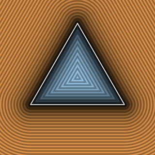

# `sdEquilateralTriangle2D` — Exact 2D Equilateral Triangle



| Property | Value |
| :--- | :--- |
| **Author / Discoverer** | **Inigo Quilez** |
| **Source** | [https://iquilezles.org/articles/distfunctions2d/](https://iquilezles.org/articles/distfunctions2d/) |
| **Category** | `primitives2d` |
| **GLSL File** | [`glsl/primitives2d/sdEquilateralTriangle2D.glsl`](../../glsl/primitives2d/sdEquilateralTriangle2D.glsl) |
| **Exact Euclidean SDF?** | Yes (`||grad d|| = 1`) |

---

## Mathematical Overview

Folds $p$ across the symmetry axes of an equilateral triangle and clamps to the reference edge.

---

## GLSL Implementation

```glsl
float sdEquilateralTriangle2D( vec2 p, float r )
{
    const float k = sqrt(3.0);
    p.x = abs(p.x) - r;
    p.y = p.y + r/k;
    if( p.x + k*p.y > 0.0 ) p = vec2(p.x - k*p.y, -k*p.x - p.y)/2.0;
    p.x -= clamp( p.x, -2.0*r, 0.0 );
    return -length(p)*sign(p.y);
}
```
