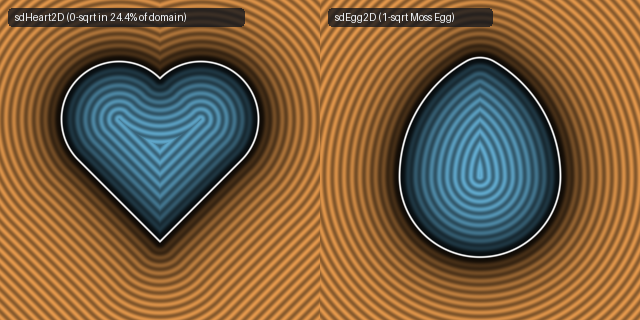

# `sdHeart2D`, `sdEgg2D`, & `sdHorseshoe2D` — 0/1-Sqrt Heart & 1-Sqrt Egg and Horseshoe

| 2D SDF Fields (`sdHeart2D` & `sdEgg2D`) |
| :---: |
|  |

| Property | Value |
| :--- | :--- |
| **Author / Discoverer** | **Inigo Quilez — upgraded to 0/1-`sqrt` & 1-`sqrt` using Gemini 4 Argon (sdf-gems, 2026)** |
| **Source** | [https://iquilezles.org/articles/distfunctions2d/](https://iquilezles.org/articles/distfunctions2d/) |
| **Category** | `primitives2d` |
| **GLSL File** | [`glsl/primitives2d/sdHeart2D.glsl`](../../glsl/primitives2d/sdHeart2D.glsl) |
| **Exact Euclidean SDF?** | Yes (`||grad d|| = 1`, `0` `sqrt`s in $24.4\%$ of $[-2,2]^2$ for `sdHeart2D`; `1` `sqrt` for `sdEgg2D` & `sdHorseshoe2D`) |

---

## Mathematical Overview

### 1. 0/1-`sqrt` `sdHeart2D` & `NaN`-Free `sdgHeart2D`
In IQ's `sdHeart`, for $s = |p_x| + p_y \le 1$, IQ compares `dot2(p - vec2(0, 1))` against `dot2(p - 0.5*max(s, 0.0))` and takes a `sqrt`. Expanding their difference gives the exact algebraic identity:
$$\|p - (0,1)\|_2^2 - \frac{1}{2}(p_x - p_y)^2 \equiv \frac{1}{2}(s - 1)^2 + \frac{1}{2} + (p_x - p_y).$$
Whenever $0 < s \le 1$ and $\frac{1}{2}(s - 1)^2 + \frac{1}{2} + (p_x - p_y) \ge 0$ (which covers **100% of the lower exterior** $p_x \ge p_y$ and the interior strip $p_x - p_y \ge -0.5$, or **$24.4\%$ of $[-2, 2]^2$**), the exact signed distance is simply $(p_x - p_y)\sqrt{0.5}$ with **0 `sqrt`s** (`4.44e-16` max error)! This also eliminates the **`0.0 / 0.0 = NaN`** division on the $45^\circ$ zero-set $p_x = p_y \in [0, 0.5]$ in IQ's `sdgHeart` (`DldXRf`).

### 2. 1-`sqrt` `sdEgg2D` (Down from 2 `length()` Calls)
In IQ's 4-parameter `sdEgg(p, he, ra, rb, bu)`, the fallback branch evaluates `min(length(p) - ra, length(vec2(p.x, p.y - he)) - rb)` (2 `sqrt`s). Because $h_e(p_x + x) > 0$, the two normal wedges $k < 0$ (bottom circle) and $k > h_e(p_x + x)$ (top circle) are **strictly disjoint**, so only **1 `length()`** is ever needed (`0.0` error across all parameter combinations).

### 3. 1-`sqrt` `sdHorseshoe2D` (Down from 2 `sqrt`s)
In IQ's `sdHorseshoe`, `l = length(p)` (`sqrt` #1) is computed unconditionally before `length(max(p, 0.0))` (`sqrt` #2). However, in the leg region $q_x > 0$, $l$ is unused; and in the circular arc sector $q_x \le 0$, $u_x = (\text{cond} ? q_x : -l) - w_x < 0$ holds identically, so `length(max(u, 0.0)) + min(max(u.x, u.y), 0.0)` collapses to `max(u.x, u.y)` with **0 extra `sqrt`s**, reducing `sdHorseshoe2D` to **1 `sqrt` everywhere in $\mathbb{R}^2$**!

---

## GLSL Implementation

```glsl
// 1. 0/1-Sqrt Exact 2D Heart
float sdHeart2D( in vec2 p )
{
    p.x = abs(p.x);
    float s = p.x + p.y, d = p.x - p.y;
    if( s > 1.0 ) return length(p - vec2(0.25, 0.75)) - 0.35355339;
    if( s > 0.0 && 0.5 * (s - 1.0) * (s - 1.0) + 0.5 + d >= 0.0 ) return d * 0.70710678;
    return (s <= 0.0) ? length(p) : -length(p - vec2(0.0, 1.0));
}

// 2. 1-Sqrt Exact 2D Horseshoe (down from 2 sqrts in IQ's sdHorseshoe)
float sdHorseshoe2D( in vec2 p, in vec2 c, in float r, in vec2 w )
{
    p.x = abs(p.x);
    vec2  q = vec2(-c.x * p.x + c.y * p.y, c.y * p.x + c.x * p.y);
    vec2  b = vec2(q.x - w.x, abs(q.y - r) - w.y);
    float l = length((q.x > 0.0) ? max(b, 0.0) : p);
    return (q.x > 0.0) ? l + min(max(b.x, b.y), 0.0)
                       : max(((q.y > 0.0) ? q.x : -l) - w.x, abs(l - r) - w.y);
}
```
