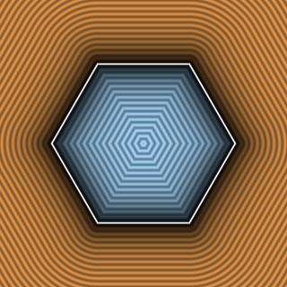

# `sdHexagon2D` — Exact 2D Regular Hexagon



| Property | Value |
| :--- | :--- |
| **Author / Discoverer** | **Inigo Quilez** |
| **Source** | [https://iquilezles.org/articles/distfunctions2d/](https://iquilezles.org/articles/distfunctions2d/) |
| **Category** | `primitives2d` |
| **GLSL File** | [`glsl/primitives2d/sdHexagon2D.glsl`](../../glsl/primitives2d/sdHexagon2D.glsl) |
| **Exact Euclidean SDF?** | Yes (`||grad d|| = 1`) |

---

## Mathematical Overview

Folds $p$ into the $30^\circ$ dihedral sector of a regular hexagon and clamps to the top edge.

---

## GLSL Implementation

```glsl
float sdHexagon2D( vec2 p, float r )
{
    const vec3 k = vec3(-0.866025404, 0.5, 0.577350269);
    p = abs(p);
    p -= 2.0*min(dot(k.xy, p), 0.0)*k.xy;
    p -= vec2(clamp(p.x, -k.z*r, k.z*r), r);
    return length(p)*sign(p.y);
}
```
