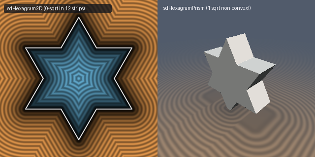

# `sdHexagram2D` & `sdPentagram2D` — 0/1-Sqrt Star Polygons & 1-Sqrt 3D Non-Convex Star Prisms

| 2D SDF Field & 1-Sqrt 3D Non-Convex Hexagram Prism |
| :---: |
|  |

| Property | Value |
| :--- | :--- |
| **Author / Discoverer** | **Inigo Quilez (2D) — upgraded to 0/1-`sqrt` & 1-`sqrt` 3D star prisms using Gemini 4 Argon (sdf-gems, 2026)** |
| **Source** | [https://iquilezles.org/articles/distfunctions2d/](https://iquilezles.org/articles/distfunctions2d/) |
| **Category** | `primitives2d` |
| **GLSL File** | [`glsl/primitives2d/sdHexagram2D.glsl`](../../glsl/primitives2d/sdHexagram2D.glsl) |
| **Exact Euclidean SDF?** | Yes (`||grad d|| = 1`, `0` `sqrt`s in all 12/10 edge normal strips; `1` `sqrt` in 3D non-convex star prisms!) |

---

## Mathematical Overview

### 1. 0/1-`sqrt` `sdHexagram2D` & `sdPentagram2D`
In a regular star polygon ($D_6$ hexagram or $D_5$ pentagram), the folded fundamental chamber is bounded on one side by the ray through the **convex outer tip** (strictly exterior, $d_y > 0$) and on the other side by the ray through the **concave re-entrant corner** (strictly interior, $d_y < 0$).
- In **`sdHexagram2D`**, since $k_w = \sqrt{3} = 3 k_z$, the reference segment $p_x \in [r k_z, 3 r k_z]$ has center $2s$ and half-width $s = r k_z$. Thus `vec2 d = vec2(abs(p.x - 2.0*s) - s, p.y - r); return (d.x > 0.0) ? length(d)*sign(d.y) : d.y;` eliminates `clamp`, eliminates constant `k.w`, and uses **0 `sqrt`s across all 12 edge normal strips**.
- In **`sdPentagram2D`**, expressing the folded coordinates directly in the orthonormal edge frame `v3 = (cos 72°, -sin 72°)` via `vec2 d = vec2(abs(dot(p, v3) - h) - h, p.y*v3.x - p.x*v3.y)` eliminates the 2D vector projection and uses **0 `sqrt`s across all 10 edge normal strips**.

### 2. Exact 1-`sqrt` 3D Non-Convex Star Prisms (`sdHexagramPrism` & `sdPentagramPrism`)
Even though the hexagram and pentagram are **non-convex**, their 3D extrusions require **at most 1 `sqrt` everywhere in $\mathbb{R}^3$**! Why? Because the re-entrant vertex wedge ($d_x < 0$ in `sdHexagramPrism`, or $u > l$ in `sdPentagramPrism`) lies **strictly inside** the 2D star polygon ($d_y < 0$):
- Above/below the prism caps ($d_z \ge 0$), a point in the re-entrant 2D wedge projects orthogonally onto the flat cap at distance $d_z$ (**0 `sqrt`s**).
- Inside the prism ($d_z < 0$), the distance in the re-entrant wedge is $\max(-\|(d_x, d_y)\|_2, d_z)$ (**1 `sqrt`**).
- Outside the re-entrant wedge ($d_x \ge 0$), only the convex outer tip exists, which fuses with $d_z$ into the single 3D norm `min(max(d.y, d.z), 0.0) + length(max(vec3(d.x - 2.0*s, d.y, d.z), 0.0))` (**1 `sqrt`**)!

---

## GLSL Implementation

```glsl
// 1. 0/1-Sqrt 2D Regular Hexagram
float sdHexagram2D( in vec2 p, in float r )
{
    const vec3 k = vec3(-0.5, 0.8660254038, 0.5773502692);
    p = abs(p);
    p -= 2.0 * min(dot(k.xy, p), 0.0) * k.xy;
    p -= 2.0 * min(dot(k.yx, p), 0.0) * k.yx;
    float s = r * k.z;
    vec2  d = vec2(abs(p.x - 2.0 * s) - s, p.y - r);
    return (d.x > 0.0) ? length(d) * sign(d.y) : d.y;
}

// 2. Exact 1-Sqrt 3D Non-Convex Hexagram Prism
float sdHexagramPrism( in vec3 p, in vec2 h )
{
    const vec3 k = vec3(-0.5, 0.8660254038, 0.5773502692);
    p = abs(p);
    p.xy -= 2.0 * min(dot(k.xy, p.xy), 0.0) * k.xy;
    p.xy -= 2.0 * min(dot(k.yx, p.xy), 0.0) * k.yx;
    float s = h.x * k.z;
    vec3  d = vec3(p.x - s, p.y - h.x, p.z - h.y);
    if( d.x < 0.0 ) return (d.z >= 0.0) ? d.z : max(-length(d.xy), d.z);
    return min(max(d.y, d.z), 0.0) + length(max(vec3(d.x - 2.0 * s, d.y, d.z), 0.0));
}
```
