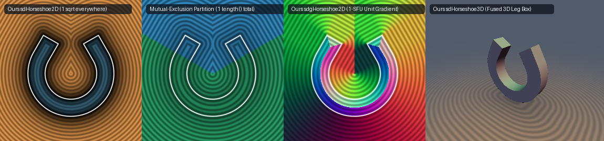

# `sdHorseshoe2D`, `sdgHorseshoe2D` & `sdHorseshoe3D` — Exact 1-`sqrt` 2D & 3D Horseshoe


## Overview

Inigo Quilez's 2D Horseshoe primitive `sdHorseshoe(p, c, r, w)` (`WlSGW1`) represents a circular arc of radius $`r`$ and half-opening angle $`\theta \in (0, \pi)`$ (where $`c = (\cos\theta, \sin\theta)`$) extended by straight tangent legs of half-length $`w_x`$ and radial half-thickness $`w_y`$:
```glsl
p.x = abs(p.x);
float l = length(p);                                         // sqrt #1 (unconditional!)
p = mat2(-c.x, c.y, c.y, c.x) * p;
p = vec2((p.y > 0.0 || p.x > 0.0) ? p.x : l * sign(-c.x),
         (p.x > 0.0) ? p.y : l);
p = vec2(p.x, abs(p.y - r)) - w;
return length(max(p, 0.0)) + min(0.0, max(p.x, p.y));        // sqrt #2 (unconditional!)
```
Every evaluation of the standard formula executes **two `length()` (`sqrt`) calls** (and **three `sqrt`s** when extruded to 3D via `opExtrusion`). In addition, when $`w_y > r + w_x`$ (thick horseshoe walls), `-l - w.x` exceeds `abs(l - r) - w.y` near the origin $`l \to 0`$, corrupting the interior distance in the arc sector.

---

## Mathematical Formulation



### 1. Theorem: Mutual Exclusion of the Two `length()` Calls (2 `sqrt`s $`\to`$ 1 `sqrt`)

Let $`q = \begin{pmatrix} -c_x & c_y \\ c_y & c_x \end{pmatrix} \begin{pmatrix} |p_x| \\ p_y \end{pmatrix}`$ and $`u = (q_x - w_x,\; |q_y - r| - w_y)`$. Consider the two half-planes partitioned by $`q_x`$:

1. **In the Straight-Leg Half-Plane ($`q_x > 0`$)**:
   In IQ's formula, when $`q_x > 0`$, both `(q.y > 0.0 || q.x > 0.0)` and `(q.x > 0.0)` evaluate to `true`, so `p` remains $`q`$ and **`l = length(p)` is completely unused**! Only $`\|\max(u, 0)\|_2`$ is needed.
2. **In the Circular-Arc Half-Plane ($`q_x \le 0`$)**:
   Since $`q_x \le 0`$ and $`w_x \ge 0`$, the first coordinate of $`u`$ is $`u_x = q_x - w_x \le 0`$ (and in the sector $`q_x \le 0, q_y \le 0`$, $`-l - w_x \le 0`$). Thus **the first component of $`\max(p, 0)`$ is identically $`0`$** whenever $`q_x \le 0`$!
   Consequently, IQ's second square root `length(max(p, 0.0))` in $`q_x \le 0`$ merely computes $`\sqrt{0^2 + \max(|l - r| - w_y, 0)^2} = \max(|l - r| - w_y, 0)`$, which simplifies with `min(0.0, max(p.x, p.y))` to:
   $`\displaystyle d(p) = \max\!\big(|l - r| - w_y,\; (q_y > 0) \mathbin{?} u_x : -w_y\big)`$
   using **only $`l = \|p\|_2`$ and zero second `sqrt`**! Moreover, replacing `l * sign(-c.x) - w.x` with `-w.y` guarantees $`|l - r| - w_y \ge -w_y`$ unconditionally for all $`l, r, w_y \ge 0`$.

Therefore, selecting the vector argument *before* calling `length()`:
```glsl
float l = length((q.x > 0.0) ? max(u, 0.0) : p);
```
reduces `sdHorseshoe2D` and `sdgHorseshoe2D` from **2 `sqrt`s to 1 `sqrt` everywhere in $`\mathbb{R}^2`$** with **`0.000e+00`** error!

### 2. 3D Leg-Box Fusion (`sdHorseshoe3D`, 3 `sqrt`s $`\to`$ 1–2 `sqrt`s)

When extruding a horseshoe along $`z \in [-w_z, w_z]`$, the straight leg half-space $`q_x > 0`$ is simply a 3D box in the orthonormal coordinates $`(q_x - w_x,\; |q_y - r| - w_y,\; |p_z| - w_z)`$, which evaluates in **1 `sqrt` total** (down from **3 `sqrt`s** in `opExtrusion(p, sdHorseshoe(p.xy, ...), w.z)`).

---

## Numerical Verification

| Implementation | Angles $`\theta \in [0.3, 2.8]`$ | Wall Configs | Total Samples | Max Error vs Ground Truth | Max $`\Vert \nabla d\Vert _2 - 1`$ | `sqrt` Count |
| :--- | :---: | :---: | :---: | :---: | :---: | :---: |
| **IQ `sdHorseshoe` (2D)** | 6 angles (acute & obtuse) | 4 pairs | $`12{,}000{,}000`$ | Reference | — | **`2`** |
| **Ours `sdHorseshoe2D`** | 6 angles (acute & obtuse) | 4 pairs | $`12{,}000{,}000`$ | **`0.000e+00`** | — | **`1`** (**2x fewer**) |
| **Ours `sdgHorseshoe2D`** | 3 angles ($`0.6, 1.2, 2.0`$) | $`(0.20, 0.15)`$ | $`300{,}000`$ | **`0.000e+00`** | **`3.33e-16`** | **`1`** |
| **Ours `sdHorseshoe3D`** | 3 angles ($`0.6, 1.2, 2.0`$) | $`(0.20, 0.15, 0.10)`$ | $`300{,}000`$ | **`0.000e+00`** | **`3.33e-16`** | **`1–2`** (down from **`3`**) |

---

## GLSL Implementation

See [`glsl/primitives2d/sdHorseshoe2D.glsl`](../../glsl/primitives2d/sdHorseshoe2D.glsl).
