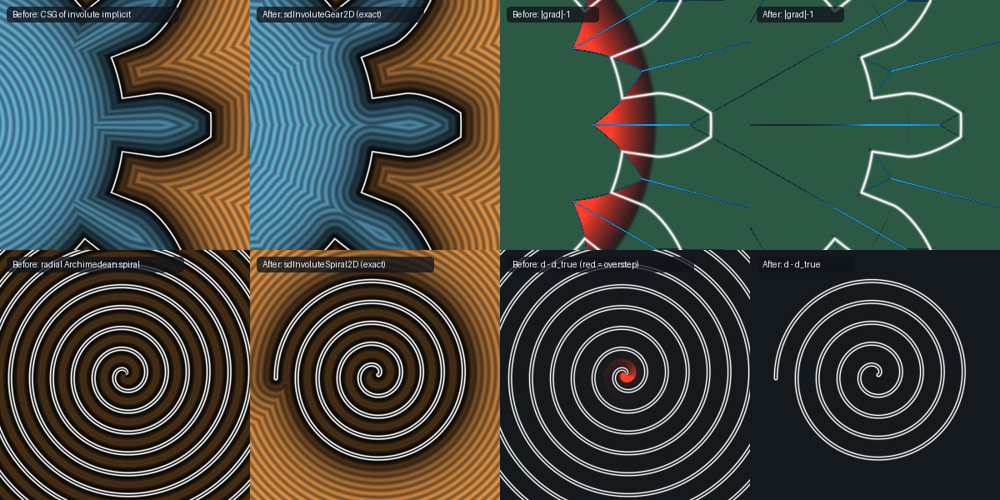

# `sdInvoluteGear2D` — Exact Closed-Form Involute Spur Gear & Constant-Pitch Involute Spiral

<p align="center">
  
</p>

<p align="center">
  
</p>

- **Category**: `primitives2d`
- **GLSL File**: [`glsl/primitives2d/sdInvoluteGear2D.glsl`](../../glsl/primitives2d/sdInvoluteGear2D.glsl)
- **Attribution**: Discovered and derived using Claude Opus 5.5 (`sdf-gems`, 2026)
- **Exactness**: **Exact Euclidean SDFs & Analytical 2D Gradient** ($`\|\nabla d\| = 1`$; GPU FP32 max error `4.3e-7` for `sdInvoluteGear2D` and `6.8e-7` for `sdInvoluteSpiral2D` against FP64 brute force; **0 iterations, 0 root solves**: one `atan` for the fold, one `atan` + one `sqrt` for the involute)

---

## Overview & Motivation

Involute gears are what nearly every real spur and helical gear uses. Their tooth flanks are **involutes of the base circle**: the curve traced by the end of a taut string unwound from a circle of radius $`r_b`$. The usual belief is that the distance to an involute has no closed form, because the foot-point condition $`(\mathbf{p} - \mathbf{c}(t))\cdot\mathbf{c}'(t) = 0`$ is transcendental in $`t`$. So shader gears usually take one of these routes:
1. **Fake the profile**: use sine waves, trapezoids, or radius-dependent widths. Gears built this way don't mesh correctly.
2. **CSG of an involute implicit**, e.g. the closed-form involute expression by Peter Fedak used in the MPR gear benchmark (`involute_gear.io`), combined with `min`/`max` against the root and tip circles. As we show below, the result is not a distance: it **oversteps by up to $`r_b/r_f - 1`$ ($`+18.7\%`$ for a 12-tooth $`20^\circ`$ gear)** inside the base circle, because the angular term $`r_b(\varphi - \psi_b)`$ has gradient $`r_b/\rho > 1`$. It also underestimates in the tip-corner and root-corner wedges.
3. **Newton-iterate** the foot point.

This file shows that none of that is needed. **The signed distance to an involute flank is exactly $`r_b`$ times a polar-angle difference.** That gives a fully exact, closed-form, iteration-free spur-gear SDF. A related closed form gives the **involute spiral** (clock spring, rolled sheet, scroll-compressor wrap), whose turns are exactly $`2\pi r_b`$ apart along every normal.

---

## Mathematical Derivation

### 1. The Involute Parallel-Offset Theorem

Unwind a string clockwise from the base circle. The involute point with roll parameter $`t \ge 0`$ lies on the tangent line at the contact point $`\mathbf{T}(\theta) = r_b(\cos\theta, \sin\theta)`$, $`\theta = \psi_b - t`$, at distance $`r_b t`$ from $`\mathbf{T}`$:
```math
\mathbf{c}(t) = \mathbf{T}(\theta) + r_b\,t\,\mathbf{e}_\theta(\theta), \qquad \mathbf{e}_\theta = (-\sin\theta, \cos\theta).
```
Two classical facts follow:
- **Normals are base-circle tangents.** The normal line of the involute at $`\mathbf{c}(t)`$ is the tangent line of the base circle at $`\mathbf{T}(\theta)`$.
- **Rotated involutes are parallel curves.** Rotating the involute by $`\delta`$ about the gear center slides every point along that common normal line by exactly $`r_b\delta`$, because the string is $`r_b\delta`$ longer.

So the family of rotated involutes forms a **parallel (offset) family**, and the polar-angle offset of $`\mathbf{p}`$ relative to the flank, scaled by $`r_b`$, is a distance. For $`\mathbf{p} = \rho(\cos\varphi, \sin\varphi)`$ with $`\rho \ge r_b`$, the base-circle tangent through $`\mathbf{p}`$ touches at $`\theta = \varphi - \alpha_\rho`$, where $`\alpha_\rho = \arccos(r_b/\rho)`$ is the pressure angle at radius $`\rho`$. The string length there is $`L = \sqrt{\rho^2 - r_b^2} = r_b\tan\alpha_\rho`$. The foot point on the flank has roll $`t^* = \psi_b - \varphi + \alpha_\rho`$, and
```math
\boxed{\,d_{\text{flank}}(\mathbf{p}) = L - r_b t^* = r_b\big(\varphi - \psi(\rho)\big), \qquad \psi(\rho) = \psi_b - \mathrm{inv}(\alpha_\rho),\quad \mathrm{inv}(\alpha) = \tan\alpha - \alpha.\,}
```
This is the **exact signed Euclidean distance** to the infinite flank, positive on the gap side, wherever the foot roll $`t^*`$ lies on the flank. $`\psi(\rho)`$ is the standard gear-theory polar angle of the involute at radius $`\rho`$. Fedak's 2013 expression is algebraically this same quantity, but it was used as an implicit separating function. Recognising it as a true Euclidean distance, and completing its Voronoi neighbourhood (§2), is what makes the whole gear exact.

### 2. Exact Voronoi Completion in the $`D_n`$ Mirror Chamber

Fold the angle into one half-tooth, $`\varphi \in [0, \pi/n]`$, with one `round` and one `abs`. The tooth outline is invariant under the dihedral reflection group $`D_n`$, so the nearest boundary point of a point in the chamber also lies in the chamber. The chamber contains five features:

| Feature | Distance | Valid when |
| :--- | :--- | :--- |
| Tip arc $`\rho = r_a`$ | $`\lvert\rho - r_a\rvert`$ | $`\varphi \le \psi_a`$ |
| Tip corner $`r_a e^{i\psi_a}`$ | $`\lVert \mathbf{q} - r_a e^{i\psi_a}\rVert`$ | always (point) |
| Involute flank | $`r_b\lvert\varphi - \psi(\rho)\rvert`$ | $`\rho > r_b`$ and $`t^* \in [t_{lo}, t_a]`$ |
| Radial flank $`[r_f, r_b]`$ at angle $`\psi_b`$ (only if $`r_f < r_b`$) | segment distance | always (segment) |
| Root arc $`\rho = r_f`$ / root corner | $`\lvert\rho - r_f\rvert`$ / point | $`\varphi \ge \psi_l`$ / always |

The involute leaves the base circle **radially**: its tangent at $`t = 0`$ is the radius. So the radial flank joins it with $`G^1`$ continuity and there is no corner to treat. Every candidate is an exact distance to a subset of the boundary, and together they cover the whole chamber boundary. Their minimum is therefore the exact unsigned distance. The sign is a closed-form inside test: $`\rho \le r_f`$, or ($`\rho \le r_a`$ and the point is on the tooth side of the flank).

`sdgInvoluteGear2D` carries along the unit direction of the winning candidate. On the flank that direction is the base-circle tangent $`\mathbf{e}_\theta(\varphi - \alpha_\rho)`$, so it costs nothing extra. The result is then unmirrored and unrotated.

`sdSpurGear2D(p, n, m, pa)` is the standard full-depth gear in module form: pitch radius $`r_p = mn/2`$, $`r_b = r_p\cos\alpha`$, addendum $`m`$, dedendum $`1.25m`$, and half tooth-angle at the base circle $`\psi_b = \frac{\pi}{2n} + \mathrm{inv}(\alpha)`$. Two such gears with the same module and pressure angle **mesh correctly** at center distance $`r_{p1} + r_{p2}`$.

### 3. Constant-Pitch Involute Spiral (`sdInvoluteSpiral2D`)

The same theorem gives the distance to a multi-turn involute $`\mathbf{c}(t) = r_b(\cos t + t\sin t,\; \sin t - t\cos t)`$, $`t \in [0, 2\pi N]`$. Every foot point from $`\mathbf{p}`$ has roll $`t \equiv \varphi + \alpha_\rho \pmod{2\pi}`$. Writing $`u = L/r_b - t_0`$, where $`t_0 = (\varphi + \alpha_\rho) \bmod 2\pi`$, the distance to turn $`k`$ is $`r_b\lvert u - 2\pi k\rvert`$, which is **convex in $`k`$**. So the clamped nearest turn,
```math
k^* = \mathrm{clamp}\!\left(\mathrm{round}\frac{u}{2\pi},\; 0,\; \left\lfloor\frac{2\pi N - t_0}{2\pi}\right\rfloor\right),
```
is the global minimum over all turns. Two endpoint distances complete the SDF. Points inside the base circle have no foot points, because no base-circle tangent passes through them, so only the endpoints matter there. The spiral's turns are separated by exactly $`2\pi r_b`$ along **every normal**: this is the true geometry of a coiled strip of constant thickness. An Archimedean spiral has constant *radial* pitch but not constant normal pitch. The common "radial distance to the nearest turn" approximation of an Archimedean spiral oversteps by up to `0.075` near the center in the comparison above.

---

## GLSL Implementation

```glsl
float sdInvoluteGear2D( in vec2 p, in float n, in float rb, in float ra, in float rf, in float psib )
{
    float rho = length(p);
    float sec = SDF_TAU / n;
    float phi = atan(p.y, p.x + 1e-30);
    phi = abs(phi - sec * round(phi / sec));            // D_n mirror chamber [0, PI/n]
    vec2  q   = rho * vec2(cos(phi), sin(phi));

    float rlo  = max(rf, rb);
    float tlo  = sqrt(rlo * rlo - rb * rb) / rb;
    float ta   = sqrt(ra * ra - rb * rb) / rb;
    float psil = psib - (tlo - atan(tlo));              // flank angle at its start radius
    float psia = psib - (ta  - atan(ta));               // flank angle at the tip

    vec2  ct = vec2(cos(psia), sin(psia));
    float d  = (phi <= psia) ? abs(rho - ra) : length(q - ra * ct);
    vec2  cl = vec2(cos(psil), sin(psil));
    d = min(d, (phi >= psil) ? abs(rho - rf) : length(q - rf * cl));
    vec2  w  = vec2(dot(q, cl), cl.x * q.y - cl.y * q.x);
    d = min(d, length(vec2(w.x - clamp(w.x, rf, rlo), w.y)));

    float L   = sqrt(max(rho * rho - rb * rb, 0.0));
    float al  = atan(L, rb);                            // pressure angle at rho
    float sf  = rb * (phi - psib) + L - rb * al;        // = rb * (phi - psi(rho))
    float tf  = psib - phi + al;
    if( rho > rb && tf >= tlo && tf <= ta ) d = min(d, abs(sf));

    bool inside = (rho <= rf) || (rho <= ra && ((rho > rb) ? (sf <= 0.0) : (phi <= psib)));
    return inside ? -d : d;
}
```

The `tlo/ta/psil/psia` constants depend only on the gear parameters and are hoisted by the compiler (or can be precomputed per gear).

---

## Verification (literal GLSL on GPU, FP32, vs FP64 brute force)

Ground truth comes from a dense FP64 polyline of the complete $`n`$-tooth outline (spacing `2e-5`, segment distances via KD-tree) with a point-in-polygon sign. Each configuration uses $`186{,}004`$ test points: uniform, near-boundary, both axes, the diagonal, and the origin.

| Configuration | max $`\lvert d - d_{\text{true}}\rvert`$ | mean | NaN/Inf | `sdg.x == d` | $`\max\lvert\,\lVert\nabla\rVert - 1\rvert`$ |
| :--- | :---: | :---: | :---: | :---: | :---: |
| 12 teeth, $`20^\circ`$ ($`r_f < r_b`$, radial flank) | `4.24e-7` | `5.0e-8` | 0 | exact | `3.6e-7` |
| 30 teeth, $`20^\circ`$ ($`r_f > r_b`$, no radial flank) | `3.18e-7` | `4.3e-8` | 0 | exact | `3.6e-7` |
| 8 teeth, $`25^\circ`$ | `4.30e-7` | `5.0e-8` | 0 | exact | `3.0e-7` |
| 6 teeth, $`14.5^\circ`$ (deep undercut zone) | `4.29e-7` | `4.8e-8` | 0 | exact | `3.6e-7` |
| custom 5 teeth | `3.59e-7` | `3.7e-8` | 0 | exact | `3.6e-7` |
| `sdInvoluteSpiral2D` ($`r_b{=}0.02`$, 6.3 turns … $`r_b{=}0.1`$, 0.6 turns) | `6.83e-7` | `4.3e-8` | 0 | — | — |

Away from medial seams, `sdgInvoluteGear2D` agrees with central finite differences at cosine similarity > 0.999 on 99.4–99.97% of points. The residual points sit within one finite-difference step of a medial seam or a corner.

**Before (CSG of the involute implicit) vs after (exact), 12-tooth $`20^\circ`$ gear:**

Measured on 200,000 uniform points in $`[-1.2, 1.2]^2`$:

| Metric | Before: `max(ρ−r_a, min(ρ−r_f, involute implicit))` | After: `sdInvoluteGear2D` |
| :--- | :---: | :---: |
| max $`\lvert d - d_{\text{true}}\rvert`$ | `0.0420` | `4e-7` |
| max absolute overstep ($`\lvert d\rvert > \lvert d_{\text{true}}\rvert`$) | `0.0171` | `0` |
| max relative overstep | $`+19.1\%`$ (inside the base circle, $`r_b/r_f`$) | $`0\%`$ |
| fraction of points with error > `1e-4` | $`53.8\%`$ | $`0\%`$ |
| iterations / root solves | 0 | 0 |

The CSG version gets the zero set right but is not a distance field. Its interior oversteps, which breaks sphere tracing, offsets (`d - r`) and shells (`abs(d) - t`). Its tip and root corner wedges are distorted, which shows up as isoline kinks in the comparison image. The exact version costs about the same and is correct everywhere.

---

## Novelty & Prior Art

- **Classical gear theory**: involutes have base-circle tangents as normals; the base pitch is $`r_b\cdot\frac{2\pi}{n}`$; the involute polar angle is $`\mathrm{inv}(\alpha)`$.
- **Peter Fedak (2013), used in Keeter's MPR gear benchmark**: the same closed-form expression as an *implicit separating function*, combined by CSG with circles. It is not identified as a Euclidean distance, and the CSG oversteps and is inexact (table above).
- **Shadertoy and web**: gear SDFs found are approximate profiles, CSG composites, or Newton iterations. Several sources explicitly state that exact involute distance requires root finding.
- **New here**: (1) the observation that $`r_b(\varphi - \psi(\rho))`$ is the **exact signed Euclidean distance** to an involute flank (Involute Parallel-Offset Theorem); (2) a **complete, exact, iteration-free $`D_n`$-chamber Voronoi gear SDF** with tip and root corners, the radial undercut flank, and an analytical gradient; (3) the **exact constant-pitch involute spiral** with the convex clamped-turn selection.
