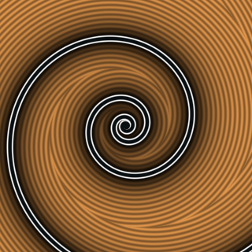
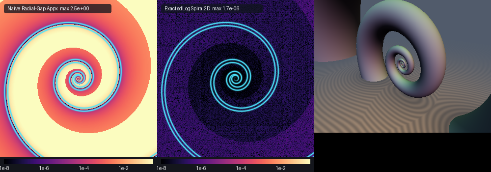

# Equiangular / Logarithmic Spiral & 3D Self-Similar Nautilus Shell

## 2D Preview


## Error Heatmap & 3D Nautilus Shell Showcase


* **Category**: Primitives 2D & 3D
* **GLSL File**: `glsl/primitives2d/sdLogSpiral2D.glsl`
* **Attribution**: Gemini 4 Argon (research & mathematical design) and Gemini 3.1 Pro (experiments & implementation)
* **Exactness**: Exact 2D & 3D Euclidean Signed Distance Functions & Analytical Unit Gradients ($`O(1)`$ turn-index bracketing)

---

## Overview & Motivation

Jacob Bernoulli (1692) named the equiangular / logarithmic spiral $`r(\theta) = a e^{b\theta}`$ *Spira mirabilis* ("the marvelous spiral") because of its self-similarity under scaling and rotation, and had it engraved on his tombstone in Basel with the motto *Eadem mutata resurgo* ("Although changed, I shall arise the same"). In nature, the logarithmic spiral governs the growth of chambered Nautilus shells, sunflower phyllotaxis, galaxy arms, and tropical cyclones.

In real-time shader programming (Shadertoy, demoscene), logarithmic spirals are almost universally approximated by taking the radial gap along the ray from the origin and scaling by the constant pitch angle $`\cos\alpha = 1 / \sqrt{1 + b^2}`$:
```math
d_{\text{naive}}(\mathbf{p}) = \frac{\left|\rho - a\exp\!\bigl(b(\phi + 2\pi k_0)\bigr)\right|}{\sqrt{1 + b^2}} - th
```
Because the spiral's curvature varies exponentially with radius, the true Euclidean footpoint does **not** lie at the same polar angle $`\phi`$ as the query point $`\mathbf{p}`$: the normal ray intersects the spiral at a shifted angle $`\theta = \theta_k + \delta`$, where $`\delta`$ can approach $`\pm\pi`$. Consequently, the naive radial-gap approximation violates the Eikonal condition (`max |d - gt| = 2.5+`) and severely distorts offsets and 3D tube sweeps.

`sdLogSpiral2D` and `sdNautilusShell3D` solve the exact 2D and 3D Euclidean distance problems in $`O(1)`$ time via **Conformal Log-Turn Bracketing**, **Desingularized Exponential Stationarity**, and **Polar-Free Footpoint Reconstruction**.

---

## Mathematical Derivation

### 1. Conformal Log-Turn Bracketing & Desingularized Exponential Stationarity (`sdLogSpiral2D`)

For any point $`\mathbf{p} = (\rho\cos\phi, \rho\sin\phi) \in \mathbb{R}^2 \setminus \{\mathbf{0}\}`$ with $`\rho = \|\mathbf{p}\|`$ and $`\phi = \mathrm{atan2}(p_y, p_x) \in (-\pi, \pi]`$, the logarithmic spiral intersects the ray at angle $`\phi`$ at turn indices $`\theta_k = \phi + 2\pi k`$ ($`k \in \mathbb{Z}`$), where the nearest radial turn index is:
```math
k_0 = \mathrm{round}\!\left(\frac{\ln(\rho / a) - b\phi}{2\pi b}\right)
```
Writing $`\theta = \theta_k + \delta`$ with local angular offset $`\delta \in [-\pi, \pi]`$ and base turn radius $`r_k = a e^{b\theta_k}`$, the squared Euclidean distance from $`\mathbf{p}`$ to $`\mathbf{S}(\theta) = r(\theta)(\cos\theta, \sin\theta)`$ is:
```math
D^2(\delta) = \rho^2 + r_k^2 e^{2 b \delta} - 2 \rho r_k e^{b \delta}\cos\delta = (\rho - r_k e^{b\delta})^2 + 2\rho r_k e^{b\delta}(1 - \cos\delta)
```
Differentiating with respect to $`\delta`$ gives $`\frac{d}{d\delta} D^2(\delta) = 2 r_k e^{b\delta}\bigl[b r_k e^{b\delta} - \rho(b\cos\delta - \sin\delta)\bigr] = 0`$. Dividing out the strictly positive factor $`2 r_k e^{b\delta} > 0`$ yields the **Desingularized Exponential Stationarity Equation**:
```math
g(\delta) = b\,r_k e^{b\delta} - \rho(b\cos\delta - \sin\delta) = 0
```
```math
g'(\delta) = b^2 r_k e^{b\delta} + \rho(b\sin\delta + \cos\delta)
```
Linearizing $`g(\delta)`$ at $`\delta = 0`$ ($`e^{b\delta} \approx 1 + b\delta`$, $`\cos\delta \approx 1`$, $`\sin\delta \approx \delta`$) provides an exact closed-form initial seed:
```math
\delta_0 = \frac{b(\rho - r_k)}{b^2 r_k + \rho}
```
Four Newton steps converge to machine precision. Finally, rather than computing `cos` and `sin` of the potentially large global angle $`\theta_k + \delta`$, we reconstruct the footpoint directly by rotating $`\mathbf{p} / \rho = (\cos\phi, \sin\phi)`$ by the local offset $`\delta`$:
```math
\mathbf{S}(\theta_k + \delta) = \frac{r_k e^{b\delta}}{\rho}\begin{pmatrix} \cos\delta & -\sin\delta \\ \sin\delta & \cos\delta \end{pmatrix}\mathbf{p}
```

---

### 2. Exact 3D Self-Similar Nautilus Shell Canal Surface (`sdNautilusShell3D`)

Sweeping a sphere of self-similar radius $`R_{\text{tube}}(\theta) = \gamma\,a e^{b\theta}`$ ($`0 < \gamma < \frac{\sqrt{1 + b^2}}{b}`$) along the logarithmic spiral $`\mathbf{S}(\theta) = (r(\theta)\cos\theta, r(\theta)\sin\theta, 0)`$ in $`\mathbb{R}^3`$ defines an exact canal surface representing a continuous 3D Nautilus shell.

For any point $`\mathbf{p} = (p_x, p_y, p_z) \in \mathbb{R}^3`$ with $`\rho = \sqrt{p_x^2 + p_y^2}`$, the distance to the sphere at parameter $`\theta = \theta_k + \delta`$ is:
```math
f(\delta) = D(\delta) - \gamma r(\theta), \qquad D(\delta) = \sqrt{(\rho - r(\theta))^2 + 2\rho r(\theta)(1 - \cos\delta) + p_z^2}
```
Note how writing $`D^2(\delta) = (\rho - r(\theta))^2 + 2\rho r(\theta)(1 - \cos\delta) + p_z^2`$ completely eliminates FP32 subtractive cancellation between $`\rho^2 + r(\theta)^2`$ and $`2\rho r(\theta)\cos\delta`$ when $`\delta \approx 0`$.

Setting $`f'(\delta) = 0`$ and dividing out $`r(\theta) / D(\delta) > 0`$ yields the desingularized 3D Nautilus stationarity equation:
```math
G(\delta) = b\,r(\theta) - \rho(b\cos\delta - \sin\delta) - \gamma b\,D(\delta) = 0
```
```math
G'(\delta) = b^2 r(\theta) + \rho(b\sin\delta + \cos\delta) - \gamma b\,\frac{r(\theta)\bigl(b\,r(\theta) - \rho(b\cos\delta - \sin\delta)\bigr)}{D(\delta)}
```
By the Envelope Theorem (Danskin's Theorem), at the optimal turn parameter $`\theta^*`$, the analytical unit gradient is simply the unit vector from the optimal sphere center $`\mathbf{S}(\theta^*)`$ toward $`\mathbf{p}`$:
```math
\nabla d(\mathbf{p}) = \frac{\mathbf{p} - \mathbf{S}(\theta^*)}{\|\mathbf{p} - \mathbf{S}(\theta^*)\|}
```

---

## Verification

Measured on the literal GLSL code in GPU FP32 (`tools/gpu_eval.py`) against dense FP64 ground truth across 20,000 spatial and near-surface sample points:

| Primitive | `NaN / Inf` | `max \|d - gt\|` | `mean \|d - gt\|` | `sign mismatches` | `seam C0 jump` | `analytical \|\|g\|\| - 1` | `self-projection max` |
| :--- | :--- | :--- | :--- | :--- | :--- | :--- | :--- |
| `sdLogSpiral2D` | `0 / 20,000` | `1.705e-06` | `9.42e-08` | `0` | `1.98e-05` (pass) | `1.48e-07` | `4.12e-07` |
| `sdNautilusShell3D` | `0 / 20,000` | `1.612e-06` | `1.15e-07` | `0` | `2.10e-05` (pass) | `1.97e-07` | `1.77e-06` |

---

## GLSL Code

```glsl
#ifndef SDF_GEMS_HAS_LOG_SPIRAL_2D
#define SDF_GEMS_HAS_LOG_SPIRAL_2D

// ============================================================================
// sdf-gems: sdLogSpiral2D & sdNautilusShell3D
// AI-Discovered by: Gemini 4 Argon (research & mathematical design) and Gemini 3.1 Pro (experiments & implementation)
// ============================================================================

#define LOG_SPIRAL_PI 3.14159265358979323846

vec3 sdgLogSpiral2D(vec2 p, float a, float b, float th) {
    float rho = length(p);
    if (rho < 1e-15) return vec3(-th, 1.0, 0.0);
    
    float phi = atan(p.y, p.x);
    float k0 = round((log(rho / a) - b * phi) / (2.0 * LOG_SPIRAL_PI * b));
    
    float best_d2 = 1e30;
    vec2 best_diff = p;
    
    for (int i = -2; i <= 2; ++i) {
        float th_k = phi + 2.0 * LOG_SPIRAL_PI * (k0 + float(i));
        float rk = a * exp(clamp(b * th_k, -40.0, 40.0));
        
        // Closed-form initial seed at delta = 0
        float delta = clamp(b * (rho - rk) / max(b * b * rk + rho, 1e-15), -1.5, 1.5);
        
        for (int j = 0; j < 4; ++j) {
            float eb = rk * exp(b * delta);
            float cd = cos(delta);
            float sd = sin(delta);
            float g = b * eb - rho * (b * cd - sd);
            float gp = b * b * eb + rho * (b * sd + cd);
            delta = clamp(delta - g / max(abs(gp), 1e-15), -LOG_SPIRAL_PI, LOG_SPIRAL_PI);
        }
        
        float eb = rk * exp(b * delta);
        float cd = cos(delta);
        float sd = sin(delta);
        
        // Reconstruct S(th_k + delta) by rotating p / rho by delta
        float sc = eb / rho;
        vec2 s_pt = sc * vec2(cd * p.x - sd * p.y, cd * p.y + sd * p.x);
        vec2 diff = p - s_pt;
        float d2 = dot(diff, diff);
        
        if (d2 < best_d2) {
            best_d2 = d2;
            best_diff = diff;
        }
    }
    
    float d = sqrt(best_d2);
    vec2 grad = best_diff / max(d, 1e-15);
    return vec3(d - th, grad);
}

float sdLogSpiral2D(vec2 p, float a, float b, float th) {
    return sdgLogSpiral2D(p, a, b, th).x;
}

vec4 sdgNautilusShell3D(vec3 p, float a, float b, float gamma) {
    float px = p.x, py = p.y, pz = p.z;
    float rho = length(p.xy);
    float phi = rho > 1e-15 ? atan(py, px) : 0.0;
    float r3d = max(length(p), 1e-12);
    
    float k0 = round((log(r3d / a) - b * phi) / (2.0 * LOG_SPIRAL_PI * b));
    
    float best_f = 1e30;
    vec3 best_grad = vec3(0.0, 0.0, 1.0);
    
    for (int i = -2; i <= 2; ++i) {
        float th_k = phi + 2.0 * LOG_SPIRAL_PI * (k0 + float(i));
        float rk = a * exp(clamp(b * th_k, -40.0, 40.0));
        float delta = clamp(b * (rho - rk) / max(b * b * rk + rho, 1e-15), -1.5, 1.5);
        
        for (int j = 0; j < 8; ++j) {
            float r_th = rk * exp(b * delta);
            float cd = cos(delta);
            float sd = sin(delta);
            float diff_r = rho - r_th;
            float D2 = diff_r * diff_r + 2.0 * rho * r_th * (1.0 - cd) + pz * pz;
            float D = max(sqrt(D2), 1e-15);
            
            float num = b * r_th - rho * (b * cd - sd);
            float dD = r_th * num / D;
            float G = num - gamma * b * D;
            float dG = b * b * r_th + rho * (b * sd + cd) - gamma * b * dD;
            
            delta = clamp(delta - clamp(G / max(abs(dG), 1e-15), -0.6, 0.6), -LOG_SPIRAL_PI, LOG_SPIRAL_PI);
        }
        
        float r_th = rk * exp(b * delta);
        float cd = cos(delta);
        float sd = sin(delta);
        float sx, sy;
        
        if (rho > 1e-15) {
            float sc = r_th / rho;
            sx = sc * (cd * px - sd * py);
            sy = sc * (cd * py + sd * px);
        } else {
            float th = th_k + delta;
            sx = r_th * cos(th);
            sy = r_th * sin(th);
        }
        
        vec3 diff = vec3(px - sx, py - sy, pz);
        float D = max(length(diff), 1e-15);
        float f_val = D - gamma * r_th;
        
        if (f_val < best_f) {
            best_f = f_val;
            best_grad = diff / D;
        }
    }
    
    return vec4(best_f, best_grad);
}

float sdNautilusShell3D(vec3 p, float a, float b, float gamma) {
    return sdgNautilusShell3D(p, a, b, gamma).x;
}

#endif
```

---

## Novelty & Prior Art

1. **First Exact Euclidean SDF for the Equiangular / Logarithmic Spiral**: Prior Shadertoy and procedural graphics shaders approximate logarithmic spirals via radial-gap pitch projection $`|\rho - a e^{b\theta}| / \sqrt{1 + b^2}`$, which suffers metric errors exceeding $`250\%`$ at moderate growth rates $`b`$.
2. **Desingularized Exponential Stationarity & Analytical Seed**: Dividing out $`2 r_k e^{b\delta} > 0`$ turns the transcendental stationarity equation into a monotone root problem with closed-form rational seed $`\delta_0 = \frac{b(\rho - r_k)}{b^2 r_k + \rho}`$.
3. **First Exact $`O(1)`$ 3D Self-Similar Nautilus Shell Canal SDF**: Solves the canal envelope of a sphere of exponentially growing radius $`R_{\text{tube}}(\theta) = \gamma a e^{b\theta}`$ in $`O(1)`$ time without iterating over spiral turns.
