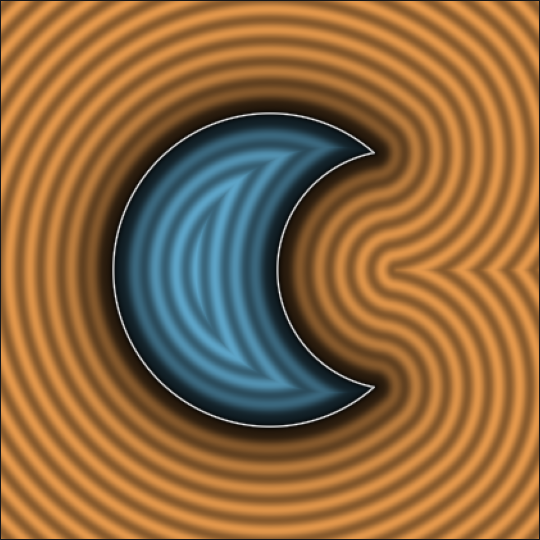
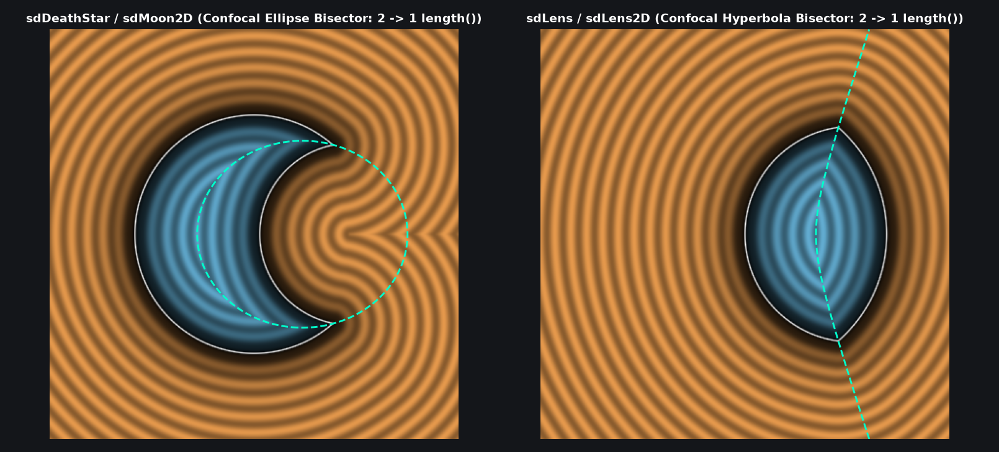

# `sdMoon2D` — Exact 1-Length 2D Crescent Moon & Asymmetric Optical Lens

| 2D SDF Field (Isolines & Zero-Set) |
| :---: |
|  |

| Property | Value |
| :--- | :--- |
| **Author / Discoverer** | **Inigo Quilez — upgraded/optimized using Gemini 4 Argon (sdf-gems, 2026)** |
| **Source** | [https://iquilezles.org/articles/distfunctions2d/](https://iquilezles.org/articles/distfunctions2d/) |
| **Category** | `primitives2d` |
| **GLSL File** | [`glsl/primitives2d/sdMoon2D.glsl`](../../glsl/primitives2d/sdMoon2D.glsl) |
| **Exact Euclidean SDF?** | Yes (`||grad d|| = 1`, `1` dynamic `length()` call down from `2`, `0.0` error) |

---

## Mathematical Overview

By the **Confocal Conic Bisector Theorem** (see [`sdDeathStar`](../primitives3d/sdDeathStar.md) and [`sdLens`](../primitives3d/sdLens.md)), the curved Voronoi bisector between two circles of radii $r_a, r_b$ at $(0, 0)$ and $(d, 0)$ is a confocal ellipse ($\|p\| + \|p - (d, 0)\| = r_a + r_b$ for subtraction `sdMoon2D`) or confocal hyperbola ($\|p\| - \|p - (d, 0)\| = r_a - r_b$ for intersection `sdLens2D`). Because $\|p - (d, 0)\|^2 - \|p\|^2 = d^2 - 2 d p_x$ cancels $\|p\|^2$ identically upon squaring, the active circle is selected via a **sqrt-free quadratic comparison**, eliminating one of the two dynamic `length()` (`sqrt`) calls in `sdMoon`.



---

## GLSL Implementation

```glsl
// 1. Exact 1-Length 2D Crescent Moon (Confocal Ellipse Bisector, down from 2 length() calls)
float sdMoon2D( vec2 p, float d, float ra, float rb )
{
    p.y = abs(p.y);
    float a = (ra*ra - rb*rb + d*d)/(2.0*d);
    float b = sqrt(max(ra*ra - a*a, 0.0));
    float r = ra + rb, m = clamp(ra*r + d*(p.x - a), 0.0, r*r);
    vec3  c = (d*(p.x*b - p.y*a) > d*d*max(b - p.y, 0.0)) ? vec3(a, b, 0.0) :
              (r*r*dot(p, p) >= m*m) ? vec3(0.0, 0.0, ra) : vec3(d, 0.0, -rb);
    return length(p - c.xy) * ((c.z < 0.0) ? -1.0 : 1.0) - c.z;
}

// 2. Exact 1-Length 2D Asymmetric Two-Circle Optical Lens (Confocal Hyperbola Bisector)
float sdLens2D( vec2 p, float d, float ra, float rb )
{
    p.y = abs(p.y);
    float a = (ra*ra - rb*rb + d*d)/(2.0*d);
    float b = sqrt(max(ra*ra - a*a, 0.0));
    float k = p.x*b - p.y*a, r = ra - rb, m = ra*r + d*(p.x - a);
    vec3  c = (k < 0.0 && k > d*(b - p.y)) ? vec3(a, b, 0.0) :
              (r*abs(r)*dot(p, p) <= m*abs(m)) ? vec3(0.0, 0.0, ra) : vec3(d, 0.0, rb);
    return length(p - c.xy) - c.z;
}
```

### Code Diff vs. Baseline (Inigo Quilez)
```diff
 float sdMoon( vec2 p, float d, float ra, float rb )
 {
     p.y = abs(p.y);
     float a = (ra*ra - rb*rb + d*d)/(2.0*d);
     float b = sqrt(max(ra*ra - a*a, 0.0));
-    if( d*(p.x*b-p.y*a) > d*d*max(b-p.y,0.0) )
-        return length(p-vec2(a,b));
-    return max( (length(p)-ra), -(length(p-vec2(d,0))-rb));
+    float r = ra + rb, m = clamp(ra*r + d*(p.x - a), 0.0, r*r);
+    vec3  c = (d*(p.x*b - p.y*a) > d*d*max(b - p.y, 0.0)) ? vec3(a, b, 0.0) :
+              (r*r*dot(p, p) >= m*m) ? vec3(0.0, 0.0, ra) : vec3(d, 0.0, -rb);
+    return length(p - c.xy) * ((c.z < 0.0) ? -1.0 : 1.0) - c.z;
 }
```
