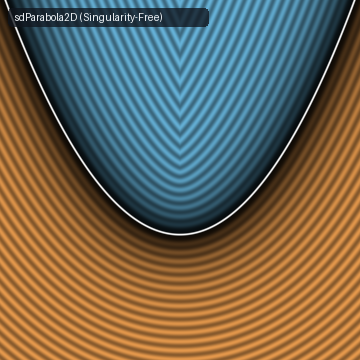
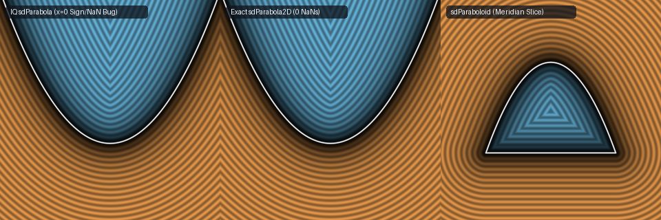

# `sdParabola2D` & `sdParabolaSeg2D` — Singularity-Free Exact 2D Parabola SDF



- **GLSL Implementation**: [`sdParabola2D.glsl`](../../glsl/primitives2d/sdParabola2D.glsl)
- **Category**: `primitives2d`
- **Status**: **Exact Euclidean SDF** (Singularity & sign-flip fixes discovered using **Gemini 4 Argon**, `sdf-gems`, 2026)

---

## 1. Summary & Motivation

Inigo Quilez's [`sdParabola(vec2 pos, float k)`](https://www.shadertoy.com/view/ws3GD7) solves the depressed cubic normal equation for $`y = k x^2`$, but exhibits two critical numerical defects on the symmetry axis $`x = 0`$:

1. **`0.0 / 0.0 = NaN` at the Focal Center of Curvature $`(0, \frac{1}{2k})`$**:
   At $`x_0 = 0, y_0 = \frac{1}{2k}`$, both $`p = 0`$ and $`q = 0`$, so $`h = q^2 - p^3 = 0`$. IQ's `if (h > 0.0) ... else` enters the `else` branch with $`r = \sqrt{p} = 0`$ and evaluates `acos(q / (p * r))` $`= \arccos(0/0) =`$ **`NaN`**.
2. **Sign Inversion & Zero Collapse on the Symmetry Axis $`x_0 = 0`$**:
   IQ determines the exterior/interior sign via `sign(pos.x - x)`. Whenever $`x_0 = 0`$ and $`y_0 \le \frac{1}{2k}`$, the closest point on the parabola is the vertex $`x = 0`$:
   - In exact arithmetic, `sign(0.0 - 0.0) = 0.0`, collapsing the distance to **`0.0` along the entire negative $`y`$-axis**.
   - In IEEE 754 floating-point arithmetic, $`r = (\sqrt{-p^3})^{1/3}`$ rounds slightly above $`-p`$, making $`x = r + p/r \approx +10^{-16} > 0`$ and flipping `sign(0.0 - x) = -1.0` across the entire exterior ray $`(0, y_0)`$ for $`y_0 < 0`$.



---

## 2. Mathematical Fix

1. **Singularity-Free Root Guard**:
   Routing $`h \ge 0`$ to Cardano's branch and guarding $`r > 0`$ (`x = (r > 0.0) ? max(r + p / r, 0.0) : 0.0;`) eliminates the `0/0` `NaN` at $`(0, \frac{1}{2k})`$ and prevents negative rounding drift in $`x`$ on $`x_0 = 0`$.
2. **Implicit Algebraic Sign**:
   Replacing `sign(pos.x - x)` with the exact implicit parabola test `(k * pos.x * pos.x > pos.y) ? 1.0 : -1.0` decouples the sign from the cubic root solver and guarantees the exact sign everywhere in $`\mathbb{R}^2`$.

---

## 3. Before / After GLSL Comparison

```diff
 float sdParabola2D(vec2 pos, float k) {
     pos.x = abs(pos.x);
     float ik = 1.0 / k;
     float p = ik * (pos.y - 0.5 * ik) / 3.0;
     float q = 0.25 * ik * ik * pos.x;
     float h = q * q - p * p * p;
     float x;
-    if (h > 0.0) {
+    if (h >= 0.0) {
         float r = pow(q + sqrt(h), 1.0 / 3.0);
-        x = r + p / r;
+        x = (r > 0.0) ? max(r + p / r, 0.0) : 0.0;
     } else {
         float r = sqrt(p);
-        x = 2.0 * r * cos(acos(q / (p * r)) / 3.0);
+        x = 2.0 * r * cos(acos(clamp(q / (p * r), -1.0, 1.0)) / 3.0);
     }
-    return length(pos - vec2(x, k * x * x)) * sign(pos.x - x);
+    float s = (k * pos.x * pos.x > pos.y) ? 1.0 : -1.0;
+    return length(pos - vec2(x, k * x * x)) * s;
 }
```
