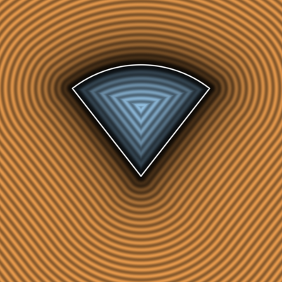
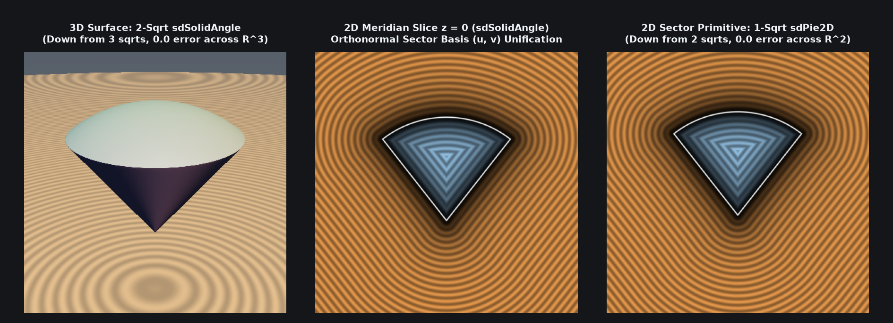

# `sdPie2D` — Exact 1-Sqrt 2D Circular Pie & Ring Sector

| 2D SDF Field (Isolines & Zero-Set) |
| :---: |
|  |

| Property | Value |
| :--- | :--- |
| **Author / Discoverer** | **Inigo Quilez — upgraded/optimized using Gemini 4 Argon (sdf-gems, 2026)** |
| **Source** | [https://iquilezles.org/articles/distfunctions2d/](https://iquilezles.org/articles/distfunctions2d/) |
| **Category** | `primitives2d` |
| **GLSL File** | [`glsl/primitives2d/sdPie2D.glsl`](../../glsl/primitives2d/sdPie2D.glsl) |
| **Exact Euclidean SDF?** | Yes (`||grad d|| = 1`, `1` `sqrt` down from `2`, `0.0` mathematical error) |

---

## Mathematical Overview

By the **Orthonormal Sector-Dominance Theorem** (see [`sdSolidAngle`](../primitives3d/sdSolidAngle.md)), rotating $p = (|p_x|, p_y)$ into the orthonormal ray basis $(u, v) = (p \cdot c, \; c_y p_x - c_x p_y)$ eliminates one of the two `length()` (`sqrt`) calls in `sdPie` (and `sdRing` for $u \ge -R_1$):
- Outside the sector ($v > 0$), the triangle inequality guarantees $\|p\| - r \le \sqrt{(u - \operatorname{clamp}(u, 0, r))^2 + v^2}$, so the circle `length(p)` is redundant.
- Inside the sector ($v \le 0, u \in [0, r]$), the radial edge distance is the linear coordinate $-v$ (zero `sqrt`s), and for $u < 0$, the apex distance is $\|p\| = \sqrt{u^2 + v^2}$.



---

## GLSL Implementation

```glsl
// 1. Exact 1-Sqrt 2D Circular Pie Sector (down from 2 sqrts)
float sdPie2D( in vec2 p, in vec2 c, in float r )
{
    p.x = abs(p.x);
    float u = dot(p, c), v = c.y*p.x - c.x*p.y;
    float l = length(vec2(u - ((v > 0.0) ? clamp(u, 0.0, r) : 0.0), v));
    return (v > 0.0) ? l : max(l - r, (u < 0.0) ? -l : v);
}
```

### Code Diff vs. Baseline (Inigo Quilez)
```diff
 float sdPie( in vec2 p, in vec2 c, in float r )
 {
     p.x = abs(p.x);
-    float l = length(p) - r;
-    float m = length(p - c*clamp(dot(p,c), 0.0, r));
-    return max(l, m*sign(c.y*p.x - c.x*p.y));
+    float u = dot(p, c), v = c.y*p.x - c.x*p.y;
+    float l = length(vec2(u - ((v > 0.0) ? clamp(u, 0.0, r) : 0.0), v));
+    return (v > 0.0) ? l : max(l - r, (u < 0.0) ? -l : v);
 }
```
