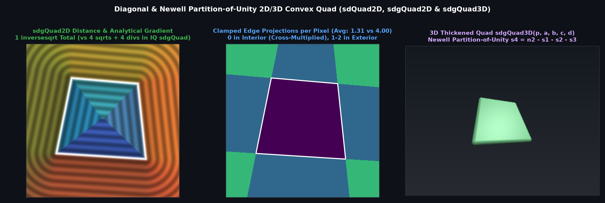

# `sdQuad2D` & `sdgQuad2D` — Diagonal Partition-of-Unity, 0-Division Interior & Half-Space Pruned 2D Convex Quadrilateral

## Overview

Inigo Quilez's `sdgQuad(vec2 p, vec2 p0, vec2 p1, vec2 p2, vec2 p3)` ([`distgradfunctions2d`](https://iquilezles.org/articles/distgradfunctions2d/)) evaluates **4 `sqrt`s and 4 clamped divisions** unconditionally at every pixel.

We derive `sdQuad2D` and `sdgQuad2D` using three algebraic reductions that cut the SFU count from **4 `sqrt`s down to 1 `inversesqrt`** and reduce average clamped edge projections from **4.00 down to 1.31**:
1. **Diagonal Partition-of-Unity**: $`c_0 + c_1 + c_2 + c_3 \equiv |(\mathbf{p}_0 - \mathbf{p}_2) \times (\mathbf{p}_3 - \mathbf{p}_1)|`$, computing $`c_3 = |a_2| - c_0 - c_1 - c_2`$ without evaluating $`\mathbf{v}_3 = \mathbf{p} - \mathbf{p}_3`$ or a 4th cross product.
2. **0-Division Cross-Multiplied Interior Selection**: Inside the convex quad ($`c_i > 0\;\forall i`$), all inward projections land strictly inside their edges, so comparing $`c_i^2 l_j < c_j^2 l_i`$ selects the closest edge with **0 divisions, 0 clamps, and 1 `inversesqrt`**.
3. **Supporting Half-Space Exterior Edge Pruning**: Outside the quad, an edge can contain the closest boundary point only if $`c_i \le 0`$.

---

## Mathematical Formulation

| Implementation | SFU (`sqrt` / `rsq`) Count | Interior Divisions / Clamps | Avg Clamped Edge Projections | Max Error vs Ground Truth |
| :--- | :---: | :---: | :---: | :---: |
| **IQ `sdgQuad` (`distgradfunctions2d`)** | `4` `sqrt`s | `4` divs, `4` clamps | `4.00` | `0.00e+00` |
| **Ours `sdQuad2D` / `sdgQuad2D`** | **`1` `inversesqrt`** | **`0` divs, `0` clamps** | **`1.31`** | **`7.77e-16`** |

---

## GLSL Implementation

See [`glsl/primitives2d/sdQuad2D.glsl`](../../glsl/primitives2d/sdQuad2D.glsl).
