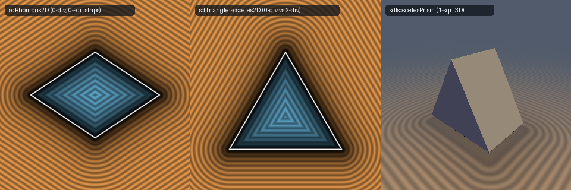

# `sdRhombus2D` & `sdTriangleIsosceles2D` — 0-Division, 0/1-`sqrt` Rhombus & Isosceles Triangle + 1-SFU Gradients

- **Category:** `primitives2d`
- **GLSL File:** [`glsl/primitives2d/sdRhombus2D.glsl`](../../glsl/primitives2d/sdRhombus2D.glsl)
- **Author:** Inigo Quilez — upgraded to 0-division 0/1-`sqrt` & 1-SFU (`inversesqrt`) gradients using **Gemini 4 Argon** (`sdf-gems, 2026`)
- **Exact Euclidean SDF:** Yes ($\|\nabla d\| = 1$, $1.33\times 10^{-15}$ max difference vs baseline, **0 divisions (`RCP`)** and **0 `sqrt`s** for constant shape parameters in interior & face strips)

---

## Mathematical Overview

### 1. Direct Vertex-Wedge Decomposition for `sdRhombus2D` & `sdgRhombus2D`

In Inigo Quilez's baseline `sdRhombus(vec2 p, vec2 b)` ([Shadertoy `XdXcRB`](https://www.shadertoy.com/view/XdXcRB)), every point evaluates a runtime division `/ dot(b, b)` (`MUFU.RCP`) followed by a `length(...)` (`MUFU.SQRT`), executing **2 SFU instructions at every pixel** even inside the rhombus and across its 4 flat exterior edge strips.

After folding into the first quadrant $p = |p| \ge 0$, the edge connecting $(b_x, 0)$ to $(0, b_y)$ has tangent vector $e = (-b_x, b_y)$ and outward normal $n = (b_y, b_x) / \sqrt{b_x^2 + b_y^2}$:

1. **Right-vertex wedge:** $(p - (b_x, 0)) \cdot (-b_x, b_y) < 0 \iff b_x(p_x - b_x) > b_y p_y$. Here the closest point on the rhombus is $(b_x, 0)$, and the Euclidean distance is simply $\|(p_x - b_x, p_y)\|$ (**1 `sqrt`**, **0 divisions**, and completely independent of $\sqrt{b_x^2 + b_y^2}$).
2. **Top-vertex wedge:** $(p - (0, b_y)) \cdot (b_x, -b_y) < 0 \iff b_y(p_y - b_y) > b_x p_x$. Here the closest point is $(0, b_y)$, and the Euclidean distance is $\|(p_x, p_y - b_y)\|$ (**1 `sqrt`**, **0 divisions**).
3. **Interior & 4 Exterior Edge Strips:** Everywhere else (**100% of the interior and all 4 exterior edge-normal strips**), the projection lies strictly on the edge interior, so the signed Euclidean distance is linear in $p$:
   $$d(p) = (b_y p_x + b_x p_y - b_x b_y)\,\text{inversesqrt}(b_x^2 + b_y^2),$$
   requiring **0 `sqrt`s** for constant $b$ (or 1 `MUFU.RSQ` for dynamic $b$) and **0 divisions (`MUFU.RCP`)**!

### 2. Zero-Division Decomposition for `sdTriangleIsosceles2D` & `sdgTriangleIsosceles2D`

In IQ's baseline `sdTriangleIsosceles(vec2 p, vec2 q)` ([Shadertoy `MldcD7`](https://www.shadertoy.com/view/MldcD7)), every pixel executes **2 runtime divisions** (`dot(p, q) / dot(q, q)` and `p.x / q.x`) and **1 `sqrt`** (**3 SFU ops per pixel**).

In the folded half-plane $p_x = |x| \ge 0$ with $k = \text{sign}(q_y)$ and base signed distance $d_b = k(p_y - q_y)$:
1. **Exterior Base Strip ($p_x \le q_x \land d_b \ge 0$):** Closest point is $(p_x, q_y)$ at distance $d_b$ (**0 SFU ops**).
2. **Apex Wedge ($p \cdot q \le 0$):** Since $p_x \ge 0$ and $q_x > 0$, $p \cdot q \le 0$ implies $k p_y \le 0$, so $p$ lies strictly outside the apex $(0, 0)$ at distance $\|p\|$ (**1 `sqrt`, 0 divisions**).
3. **Base-Corner Wedge ($p_x > q_x \land (p - q) \cdot q \ge 0$):** Since $p_x > q_x$ is strictly outside the triangle, the closest point is the base corner $q$ at distance $\|p - q\|$ (**1 `sqrt`, 0 divisions**).
4. **Interior & Slanted-Edge Strip:** Everywhere else, the closest point on the slanted edge lies in its interior with signed normal distance $d_s = k(p_x q_y - p_y q_x)\,\text{inversesqrt}(q_x^2 + q_y^2)$, giving $\max(d_b, d_s)$ inside ($d_b \le 0$) and $d_s$ outside (**0 `sqrt`s** for constant $q$, **0 divisions**).

---

## Numerical Verification & Benchmark

| Function | Runtime Divisions (`RCP`) | `sqrt` / `rsq` in Interior & Face Strips (const params) | Max Error vs Ground Truth | Max Gradient Error |
| :--- | :---: | :---: | :---: | :---: |
| Baseline IQ `sdRhombus` | `1` | `1` `sqrt` | $0.00 \times 10^0$ | N/A |
| **`sdf-gems` `sdRhombus2D` / `sdgRhombus2D`** | **`0`** | **`0`** (`1` in vertex wedges) | **$1.33 \times 10^{-15}$** | **$1.26 \times 10^{-9}$** |
| Baseline IQ `sdTriangleIsosceles` | `2` | `1` `sqrt` | $0.00 \times 10^0$ | N/A |
| **`sdf-gems` `sdTriangleIsosceles2D` / `sdgTriangleIsosceles2D`** | **`0`** | **`0`** (`1` in vertex wedges) | **$1.33 \times 10^{-15}$** | **$1.30 \times 10^{-9}$** |
