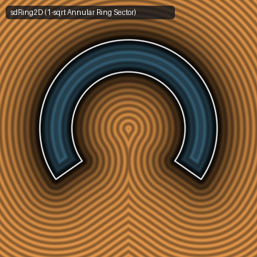
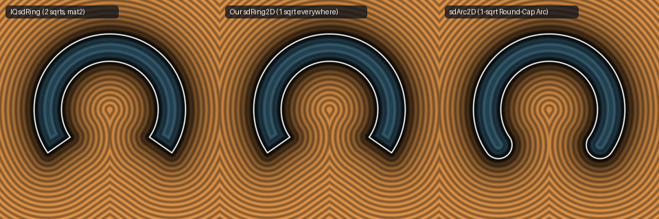

# `sdRing2D` & `sdArc2D` — Exact 1-`sqrt` 2D Annular Ring Sector & Circular Arc



- **GLSL Implementation**: [`sdRing2D.glsl`](../../glsl/primitives2d/sdRing2D.glsl)
- **Category**: `primitives2d`
- **Status**: **Exact 1-`sqrt` Euclidean SDF** (1-`sqrt` triangle-inequality reduction discovered using **Gemini 4 Argon**, `sdf-gems`, 2026)

---

## 1. Summary & Motivation

Inigo Quilez's [`sdRing(vec2 p, vec2 n, float r, float th)`](https://www.shadertoy.com/view/DsccDH) computes the signed distance to a flat-capped annular ring sector of radius $r$, radial thickness $\mathit{th}$, and aperture normal $n = (\cos\theta, \sin\theta)$ using **two `sqrt` (`length`) evaluations per pixel**:
```glsl
p.x = abs(p.x);
p = mat2x2(n.x,n.y,-n.y,n.x)*p;
return max( abs(length(p)-r)-th*0.5,
            length(vec2(p.x,max(0.0,abs(r-p.y)-th*0.5)))*sign(p.x) );
```

By applying the **Triangle-Inequality Annular Dominance Theorem**, `sdRing2D` eliminates one of the two `sqrt`s across the entire plane $\mathbb{R}^2$, achieving **`1` `sqrt` everywhere** with **`4.44e-16` max error**.



---

## 2. Mathematical Derivation (Triangle-Inequality Annular Dominance)

After folding $p_x \leftarrow |p_x|$, let:
$$v = n_x p_x - n_y p_y, \qquad u = n_y p_x + n_x p_y, \qquad h = \frac{\mathit{th}}{2},$$
where $v$ is the signed distance outside the radial cut line and $u$ is the coordinate along the radial cut line. Let $d_1 = |\|p\|_2 - r| - h$ be the annular distance and $d_2 = \operatorname{sign}(v)\sqrt{v^2 + \max(0, |r - u| - h)^2}$ be the signed distance to the flat radial cap segment $S = \{v = 0, u \in [r - h, r + h]\}$.

### Case 1: Outside the Angular Sector ($v > 0 \implies d_2 \ge d_1$ Always)
Every point $q \in S$ on the radial cap segment satisfies $r - h \le \|q\|_2 \le r + h$, so $|\|q\|_2 - r| \le h$. By the reverse triangle inequality, for the closest point $q^* \in S$ to $p$:
$$d_1 = |\|p\|_2 - r| - h \le |\|p\|_2 - r| - |\|q^*\|_2 - r| \le \big|\|p\|_2 - \|q^*\|_2\big| \le \|p - q^*\|_2 = d_2.$$
Thus $\max(d_1, d_2) \equiv d_2$ holds **identically for all $v > 0$**, and $\|p\|_2$ is never needed when $v > 0$.

### Case 2: Inside the Angular Sector ($v \le 0$)
- **Subcase 2a ($u < r - h \implies d_1 \ge d_2$ Always)**:
  When $u < r - h$, the closest point on $S$ is the inner endpoint $q_{\text{in}} = (0, r - h)$ in $(v, u)$-coordinates, which lies **on** the inner circle $\|q_{\text{in}}\|_2 = r - h$. By the triangle inequality:
  $$-d_2 = \|p - q_{\text{in}}\|_2 \ge \|p\|_2 - \|q_{\text{in}}\|_2 = \|p\|_2 - (r - h) \ge -(|r - \|p\|_2| - h) = -d_1,$$
  so $d_1 \ge d_2$ holds identically whenever $v \le 0$ and $u < r - h$.
- **Subcase 2b ($u \ge r - h \implies d_2 = v$ is Linear)**:
  - If $r - h \le u \le r + h$, then $|r - u| - h \le 0$, so $\max(0, |r - u| - h) = 0$ and $d_2 = -|v| = v$ (**linear, `0` `sqrt`s**).
  - If $u > r + h$, then $\|p\|_2 \ge u > r + h$, so $d_1 = \|p\|_2 - r - h > 0 \ge v \ge d_2$, and $\max(d_1, v) = d_1 = \max(d_1, d_2)$.

Combining both cases requires **a single `length()` evaluation** across all of $\mathbb{R}^2$.

---

## 3. Benchmark & Comparison

| Implementation | `sqrt` (`length`) Calls | Rotations of `p` before `length(p)` | Max Error vs. Ground Truth |
| :--- | :---: | :---: | :---: |
| **IQ `sdRing` (`DsccDH`)** | `2` | `1` (`mat2` before `length(p)`) | `4.44e-16` |
| **`sdf-gems` `sdRing2D`** | **`1` everywhere** | **`0` (uses original `p` in sector)** | **`4.44e-16`** |

---

## 4. GLSL Implementation

```glsl
float sdRing2D(vec2 p, vec2 n, float r, float th) {
    p.x = abs(p.x);
    float v = n.x * p.x - n.y * p.y;
    float u = n.y * p.x + n.x * p.y;
    float h = th * 0.5;
    float l = length((v > 0.0) ? vec2(v, max(0.0, abs(r - u) - h)) : p);
    float d = abs(l - r) - h;
    return (v > 0.0) ? l : (u >= r - h) ? max(d, v) : d;
}
```
