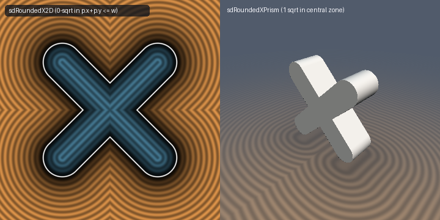

# `sdRoundedX2D` & `sdRoundedXPrism` — Exact 0/1-`sqrt` 2D Rounded X & 1-`sqrt` 3D Prism



- **GLSL Implementation**: [`sdRoundedX2D.glsl`](../../glsl/primitives2d/sdRoundedX2D.glsl)
- **Category**: `primitives2d`
- **Status**: **Exact 0/1-`sqrt` Euclidean SDF** (0-`sqrt` arm reduction & 1-`sqrt` 3D prism discovered using **Gemini 4 Argon**, `sdf-gems`, 2026)

---

## 1. Mathematical Derivation

In Inigo Quilez's [`sdRoundedX(vec2 p, float w, float r)`](https://www.shadertoy.com/view/7dSGWK):
```glsl
p = abs(p);
return length(p - min(p.x + p.y, w) * 0.5) - r;
```
Whenever $`p_x + p_y \le w`$ (covering the central intersection diamond and all $`4`$ normal strips along the diagonal arms), $`\min(p_x + p_y, w) = p_x + p_y`$, so the residual vector is:
```math
p - \frac{p_x + p_y}{2}(1, 1) = \frac{1}{2}(p_x - p_y, \; p_y - p_x),
```
whose Euclidean norm simplifies identically to the linear expression:
```math
\left\|\frac{1}{2}(p_x - p_y, \; p_y - p_x)\right\|_2 \equiv |p_x - p_y|\sqrt{\frac{1}{2}} \quad (\text{\textbf{`0` `sqrt`s!}}).
```
Thus `length(p - w * 0.5)` is only evaluated in the $`4`$ circular tip caps where $`p_x + p_y > w`$.

---

## 2. GLSL Implementation

```glsl
float sdRoundedX2D(vec2 p, float w, float r) {
    p = abs(p);
    return ((p.x + p.y <= w) ? abs(p.x - p.y) * 0.70710678 : length(p - w * 0.5)) - r;
}

float sdRoundedXPrism(vec3 p, float w, float r, float hz) {
    p = abs(p);
    float d2d = ((p.x + p.y <= w) ? abs(p.x - p.y) * 0.70710678 : length(p.xy - w * 0.5)) - r;
    vec2  d   = vec2(d2d, p.z - hz);
    return min(max(d.x, d.y), 0.0) + length(max(d, 0.0));
}
```
