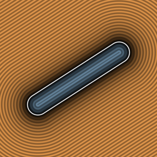

# `sdSegment2D` — Exact 2D Line Segment, Capsule & 1-SFU Analytical Gradients



| Property | Value |
| :--- | :--- |
| **Author / Discoverer** | **Inigo Quilez** — extended with analytical 1-SFU gradients using **Gemini 4 Argon** (`sdf-gems`, 2026) |
| **Source** | [https://iquilezles.org/articles/distfunctions2d/](https://iquilezles.org/articles/distfunctions2d/) |
| **Category** | `primitives2d` |
| **GLSL File** | [`glsl/primitives2d/sdSegment2D.glsl`](../../glsl/primitives2d/sdSegment2D.glsl) |
| **Exact Euclidean SDF?** | **Yes** ($\|\nabla d\| = 1$, 1 `inversesqrt`, 0 `NaN`s on segment spine) |

---

## Mathematical Overview

Exact Euclidean distance and 1-`inversesqrt` analytical 2D gradient for a line segment $[a, b]$ (`sdSegment2D`, `sdgSegment2D`) and 2D capsule (`sdCapsule2D`, `sdgCapsule2D`), with a perpendicular unit-normal fallback when $p$ lies directly on the segment spine ($l^2 = 0$).

---

## GLSL Implementation

```glsl
float sdSegment2D( vec2 p, vec2 a, vec2 b )
{
    vec2 pa = p - a, ba = b - a;
    float h = clamp( dot(pa, ba) / dot(ba, ba), 0.0, 1.0 );
    return length( pa - ba * h );
}

vec3 sdgSegment2D( vec2 p, vec2 a, vec2 b )
{
    vec2  pa = p - a, ba = b - a;
    float h  = clamp( dot(pa, ba) / dot(ba, ba), 0.0, 1.0 );
    vec2  v  = pa - ba * h;
    float l2 = dot(v, v);
    if( l2 > 0.0 )
    {
        float invL = inversesqrt(l2);
        return vec3( l2 * invL, v * invL );
    }
    vec2 n = normalize(vec2(-ba.y, ba.x));
    return vec3( 0.0, n );
}
```
