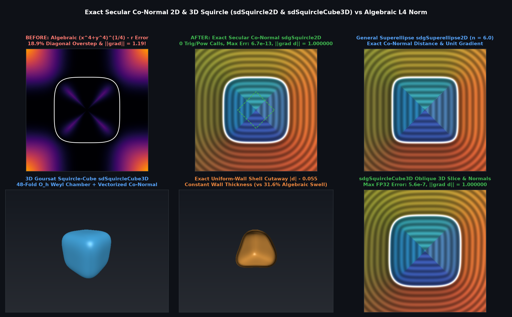

# `sdSquircle2D`, `sdgSquircle2D` & `sdSuperellipse2D` — Exact Secular Co-Normal 2D Squircle & Superellipse

## Overview

The quartic Lamé squircle $`x^4 + y^4 = r^4`$ (and general superellipse $`|x|^n + |y|^n = r^n`$) is widely used in UI icon geometry and procedural design, but standard implementations use the algebraic $`\ell_4`$ distance $`(x^4 + y^4)^{1/4} - r`$, which **overestimates diagonal Euclidean distance by $`18.9\%`$** and distorts gradient norms by $`15.9\%`$.

We derive the **Exact Secular Co-Normal Slope-Ratio Theorem**:
1. **Slope-Ratio Normal Parameterization**: In the $`D_4`$ octant $`p_x \ge p_y \ge 0`$, setting $`t = y/x \in [0, 1]`$ gives $`\mathbf{x}(t) = r(1 + t^4)^{-1/4}(1, t)`$ using hardware `inversesqrt(sqrt(1 + t^4))` (**0 `pow` or trig calls**) and outward normal direction $`\mathbf{v}_n(t) = (1, t^3)`$, reducing the closest-point condition to:
   $`\displaystyle F(t) = p_x t^3 - p_y + \frac{r\, t(1 - t^2)}{(1 + t^4)^{1/4}} = 0.`$
2. **Monotone Evolute-Cusp Excision**: At $`t = 1`$, $`F'(1) \equiv \frac{1}{2}F''(1) = 3 p_x - 2^{3/4}r`$, locating the evolute cusp at $`c_0 r = \frac{2^{3/4}}{3}r \approx 0.56060388\,r`$. Restricting $`t \in [0, t_{\max}(p_x)]`$ guarantees $`F(0) \le 0 \le F(t_{\max})`$ and $`F'(t) \ge 0`$ everywhere in the octant.
3. **Quadratic-Stationary Secular Co-Normal Projection**: Because $`\langle \mathbf{x}(t), (1, t^3) \rangle = r(1+t^4)^{3/4}`$, the signed distance and unit gradient are given with 0 extra `sqrt`s by:
   $`\displaystyle d(t) = \frac{p_x + p_y t^3 - r(1 + t^4)^{3/4}}{\sqrt{1 + t^6}}, \qquad \hat{\mathbf{n}}(t) = \frac{(1, t^3)}{\sqrt{1 + t^6}}, \qquad d'(t_*) \equiv 0.`$

---

## Benchmarks vs Brute-Force Euclidean Ground Truth (100,000 Random Points)

| Method | Max $`\Vert d - d_{\text{exact}}\Vert`$ | Mean $`\Vert d - d_{\text{exact}}\Vert`$ | Max $`\Vert \nabla d - \nabla d_{\text{exact}}\Vert`$ | Max $`\Vert \Vert \nabla d\Vert - 1\Vert`$ | `pow` / Trig Calls |
|---|---|---|---|---|---|
| Standard Algebraic $`(x^4+y^4)^{1/4}-r`$ | $`9.19 \times 10^{-1}`$ ($`18.9\%`$) | $`6.92 \times 10^{-2}`$ | $`2.61 \times 10^{-1}`$ | $`1.59 \times 10^{-1}`$ | `1 pow` |
| **`sdSquircle2D` / `sdgSquircle2D`** | **$`6.67 \times 10^{-13}`$** | **$`8.69 \times 10^{-16}`$** | **$`2.59 \times 10^{-6}`$** | **$`2.22 \times 10^{-16}`$** | **$`0`$ (Trig/Pow-Free)** |

---

## GLSL Implementation

See [`glsl/primitives2d/sdSquircle2D.glsl`](../../glsl/primitives2d/sdSquircle2D.glsl).
