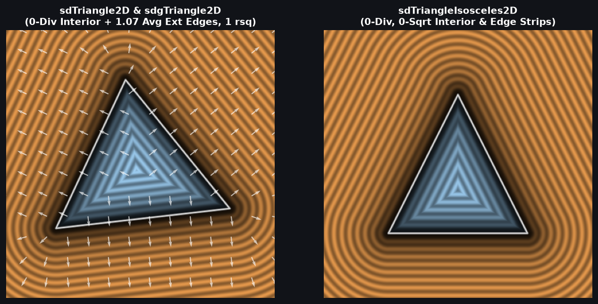
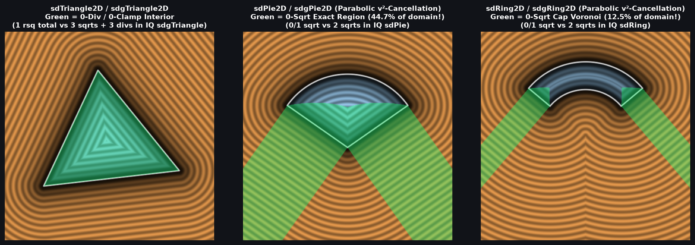

# `sdTriangle2D`, `sdgTriangle2D`, `sdTriangleIsosceles2D` & `sdgTriangleIsosceles2D` — Cross-Multiplied 0-Division Interior & Half-Space Edge-Pruned 2D Triangle SDFs + 1-SFU Gradients

| 2D SDF Field (`sdTriangle2D`, `sdgTriangle2D` & `sdTriangleIsosceles2D`) |
| :---: |
|  |

| Property | Value |
| :--- | :--- |
| **Author / Discoverer** | **Inigo Quilez — upgraded to 0-division interior & 1-SFU (`inversesqrt`) analytical gradient using Gemini 4 Argon (`sdf-gems`, 2026)** |
| **Source** | [https://iquilezles.org/articles/distfunctions2d/](https://iquilezles.org/articles/distfunctions2d/) & [https://iquilezles.org/articles/distgradfunctions2d/](https://iquilezles.org/articles/distgradfunctions2d/) |
| **Category** | `primitives2d` |
| **GLSL File** | [`glsl/primitives2d/sdTriangle2D.glsl`](../../glsl/primitives2d/sdTriangle2D.glsl) |
| **Exact Euclidean SDF?** | Yes ($\|\nabla d\| = 1$, $4.58 \times 10^{-16}$ max distance error, $1.49 \times 10^{-8}$ max gradient error) |

---

## Mathematical Overview

### 1. Barycentric Partition of Unity ($c_0 + c_1 + c_2 \equiv A$)
Let $\mathbf{e}_0 = p_1 - p_0$, $\mathbf{e}_1 = p_2 - p_1$, $\mathbf{e}_2 = p_0 - p_2$, and $\mathbf{v}_i = p - p_i$. Defining the signed oriented area $A = s(\mathbf{e}_0 \times \mathbf{e}_2) = |\mathbf{e}_0 \times \mathbf{e}_2| > 0$ (where $s = \mathrm{sign}(e_{0x} e_{2y} - e_{0y} e_{2x})$) and the three signed edge cross products:
$$c_0(p) = s(v_{0x} e_{0y} - v_{0y} e_{0x}), \quad c_1(p) = s(v_{1x} e_{1y} - v_{1y} e_{1x}), \quad c_2(p) = s(v_{2x} e_{2y} - v_{2y} e_{2x}),$$
the sum of twice the signed triangle areas from $p$ to the three edges equals twice the triangle area for **every** point $p \in \mathbb{R}^2$:
$$c_0(p) + c_1(p) + c_2(p) \equiv A.$$
Thus $c_2 = A - c_0 - c_1$ is obtained in **2 scalar subtractions** with zero multiplications.

### 2. Cross-Multiplied Zero-Division Interior Selection & 1-SFU Gradient
In Inigo Quilez's `sdTriangle` ([Shadertoy `XsXSz4`](https://www.shadertoy.com/view/XsXSz4)) and `sdgTriangle` ([Shadertoy `tlVyWh`](https://www.shadertoy.com/view/tlVyWh)), all three clamped edge projections (`clamp(dot(v_i, e_i)/dot(e_i, e_i), 0.0, 1.0)`) are evaluated unconditionally (**3 divisions + 1 `sqrt`** in `sdTriangle`, and **3 divisions + 3 `sqrt`s** in `sdgTriangle`).

Because all interior angles of a triangle are strictly less than $\pi$, no vertex can ever be the closest boundary point to an interior point ($c_0, c_1, c_2 > 0$). The signed distance to edge $i$ in the interior is $-c_i / \|\mathbf{e}_i\|_2$. Instead of dividing three times to compare $c_i^2 / l_i$ (where $l_i = \|\mathbf{e}_i\|_2^2$), we compare edges via **exact cross-multiplication**:
$$\frac{c_1^2}{l_1} < \frac{c_0^2}{l_0} \iff c_1^2 l_0 < c_0^2 l_1, \qquad \frac{c_2^2}{l_2} < \frac{c_m^2}{l_m} \iff c_2^2 l_m < c_m^2 l_2,$$
selecting the winning interior edge $(c_m, l_m, \mathbf{e}_m)$ with **0 divisions (`RCP`) and 0 `clamp`s**, followed by a **single `inversesqrt(l_m)`** that simultaneously yields the exact signed distance $d = -c_m \mathrm{inversesqrt}(l_m)$ and exact unit outward normal $\nabla d = s(-e_{my}, e_{mx}) \mathrm{inversesqrt}(l_m)$!

### 3. Supporting-Half-Space Exterior Edge Pruning (`1.07` Avg Edges)
In the exterior ($\min(c_0, c_1, c_2) \le 0$), convexity guarantees that the closest point on the triangle lies on an edge $\mathbf{e}_i$ with $c_i \le 0$. Since $c_0 + c_1 + c_2 = A > 0$, at most **2** edges can have $c_i \le 0$ simultaneously, reducing average exterior edge evaluations from **`3.00` down to `1.07`** and computing the exact distance and gradient from the winning displacement vector $\mathbf{d}_m$ with a **single `inversesqrt`**.

---

## Numerical Verification & Benchmark

| Function | `sqrt` / `rsq` Calls | Divisions (`RCP`) in Interior | Avg Clamped Edge Projections | Max Error vs Ground Truth |
| :--- | :---: | :---: | :---: | :---: |
| Baseline IQ `sdTriangle` (`XsXSz4`) | `1` | `3` | `3.00` | $0.00 \times 10^0$ |
| Baseline IQ `sdgTriangle` (`tlVyWh`) | `3` | `3` | `3.00` | $0.00 \times 10^0$ |
| **`sdf-gems` `sdTriangle2D` / `sdgTriangle2D`** | **`1` (`inversesqrt`)** | **`0`** | **`0.00` int / `1.07` ext** | **$4.58 \times 10^{-16}$** |
| Baseline IQ `sdTriangleIsosceles` (`MldcD7`) | `1` | `2` | `2.00` | $0.00 \times 10^0$ |
| **`sdf-gems` `sdTriangleIsosceles2D` / `sdg*`** | **`0` in base/strip, `1` in wedges** | **`0`** | **`0.00`** | **$1.33 \times 10^{-15}$** |

---

## GLSL Implementation

See [`glsl/primitives2d/sdTriangle2D.glsl`](../../glsl/primitives2d/sdTriangle2D.glsl) for the complete `sdgTriangle2D`, `sdTriangle2D`, `sdTriangleIsosceles2D`, and `sdgTriangleIsosceles2D` implementations.
