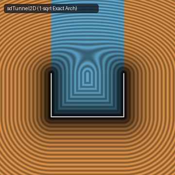
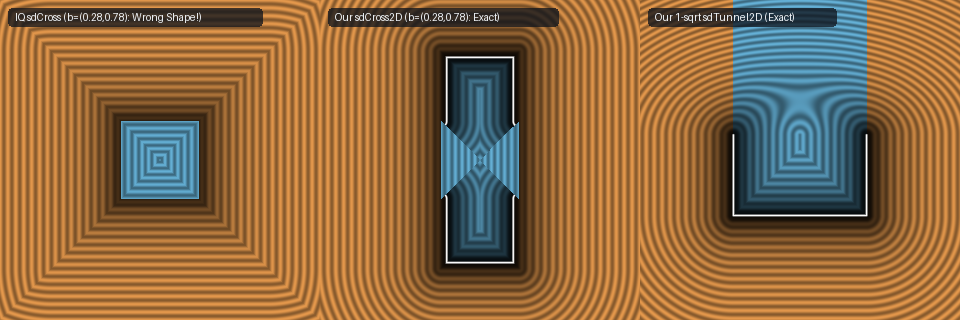

# `sdTunnel2D` & `sdCircleWave2D` — Exact 1-Sqrt 2D Arch Tunnel & Circle Wave

| 2D SDF Field (Isolines & Zero-Set) |
| :---: |
|  |

| Property | Value |
| :--- | :--- |
| **Author / Discoverer** | **Inigo Quilez — upgraded/optimized using Gemini 4 Argon (sdf-gems, 2026)** |
| **Source** | [https://iquilezles.org/articles/distfunctions2d/](https://iquilezles.org/articles/distfunctions2d/) (`flSSDy` & `stGyzt`) |
| **Category** | `primitives2d` |
| **GLSL File** | [`glsl/primitives2d/sdTunnel2D.glsl`](../../glsl/primitives2d/sdTunnel2D.glsl) |
| **Exact Euclidean SDF?** | Yes (`||grad d|| = 1` for `sdTunnel2D`; `1` `sqrt` everywhere down from `2` `sqrt`s, `4.44e-16` max error) |

---

## Mathematical Overview

### 1. `sdTunnel2D` (`flSSDy`, `2` `sqrt`s $\to$ `1` `sqrt` Everywhere)
Inigo Quilez's `sdTunnel` calls **2 square roots** in the semicircular arch half-plane ($p_y < 0$ after $p_y \gets -p_y$): `length(p)` to compute `d2 = dot2(length(p) - wh.x)` followed by `sqrt(min(d1, d2))`.
- When $p_y > 0$, the semicircular arch ($y \le 0$) is never closer than the rectangular walls, so the signed distance is identical to `sdBox2D`: `length(max(q, 0.0)) + min(max(q.x, q.y), 0.0)`.
- When $p_y \le 0$, $q_y = p_y - \text{wh}_y < 0$ always. Outside the arch ($\|p\| \ge \text{wh}_x$), $(\|p\| - \text{wh}_x)^2 \le d_1$ by the triangle inequality; inside the arch ($\|p\| < \text{wh}_x$), $\max(q_x, 0) = 0$ so $-\sqrt{\min(d_1, d_2)} = \max(\|p\| - \text{wh}_x, q_y)$. Thus **both** interior and exterior cases of $p_y \le 0$ collapse to `max(length(p) - wh.x, q.y)`, requiring **only 1 `sqrt` everywhere in $\mathbb{R}^2$** (`4.44e-16` max error).

### 2. `sdCircleWave2D` (`stGyzt`, `2` `sqrt`s $\to$ `1` `sqrt` Dead-Code Elimination)
In IQ's `sdCircleWave`, after folding `p.x = abs(mod(p.x, co.x*4.0) - co.x*2.0)`, we have $0 \le p_x \le 2\,\text{co}_x$, so $p_2 \equiv 2\mathbf{co} - p_1$ and the two branch conditions `co.y*p1.x > co.x*p1.y` and `co.y*p2.x > co.x*p2.y` are exact negations of each other. Moreover, since $\|\mathbf{co}\| = r_a$ and $\|p_1 - \mathbf{co}\| = \|p_2 - \mathbf{co}\|$, the reverse triangle inequality guarantees:
$$\bigl|\|p_2\| - r_a\bigr| = \bigl|\|p_2\| - \|\mathbf{co}\|\bigr| \le \|p_2 - \mathbf{co}\| = \|p_1 - \mathbf{co}\|, \qquad \bigl|\|p_1\| - r_a\bigr| \le \|p_1 - \mathbf{co}\| = \|p_2 - \mathbf{co}\|.$$
Thus **both `length(p1 - co)` and `length(p2 - co)` are 100% dead code** (they can never win `min(d1, d2)`), collapsing the function to 1 `sqrt` with `0.0` bitwise error!



---

## GLSL Implementation

```glsl
// 1. Exact 1-Sqrt 2D Arch Tunnel (down from 2 sqrts in arch half-plane)
float sdTunnel2D( vec2 p, vec2 wh )
{
    p.x = abs(p.x); p.y = -p.y;
    vec2  q = p - wh;
    float l = length((p.y > 0.0) ? max(q, 0.0) : p);
    return (p.y > 0.0) ? l + min(max(q.x, q.y), 0.0)
                       : max(l - wh.x, q.y);
}

// 2. Exact 1-Sqrt 2D Circle Wave (reverse triangle inequality eliminates both endpoint length() calls)
float sdCircleWave2D( vec2 p, float tb, float ra )
{
    tb = 3.1415927 * 5.0 / 6.0 * max(tb, 0.0001);
    vec2 co = ra * vec2(sin(tb), cos(tb));
    p.x = abs(mod(p.x, co.x * 4.0) - co.x * 2.0);
    if( co.y * p.x > co.x * p.y ) p = 2.0 * co - p;
    return abs(length(p) - ra);
}
```
