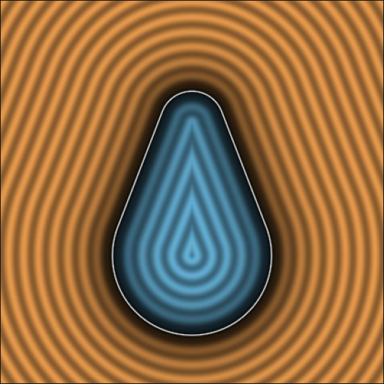
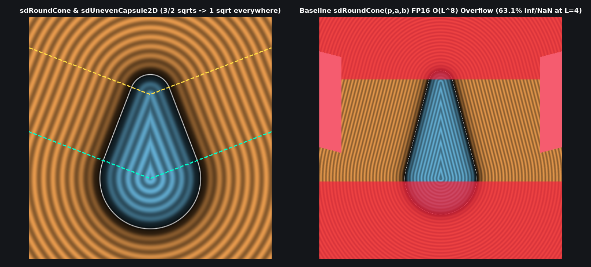

# `sdUnevenCapsule2D` — Exact 1-Sqrt 2D Uneven Capsule (Signed-Square Tangent-Cone Reduction)

| 2D SDF Field (Isolines & Zero-Set) |
| :---: |
|  |

| Property | Value |
| :--- | :--- |
| **Author / Discoverer** | **Inigo Quilez — upgraded/optimized using Gemini 4 Argon (sdf-gems, 2026)** |
| **Source** | [https://iquilezles.org/articles/distfunctions2d/](https://iquilezles.org/articles/distfunctions2d/) |
| **Category** | `primitives2d` |
| **GLSL File** | [`glsl/primitives2d/sdUnevenCapsule2D.glsl`](../../glsl/primitives2d/sdUnevenCapsule2D.glsl) |
| **Exact Euclidean SDF?** | Yes (`||grad d|| = 1`, `1` `sqrt` everywhere down from `2` `sqrt`s, `0.0` error) |

---

## Mathematical Overview

Inigo Quilez's baseline `sdUnevenCapsule` computes `a = sqrt(1.0 - b*b)` upfront and then calls a second `sqrt` (`length(p)` or `length(p - vec2(0.0, h))`) in both circular cap regions.

By the **Signed-Square Tangent-Cone Reduction** (see [`sdRoundCone`](../primitives3d/sdRoundCone.md)), since $p_x = |p_x| \ge 0$ and $a = \sqrt{1 - b^2} \ge 0$, the two cap boundary tests $a y < b p_x$ and $a(y - h) > b p_x$ are equivalent to the **sqrt-free inequalities** $a^2 y |y| < b |b| p_x^2$ and $a^2 z |z| > b |b| p_x^2$ ($z = y - h$). Thus `sqrt(a2)` is only evaluated on the linear side wall, while the two cap regions only evaluate `length(p)` or `length(vec2(p.x, z))` — executing **exactly 1 `sqrt` everywhere in $\mathbb{R}^2$**.



---

## GLSL Implementation

```glsl
float sdUnevenCapsule2D( vec2 p, float r1, float r2, float h )
{
    p.x = abs(p.x);
    float b = (r1 - r2)/h, a2 = 1.0 - b*b;
    float y = p.y, z = y - h, s = b*abs(b)*p.x*p.x;
    return (a2*y*abs(y) < s) ? length(p) - r1 :
           (a2*z*abs(z) > s) ? length(vec2(p.x, z)) - r2 :
                               sqrt(a2)*p.x + b*y - r1;
}
```

### Code Diff vs. Baseline (Inigo Quilez)
```diff
 float sdUnevenCapsule( vec2 p, float r1, float r2, float h )
 {
     p.x = abs(p.x);
-    float b = (r1-r2)/h;
-    float a = sqrt(1.0-b*b);
-    float k = dot(p,vec2(-b,a));
-    if( k < 0.0 ) return length(p) - r1;
-    if( k > a*h ) return length(p-vec2(0.0,h)) - r2;
-    return dot(p, vec2(a,b) ) - r1;
+    float b = (r1 - r2)/h, a2 = 1.0 - b*b;
+    float y = p.y, z = y - h, s = b*abs(b)*p.x*p.x;
+    return (a2*y*abs(y) < s) ? length(p) - r1 :
+           (a2*z*abs(z) > s) ? length(vec2(p.x, z)) - r2 :
+                               sqrt(a2)*p.x + b*y - r1;
 }
```
