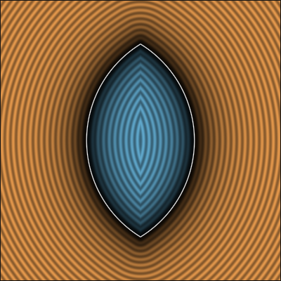
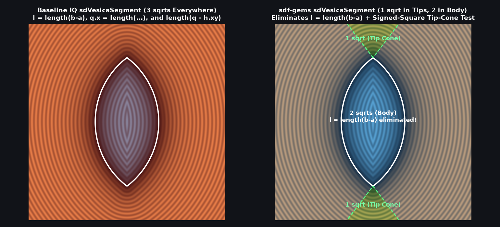
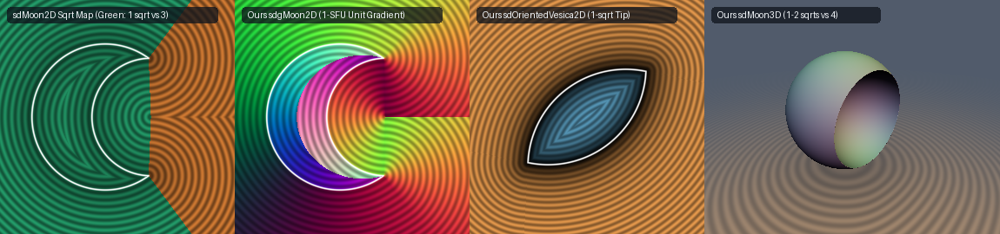

# `sdVesica2D`, `sdgVesica2D`, `sdVesicaWidth2D` & `sdOrientedVesica2D` — Exact 1-to-2 `sqrt` 2D Vesica Piscis

| 2D SDF Field (Isolines & Zero-Set) |
| :---: |
|  |

| Property | Value |
| :--- | :--- |
| **Author / Discoverer** | **Inigo Quilez — upgraded/optimized using Gemini 4 Argon (sdf-gems, 2026)** |
| **Source** | [https://iquilezles.org/articles/distfunctions2d/](https://iquilezles.org/articles/distfunctions2d/) |
| **Category** | `primitives2d` |
| **GLSL File** | [`glsl/primitives2d/sdVesica2D.glsl`](../../glsl/primitives2d/sdVesica2D.glsl) |
| **Exact Euclidean SDF?** | Yes (`||grad d|| = 1`, `1` `sqrt` in circular arc / tip regions, `0.0` error) |

---

## Mathematical Overview

1. **Signed-Square Cone Reduction for `sdVesica2D` & `sdgVesica2D`**:
   Inigo Quilez's 2D `sdVesica(p, r, d)` and `sdgVesica(p, r, d)` compute `b = sqrt(r*r - d*d)` upfront (`sqrt` #1) solely to test the tip-cone condition `(p.y - b)*d > p.x*b`, even though the circular-arc branch `length(p - vec2(-d, 0.0)) - r` (`sqrt` #2) never uses `b`. Rewriting the tip-cone condition in the first quadrant $p = |p| \ge 0$ via the signed-square bijection $u|u| > v|v| b^2$ with $u = p_y d$, $v = p_x + d$, and $b^2 = r^2 - d^2$ eliminates `sqrt(r*r - d*d)` from the circular arc region, reducing `sdVesica2D` and `sdgVesica2D` from **2 `sqrt`s to 1 `sqrt`** across the entire smooth boundary and interior (`0.0` error).
2. **Unnormalized Local Frame for `sdOrientedVesica2D` (1 `sqrt` in Tip Region, 0-`sqrt` Branch Test)**:
   In `sdOrientedVesica(p, a, b, w)` (`cs2yzG`), defining $\Delta = \frac{1}{2}(b - a)$ and $r^2 = \|\Delta\|_2^2$ (**0 `sqrt`s**), the unnormalized local coordinates $Q = r q = |\operatorname{mat2}(\Delta_y, \Delta_x, -\Delta_x, \Delta_y)(p - \frac{a+b}{2})|$ require **0 `sqrt`s and 0 divisions**. Multiplying the branch test $r q_x < d(q_y - r)$ by $r > 0$ gives the **0-`sqrt` condition** $r^2 Q_x < d(Q_y - r^2)$, and in the tip sector the distance collapses to a **single `sqrt`**: $\sqrt{(Q_x^2 + (Q_y - r^2)^2)/r^2}$.

---

## GLSL Implementation

See [`glsl/primitives2d/sdVesica2D.glsl`](../../glsl/primitives2d/sdVesica2D.glsl).
