# 1. 3D Primitives & Surfaces

[**← Back to Main `sdf-gems` README**](../../README.md) · **GLSL Headers**: [`glsl/primitives3d/`](../../glsl/primitives3d/) (56 headers)

Standalone 3D surface and solid Signed Distance Functions, spanning classic CSG primitives (upgraded with 0-`sqrt` Voronoi face-prism checks and singularity-free formulations), constant-width bodies, quadrics, Dupin cyclides, and minimal/ruled surfaces.

## Contents

- **Basic CSG Solids, Cylinders, Cones & Frustums** (26)
- **Spherical Caps, Lenses, Shells & Mechanical Solids** (11)
- **Constant-Width Bodies, Rollers & Developable Solids** (4)
- **Quadrics, Cyclides, Minimal & Algebraic Surfaces** (15)

## Basic CSG Solids, Cylinders, Cones & Frustums

| Preview | Function | Summary |
| :---: | :--- | :--- |
| 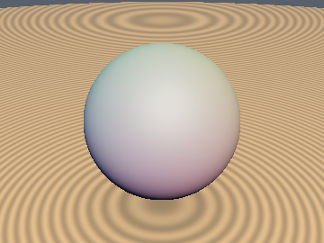&nbsp;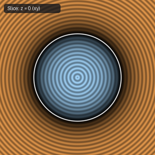 | [**`sdSphere`**](sdSphere.md) [`glsl`](../../glsl/primitives3d/sdSphere.glsl) · **Exact** | Isotropic radial distance $`\Vert p\Vert - r`$ |
| 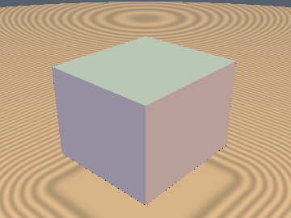&nbsp;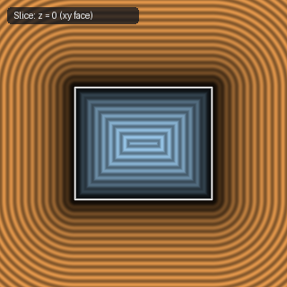 | [**`sdBox`**](sdBox.md) [`glsl`](../../glsl/primitives3d/sdBox.glsl) · **Exact** | 0/1-`sqrt` 3D box via median face-prism check (`0` `sqrt`s in interior + all 6 exterior face prisms [$`64.9\%`$]) |
| 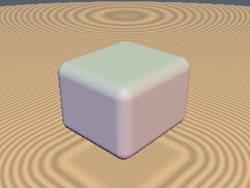&nbsp;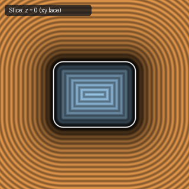 | [**`sdRoundBox`**](sdRoundBox.md) [`glsl`](../../glsl/primitives3d/sdRoundBox.glsl) · **Exact** | 0/1-`sqrt` 3D rounded box (`0` `sqrt`s in interior + all 6 exterior face prisms, `1` on bevels) |
| 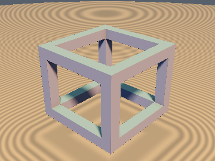&nbsp;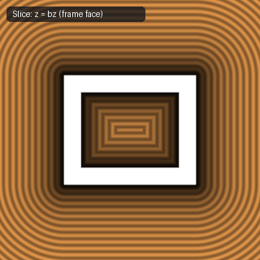 | [**`sdBoxFrame`**](sdBoxFrame.md) [`glsl`](../../glsl/primitives3d/sdBoxFrame.glsl) · **Exact** | 1-`sqrt` closest-beam reduction (down from 3 `sqrt`s & 3 box evals; exact interior incl. corner cubes; includes `sdBoxEdges`) |
| 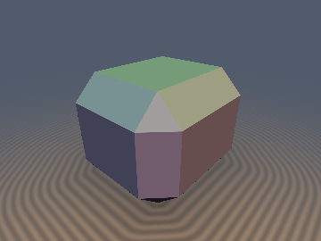 | [**`sdOctaBox`**](sdOctaBox.md) [`glsl`](../../glsl/primitives3d/sdOctaBox.glsl) · **Exact** | **Also**: `sdgOctaBox`, `opExtrudeCone`, `sdgExtrudeCone`. Exact 26-faced crystal-beveled octa-box (Minkowski sum of box and octahedron) and conical chamfered extrusion in 1 `sqrt` |
| 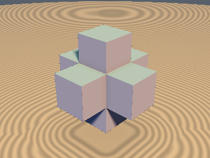&nbsp;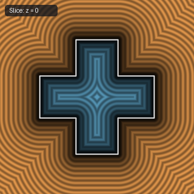 | [**`sdCross3D`**](sdCross3D.md) [`glsl`](../../glsl/primitives3d/sdCross3D.glsl) · **Exact** | 1-`sqrt` exact 3D orthogonal cross (`sdCross3D`) & infinite Menger cross (`sdInfCross3D`) via Weyl-chamber folding |
| 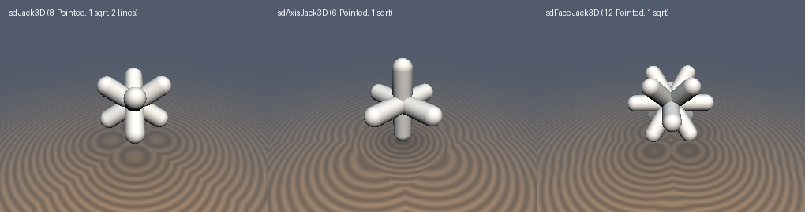&nbsp;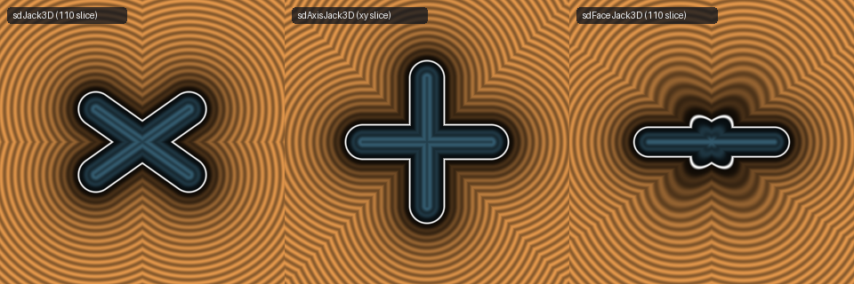 | [**`sdJack3D`**](sdJack3D.md) [`glsl`](../../glsl/primitives3d/sdJack3D.glsl) · **Exact** | **Also**: `sdAxisJack3D`, `sdFaceJack3D`. 1-`sqrt`, 0-sort exact 3D 8-pointed body-diagonal (2 lines!), 6-pointed axis, and 12-pointed face-diagonal capsule jacks |
| 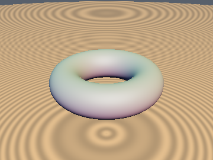&nbsp;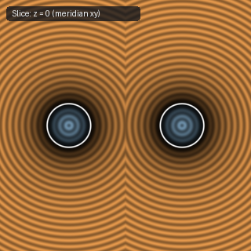 | [**`sdTorus`**](sdTorus.md) [`glsl`](../../glsl/primitives3d/sdTorus.glsl) · **Exact** | Cylindrical reduction $`(\Vert p_{xz}\Vert - R, p_y)`$ followed by 2D circle distance |
| 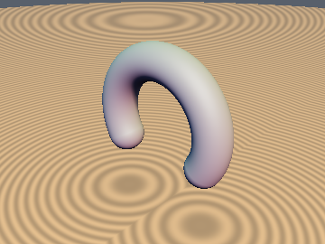&nbsp;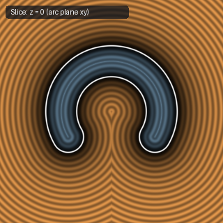 | [**`sdCappedTorus`**](sdCappedTorus.md) [`glsl`](../../glsl/primitives3d/sdCappedTorus.glsl) · **Exact** | Clamped angular projection; avoids negative-radicand `NaN`s on the core circle |
| 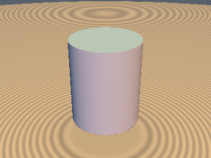&nbsp;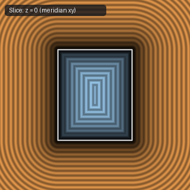 | [**`sdCappedCylinder`**](sdCappedCylinder.md) [`glsl`](../../glsl/primitives3d/sdCappedCylinder.glsl) · **Exact** | 0/1/2-`sqrt` vertical capped cylinder via Unified Cap-Voronoi Radius Theorem (`0` `sqrt`s in cap zones) |
| 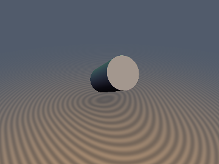&nbsp;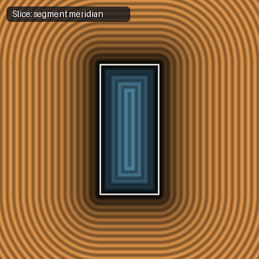 | [**`sdCappedCylinderSeg`**](sdCappedCylinderSeg.md) [`glsl`](../../glsl/primitives3d/sdCappedCylinderSeg.glsl) · **Exact** | 1/2-`sqrt` arbitrary-segment cylinder (down from `3` `sqrt`s via $`L`$-cancellation; avoids $`O(\Vert b-a\Vert ^6)`$ FP16 overflow) |
| 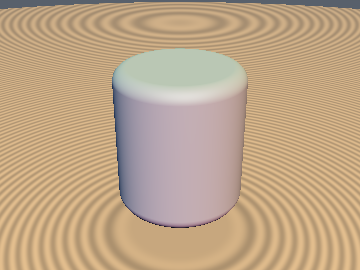&nbsp;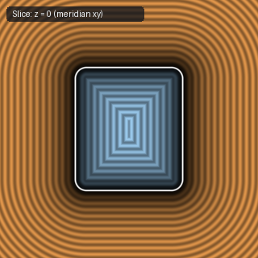 | [**`sdRoundedCylinder`**](sdRoundedCylinder.md) [`glsl`](../../glsl/primitives3d/sdRoundedCylinder.glsl) · **Exact** | 0/1/2-`sqrt` revolved rounded rectangle with corner fillet radius $`r_b`$ (`0` `sqrt`s in cap zones) |
| 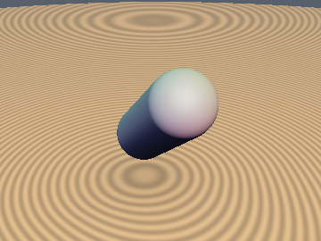&nbsp;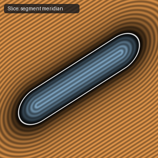 | [**`sdCapsule`**](sdCapsule.md) [`glsl`](../../glsl/primitives3d/sdCapsule.glsl) · **Exact** | Clamped line-segment projection minus radius $`r`$ |
| 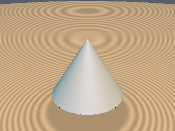&nbsp;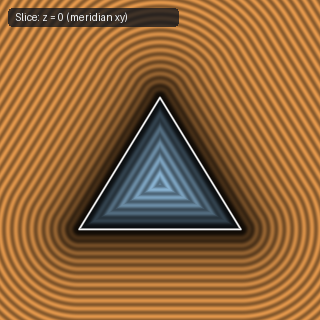 | [**`sdCone`**](sdCone.md) [`glsl`](../../glsl/primitives3d/sdCone.glsl) · **Exact** | Orthonormal $`(c_x, c_y)`$ mantle projection (saves 1 division, 4 multiplies, and 2 additions vs. IQ's `sdCone`) |
| 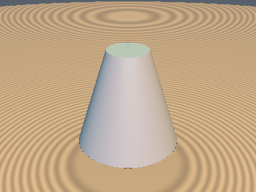&nbsp;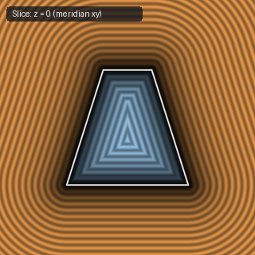 | [**`sdCappedCone`**](sdCappedCone.md) [`glsl`](../../glsl/primitives3d/sdCappedCone.glsl) · **Exact** | Revolved right trapezoid with simplified normal-side sign test `max(-ca.y, dot(cb, k2) - 4*h^2) < 0` |
| 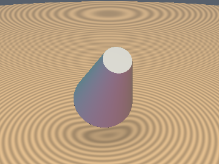&nbsp;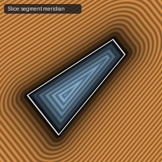 | [**`sdCappedConeSeg`**](sdCappedConeSeg.md) [`glsl`](../../glsl/primitives3d/sdCappedConeSeg.glsl) · **Exact** | Arbitrary-endpoint frustum; guards against $`0/0`$ `NaN`s on the symmetry axis |
| 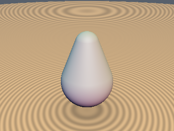&nbsp;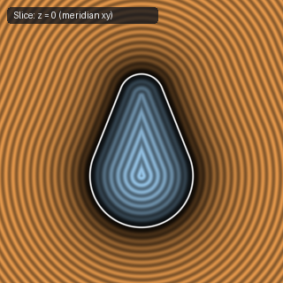 | [**`sdRoundCone`**](sdRoundCone.md) [`glsl`](../../glsl/primitives3d/sdRoundCone.glsl) · **Exact** | 1-`sqrt` vertical round cone (down from 3 `sqrt`s) & $`O(L^2)`$ scale-safe `sdRoundConeSeg` (fixes $`O(L^8)`$ FP16 overflow) |
| 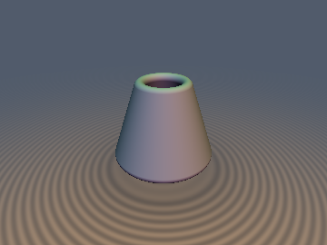&nbsp;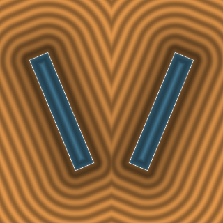 | [**`sdHollowCone`**](sdHollowCone.md) [`glsl`](../../glsl/primitives3d/sdHollowCone.glsl) · **Exact** | **Also**: `sdHollowConeRound`, `sdHollowCylinder`, `sdHollowCylinderRound`, `sdgHollowCone`, `sdgHollowCylinder`. 0/1/2-`sqrt` open-ended cylindrical pipe (0-`sqrt` Annular Rim-Voronoi) & conical frustum funnel (Conformal Midpoint-Fold) |
| 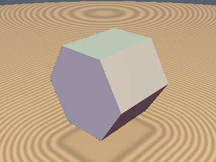&nbsp;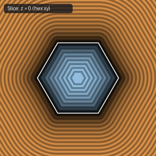 | [**`sdHexPrism`**](sdHexPrism.md) [`glsl`](../../glsl/primitives3d/sdHexPrism.glsl) · **Exact** | $`D_6`$ fundamental-sector folding + orthogonal $`z`$-extrusion |
| 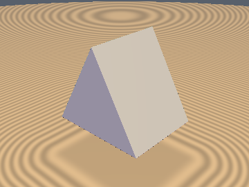&nbsp;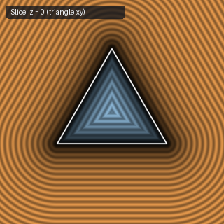 | [**`sdTriPrism`**](sdTriPrism.md) [`glsl`](../../glsl/primitives3d/sdTriPrism.glsl) · **Exact** | Exact Euclidean SDF via $`D_3`$ folding + orthogonal $`z`$-extrusion (replaces plane bound) |
| 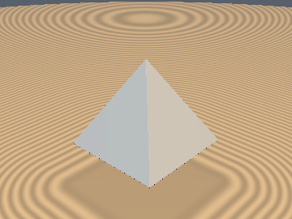&nbsp;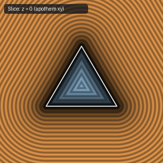 | [**`sdPyramid`**](sdPyramid.md) [`glsl`](../../glsl/primitives3d/sdPyramid.glsl) · **Exact** | Includes exact $`y=0`$ base face and removes interior bisector fold distortion |
| 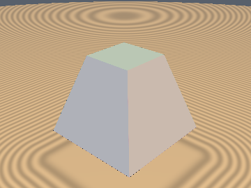&nbsp;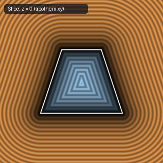 | [**`sdPyramidFrustum`**](sdPyramidFrustum.md) [`glsl`](../../glsl/primitives3d/sdPyramidFrustum.glsl) · **Exact** | Flat-topped square frustum via $`D_4`$ folding and ridge-edge decoupling |
| 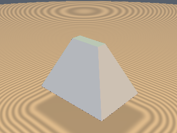&nbsp;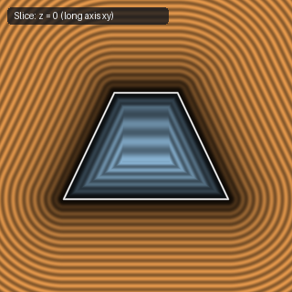 | [**`sdRectFrustum`**](sdRectFrustum.md) [`glsl`](../../glsl/primitives3d/sdRectFrustum.glsl) · **Exact** | General rectangular frustum, rectangular pyramid, and hip roof |
| 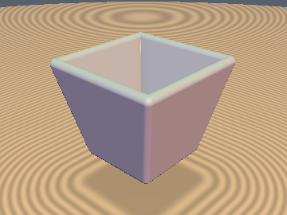&nbsp;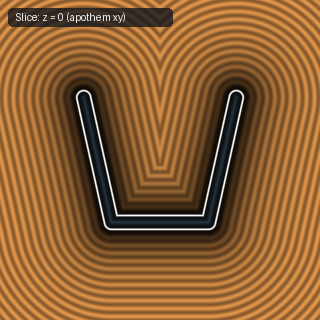 | [**`sdSquareBucket`**](sdSquareBucket.md) [`glsl`](../../glsl/primitives3d/sdSquareBucket.glsl) · **Exact** | Open-ended hollow square frustum shell with rounded rim |
| 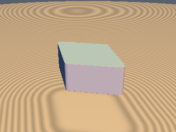&nbsp;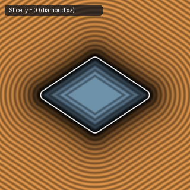 | [**`sdRhombus`**](sdRhombus.md) [`glsl`](../../glsl/primitives3d/sdRhombus.glsl) · **Exact** | Direct diagonal-edge projection; eliminates `ndot` and fixes $`x=0`$ `sign(0.0)` collapse |
| 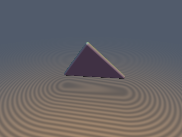&nbsp; | [**`udTriangle`**](udTriangle.md) [`glsl`](../../glsl/primitives3d/udTriangle.glsl) · **Exact** | **Also**: `sdgTriangle3D`, `udQuad`, `sdTriangle2D`. Barycentric Partition-of-Unity ($`s_1+s_2+s_3 \equiv \Vert \mathbf{n}\Vert ^2`$) & Half-Space Edge Pruning (`1.12` avg edges vs `3.0`, `0` divs in face prism) |

## Spherical Caps, Lenses, Shells & Mechanical Solids

| Preview | Function | Summary |
| :---: | :--- | :--- |
| &nbsp; | [**`sdSolidAngle`**](sdSolidAngle.md) [`glsl`](../../glsl/primitives3d/sdSolidAngle.glsl) · **Exact** | 2-`sqrt` orthonormal sector-dominance reduction (down from 3 `sqrt`s; `0.0` error across $`\mathbb{R}^3`$) |
| &nbsp; | [**`sdCutSphere`**](sdCutSphere.md) [`glsl`](../../glsl/primitives3d/sdCutSphere.glsl) · **Exact** | Conjugate-square & signed-square reduction (`0` `sqrt`s in cap, `1` in sphere, `2` in rim; down from `2-3`) |
| &nbsp; | [**`sdCutHollowSphere`**](sdCutHollowSphere.md) [`glsl`](../../glsl/primitives3d/sdCutHollowSphere.glsl) · **Exact** | Conjugate-square & signed-square reduction (`1` `sqrt` in shell, `2` in rim; down from `3` `sqrt`s) |
| &nbsp; | [**`sdSphericalSegmentSym`**](sdSphericalSegmentSym.md) [`glsl`](../../glsl/primitives3d/sdSphericalSegmentSym.glsl) · **Exact** | Two-plane truncated sphere ($`y = \pm h`$) with conjugate-square reduction (`0/1/2` `sqrt`s) |
| &nbsp; | [**`sdSphericalZone`**](sdSphericalZone.md) [`glsl`](../../glsl/primitives3d/sdSphericalZone.glsl) · **Exact** | Hollow spherical zone ($`y \in [h_1, h_2]`$) with conjugate-square reduction (`1/2` `sqrt`s, down from `4`) |
| &nbsp; | [**`sdDeathStar`**](sdDeathStar.md) [`glsl`](../../glsl/primitives3d/sdDeathStar.glsl) · **Exact** | 2-`length()` confocal-ellipse bisector reduction (down from 3 dynamic `length()` calls; `0.0` error) |
| &nbsp; | [**`sdLens`**](sdLens.md) [`glsl`](../../glsl/primitives3d/sdLens.glsl) · **Exact** | 2-`length()` biconvex, plano-convex, and meniscus two-sphere optical lens via confocal-hyperbola bisector |
| &nbsp; | [**`sdVesicaSegment`**](sdVesicaSegment.md) [`glsl`](../../glsl/primitives3d/sdVesicaSegment.glsl) · **Exact** | 1-to-2 `sqrt` 3D revolved vesica spindle (eliminates `l = length(b-a)` & uses signed-square tip-cone test; down from 3 `sqrt`s) |
| &nbsp; | [**`sdBarrel`**](sdBarrel.md) [`glsl`](../../glsl/primitives3d/sdBarrel.glsl) · **Exact** | Revolved circular-arc cask ($`r_{\text{mid}} > r_{\text{cap}}`$) and waisted spool ($`r_{\text{mid}} < r_{\text{cap}}`$) |
| &nbsp; | [**`sdSteinmetz`**](sdSteinmetz.md) [`glsl`](../../glsl/primitives3d/sdSteinmetz.glsl) · **Exact** | **Also**: `sdTricylinder`, `sdCylinderCross3D`, `sdCloisterVault`, `sdGroinVault`, `sdg*`. 1/2-`sqrt` Steinmetz bicylinder, 12-faced tricylinder (`1` `sqrt` in $`100\%`$ of interior), 3-cylinder cross (`1` `sqrt` in $`100\%`$ of exterior), & vaults |
| &nbsp; | [**`sdHelicalGear`**](sdHelicalGear.md) [`glsl`](../../glsl/primitives3d/sdHelicalGear.glsl) · **Exact** | **Also**: `sdInvoluteHelicoidGear`, `sdgHelicalGear`, `sdHelicalGearCapped` (bound near end edges). Closed-form involute helical gear via the Involute-Helicoid Parallel-Offset Theorem $`d = r_b\cos\beta_b(\varphi' - \psi(\rho))`$ & orbit-space chiral fold (replaces twist/Lipschitz: $`+13\%`$ overstep or $`1.1\times`$ understep) |

## Constant-Width Bodies, Rollers & Developable Solids

| Preview | Function | Summary |
| :---: | :--- | :--- |
|  | [**`sdReuleaux3D`**](sdReuleaux3D.md) [`glsl`](../../glsl/primitives3d/sdReuleaux3D.glsl) · **Exact** | **Also**: `sdReuleauxTetrahedron`, `sdReuleauxRotor3D`, `sdg*`. 0-trig, 1/2-`sqrt` 3D Reuleaux tetrahedron ($`T_d`$ vertex distance total-ordering) and constant-width Reuleaux rotor |
| &nbsp; | [**`sdMeissnerTetrahedron`**](sdMeissnerTetrahedron.md) [`glsl`](../../glsl/primitives3d/sdMeissnerTetrahedron.glsl) · **Exact** | **Also**: `sdMeissnerTetrahedronV`, `sdMeissnerTetrahedronF`, `sdg*`. 0-trig exact SDFs of both Meissner constant-width bodies via Constant-Width Farthest-Point Duality $`d = \max_{o \in M}\Vert p - o\Vert - s`$ & 1-evaluation sharp-point certificate (fixes $`12.8\%`$–$`16.0\%`$ naive-bound underestimation) |
| &nbsp; | [**`sdOloid`**](sdOloid.md) [`glsl`](../../glsl/primitives3d/sdOloid.glsl) · **Exact** | **Also**: `sdgOloid`. 0-trig exact oloid (convex hull of two linked circles) via bitangent-plane family max + 240° edge-arc Voronoi & provably unimodal Chebyshev-bracketed solver (fixes $`50\%`$ support-plane underestimation) |
|  | [**`sdSphericon`**](sdSphericon.md) [`glsl`](../../glsl/primitives3d/sdSphericon.glsl) · **Exact** | **Also**: `sdgSphericon`, `sdOctasphericon`, `sdgOctasphericon`, `opSphericonCoords`. Exact 3D Euclidean Sphericon, Octasphericon, and developable rollers via $`S_4`$ rotoreflection seam dominance (1 `sqrt`, 0 loops) |

## Quadrics, Cyclides, Minimal & Algebraic Surfaces

| Preview | Function | Summary |
| :---: | :--- | :--- |
| &nbsp; | [**`sdEllipsoid`**](sdEllipsoid.md) [`glsl`](../../glsl/primitives3d/sdEllipsoid.glsl) · Bound | 11-line unified interior/exterior concave-secular Halley bound (`~1e-6` mean error, `0` overstep, `0` NaNs) |
| &nbsp; | [**`sdEllipsoidExact`**](sdEllipsoidExact.md) [`glsl`](../../glsl/primitives3d/sdEllipsoidExact.glsl) · **Exact** | True FP32-exact (`~1 ULP`) triaxial ellipsoid SDF across exterior, interior, and focal-ellipse medial surface |
| &nbsp; | [**`sdSpheroid`**](sdSpheroid.md) [`glsl`](../../glsl/primitives3d/sdSpheroid.glsl) · **Exact** | Exact closed-form 3D oblate/prolate spheroid via pole-midpoint monic quartic |
|  | [**`sdSquircleCube3D`**](sdSquircleCube3D.md) [`glsl`](../../glsl/primitives3d/sdSquircleCube3D.glsl) · **Exact** | **Also**: `sdSquircleSphere3D`, `sdgSquircleCube3D`, `sdgSquircleSphere3D`. Machine-precision (`< 1e-7`) 3D $`\ell_4`$ Lamé squircle-cube and squircle-sphere via 2-step co-normal secular Newton-Halley solver |
| &nbsp; | [**`sdParaboloid`**](sdParaboloid.md) [`glsl`](../../glsl/primitives3d/sdParaboloid.glsl) · **Exact** | Exact closed-form 3D solid capped paraboloid & parabolic reflector dish (`sdParaboloidDish`) via depressed cubic |
|  | [**`sdHyperbolicParaboloid`**](sdHyperbolicParaboloid.md) [`glsl`](../../glsl/primitives3d/sdHyperbolicParaboloid.glsl) · **Exact** | **Also**: `sdgHyperbolicParaboloid`, `sdPringleChip`, `sdHyperboloid1Sheet`, `sdgHyperboloid1Sheet`, `sdHyperboloid2Sheet`. Exact 3D hyperbolic paraboloid (Pringle saddle) and doubly-ruled hyperboloids via pole-cleared secular quadrics |
|  | [**`sdDupinCyclideExact`**](sdDupinCyclideExact.md) [`glsl`](../../glsl/primitives3d/sdDupinCyclideExact.glsl) · **Exact** | **Also**: `sdgDupinCyclideExact`, `sdCartesianOval2D`, `sdgCartesianOval2D`, `sdAplanaticLens3D`, `sdgAplanaticLens3D`. Exact 3D Euclidean Dupin cyclide via Maxwell's focal-ellipse canal theorem and Descartes aplanatic optical lenses |
|  | [**`sdParabolicCyclide`**](sdParabolicCyclide.md) [`glsl`](../../glsl/primitives3d/sdParabolicCyclide.glsl) · **Exact** | **Also**: `sdgParabolicCyclide`, `sdParabolicCyclideShell`, `sdgParabolicCyclideShell`. 0-trig exact 3D Euclidean parabolic Dupin cyclide via Maxwell's dual focal-parabola distance identity and cubic secular collapse |
|  | [**`sdSoddyHexlet`**](sdSoddyHexlet.md) [`glsl`](../../glsl/primitives3d/sdSoddyHexlet.glsl) · **Exact** | **Also**: `sdgSoddyHexlet`, `sdSoddyNecklace`, `sdgSoddyNecklace`, `sdSteinerChain2D`, `sdgSteinerChain2D`, `sdSteinerEnvelopes2D`. $`O(1)`$ exact 3D Euclidean Soddy's Hexlet, $`N`$-sphere Dupin necklace, and 2D Steiner porism chains via relativistic aberration |
|  | [**`sdBohemianDome`**](sdBohemianDome.md) [`glsl`](../../glsl/primitives3d/sdBohemianDome.glsl) · **Exact** | **Also**: `sdgBohemianDome`. Exact 3D quartic Bohemian dome and translated circle vaults via vectorized circular cross-section envelope reduction + analytical gradient |
|  | [**`sdMinimalSurface`**](sdMinimalSurface.md) [`glsl`](../../glsl/primitives3d/sdMinimalSurface.glsl) · **Exact / 1-Lipschitz** | **Also**: `sdEnneperSurface`, `sdgEnneperSurface`, `sdCatenoid`, `sdgCatenoid`, `sdHelicoid`, `sdgHelicoid`, `sdScherkTower`, `sdgScherkTower`. 0-trig/0-`sqrt`-core exact bounded Enneper minimal surface ($`D_{2d}`$ harmonic Newton + Cayley rim), exact Catenoid & Ruled Helicoid, and asymptotic-wing Hyperbolic-Secant Scherk saddle tower (`2.5x` faster far-field marching, unit `sdg`) |
|  | [**`sdMobiusStrip`**](sdMobiusStrip.md) [`glsl`](../../glsl/primitives3d/sdMobiusStrip.glsl) · **Exact** | **Also**: `sdgMobiusStrip`, `sdTwistedRibbon`, `sdgTwistedRibbon`. Exact 3D Euclidean ruled Möbius strip and $`n`$-half-twist torus ribbon with 0 branch cuts via cylindrical Envelope-Theorem Newton reduction |
|  | [**`sdPluckerConoid`**](sdPluckerConoid.md) [`glsl`](../../glsl/primitives3d/sdPluckerConoid.glsl) · **Exact** | **Also**: `sdgPluckerConoid`, `sdRuledConoid`, `sdgRuledConoid`. Exact 3D Euclidean Plücker's conoid and harmonic $`n`$-fold ruled conoids with desingularized central spine |
|  | [**`sdConicalWedge`**](sdWallisConicalEdge.md) [`glsl`](../../glsl/primitives3d/sdWallisConicalEdge.glsl) · **Exact** | **Also**: `sdgConicalWedge`, `sdWallisConicalEdge`, `sdgWallisConicalEdge`. Exact 3D Euclidean John Wallis's (1665) *Cuneus Conicus* ruled conoid and watertight ship-hull conical wedge via Envelope-Theorem ruling elimination and 0-trig, 0-`sqrt` quartic sign test |
|  | [**`sdPseudosphere`**](sdPseudosphere.md) [`glsl`](../../glsl/primitives3d/sdPseudosphere.glsl) · **Exact** | **Also**: `sdgPseudosphere`, `sdTractrix2D`, `sdgTractrix2D`. Exact 3D Beltrami pseudosphere ($`K = -1/R^2`$) and Huygens tractrix via Pythagorean hyperbolic tangent-normal collapse |
