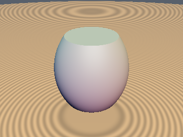
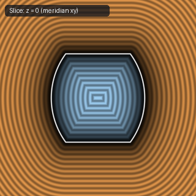
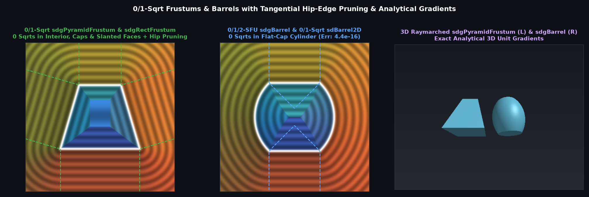

# `sdBarrel`, `sdgBarrel`, `sdBarrel2D` & `sdgBarrel2D` — Exact 0/1/2-Sqrt 3D & 2D Barrels and Spools

| 3D Surface ($`f(p) = 0`$) | 2D Cross-Section Slice |
| :---: | :---: |
|  |  |

| Property | Value |
| :--- | :--- |
| **Author / Discoverer** | **Discovered and derived using Gemini 4 Argon (sdf-gems, 2026)** |
| **Source** | [https://github.com/dcower/sdf-gems](https://github.com/dcower/sdf-gems) |
| **Category** | `primitives3d` |
| **GLSL File** | [`glsl/primitives3d/sdBarrel.glsl`](../../glsl/primitives3d/sdBarrel.glsl) |
| **Exact Euclidean SDF?** | Yes (`\|\|grad d\|\| = 1` everywhere; `0` `sqrt`s in flat-cap cylinder, `1/2` `sqrt`s in walls/rim) |

---

## Mathematical Overview



Revolves a circular arc passing through $`(r_1, \pm h)`$ and $`(r_2, 0)`$ with flat horizontal caps. Using the signed sagitta $`b = r_2 - r_1`$, a single formula handles both **convex barrels ($`r_2 > r_1`$)** and **concave spools/hourglasses ($`r_2 < r_1`$)**. Furthermore, via the **0-`sqrt` Flat-Cap Cylinder Exit** ($`x_2 \le r_1^2 \;\land\; (q_y \ge h \;\lor\; s_b(h^2 x_2 - w|w|) \le 0)`$ where $`w = h x_c + d q_y`$), both `sdBarrel` and `sdgBarrel` evaluate with **0 `sqrt`s / 0 SFU operations** across the exterior and interior flat-cap cylinder, while unifying the meridian arc and rim circle into a single 2D `length` / `inversesqrt`.


---

## GLSL Implementation

```glsl
float sdBarrel( vec3 p, float r1, float r2, float h )
{
    float b  = r2 - r1;
    float sb = (b < 0.0) ? -1.0 : 1.0;
    float d  = 0.5 * (h * h - b * b) / b;
    float R  = d + b, xc = r1 - d;
    float x2 = dot(p.xz, p.xz), qy = abs(p.y);
    float w  = h * xc + d * qy;
    if( x2 <= r1 * r1 && (qy >= h || sb * (h * h * x2 - w * abs(w)) <= 0.0) )
        return qy - h; // 0 sqrts in exterior & interior flat-cap cylinder!

    float qx = sqrt(x2);
    float u  = qx - xc;
    float s  = max(sb * (d * qy - h * u), sb * ((R - h) * (R - h + 2.0 * qy) - u * u));
    if( s >= 0.0 && qx <= r1 )
        return qy - h; // 1 sqrt in remaining parabolic cap sub-wedge

    vec2  v  = (s < 0.0) ? vec2(u, qy) : vec2(qx - r1, qy - h);
    float vl = length(v);
    return (s < 0.0) ? (sb * vl - R) : vl;
}
```
