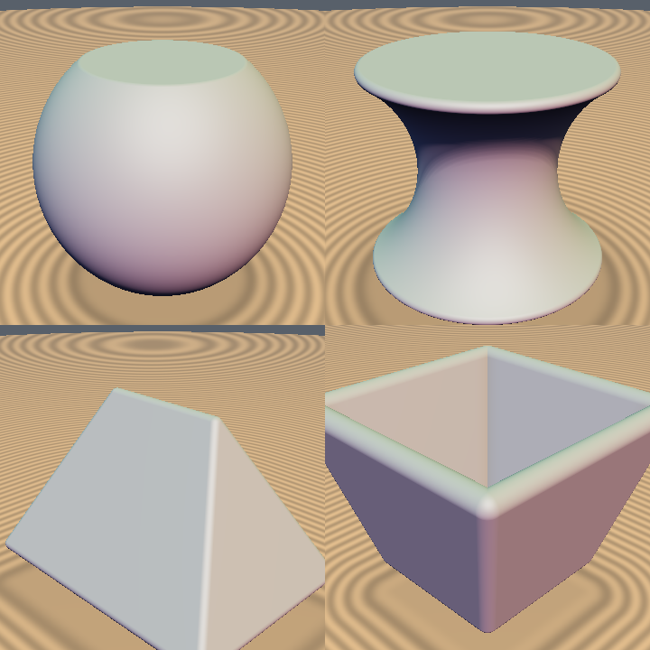

# `sdBarrel` — Exact 3D Convex Barrel & Concave Waisted Spool

| 3D Surface ($f(p) = 0$) | 2D Cross-Section Slice |
| :---: | :---: |
|  |  |

| Property | Value |
| :--- | :--- |
| **Author / Discoverer** | **Dillon Cower (sdf-gems, 2026)** |
| **Source** | [https://github.com/dcower/sdf-gems](https://github.com/dcower/sdf-gems) |
| **Category** | `primitives3d` |
| **GLSL File** | [`glsl/primitives3d/sdBarrel.glsl`](../../glsl/primitives3d/sdBarrel.glsl) |
| **Exact Euclidean SDF?** | Yes (`||grad d|| = 1`) |

---

## Mathematical Overview

Revolves a circular arc passing through $(r_1, \pm h)$ and $(r_2, 0)$ with flat horizontal caps. Using the signed sagitta $b = r_2 - r_1$, a single formula handles both **convex barrels ($r_2 > r_1$)** and **concave spools/hourglasses ($r_2 < r_1$)**.



---

## GLSL Implementation

```glsl
float sdBarrel( vec3 p, float r1, float r2, float h )
{
    float b  = r2 - r1;
    float sb = sign(b);
    float d  = 0.5*(h*h - b*b)/b;
    float R  = d + b;
    vec2  q  = vec2( length(p.xz), abs(p.y) );
    float u  = q.x - (r1 - d);
    float s  = max( sb*(d*q.y - h*u), sb*((R - h)*(R - h + 2.0*q.y) - u*u) );
    return (s < 0.0) ? sb*length(vec2(u, q.y)) - R :
           (q.x < r1) ? q.y - h :
                        length(q - vec2(r1, h));
}
```
