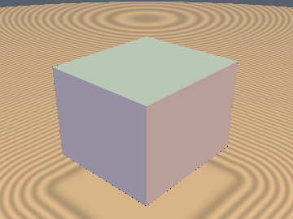
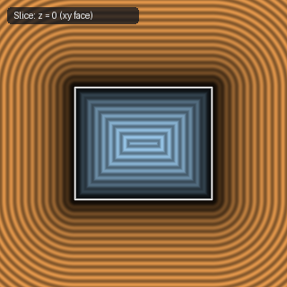
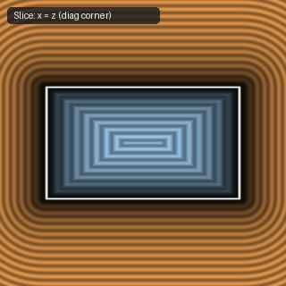

# `sdBox` — Exact 3D Axis-Aligned Box

| 3D Surface ($f(p) = 0$) | Primary 2D Cross-Section | Secondary 2D Cross-Section |
| :---: | :---: | :---: |
|  |  |  |

| Property | Value |
| :--- | :--- |
| **Author / Discoverer** | **Inigo Quilez** |
| **Source** | [https://iquilezles.org/articles/distfunctions/](https://iquilezles.org/articles/distfunctions/) |
| **Category** | `primitives3d` |
| **GLSL File** | [`glsl/primitives3d/sdBox.glsl`](../../glsl/primitives3d/sdBox.glsl) |
| **Exact Euclidean SDF?** | Yes (`||grad d|| = 1`) |

---

## Mathematical Overview

Folds $p$ into the first octant via `abs(p)` and decomposes the distance into the exterior octant cone `length(max(q, 0.0))` and the interior face distance `min(max(q.x, max(q.y, q.z)), 0.0)`.

---

## GLSL Implementation

```glsl
float sdBox( vec3 p, vec3 b )
{
    vec3 q = abs(p) - b;
    return length(max(q, 0.0)) + min(max(q.x, max(q.y, q.z)), 0.0);
}
```
