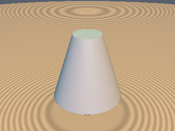
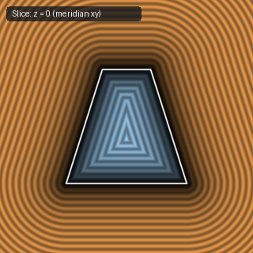

# `sdCappedCone` — Exact 1-to-2 Sqrt 3D Capped Cone via Endpoint Subsumption

| 3D Surface ($f(p) = 0$) | 2D Cross-Section Slice ($z = 0$) |
| :---: | :---: |
|  |  |

| Property | Value |
| :--- | :--- |
| **Author / Discoverer** | **Inigo Quilez — upgraded/optimized using Gemini 4 Argon (sdf-gems, 2026)** |
| **Source** | [https://iquilezles.org/articles/distfunctions/](https://iquilezles.org/articles/distfunctions/) |
| **Category** | `primitives3d` |
| **GLSL File** | [`glsl/primitives3d/sdCappedCone.glsl`](../../glsl/primitives3d/sdCappedCone.glsl) |
| **Exact Euclidean SDF?** | Yes (`||grad d|| = 1`, `1` `sqrt` in flat-cap Voronoi zone & `2` in mantle, down from `2` everywhere) |

---

## Mathematical Overview

Inigo Quilez's `sdCappedCone(p, h, r1, r2)` computes `ca = vec2(q.x - min(q.x, rcap), abs(q.y) - h)` and `cb` (the vector to the slanted mantle segment connecting $(r_1, -h)$ and $(r_2, +h)$), then calls `s * sqrt(min(dot2(ca), dot2(cb)))`.

### Endpoint-Subsumption Theorem
Observe that the outer rim corners of the two horizontal caps — $(r_1, -h)$ and $(r_2, +h)$ — are the **exact endpoints** of the slanted mantle segment $[A, B]$:
- Whenever $q_x > r_{\text{cap}}$ (where $r_{\text{cap}} = (q_y < 0) \; ? \; r_1 : r_2$), the closest point on the horizontal cap is the rim corner $(r_{\text{cap}}, \pm h)$, which is already an endpoint of the mantle segment $[A, B]$. Therefore, $\|\text{cb}\|^2 \le \|\text{ca}\|^2$ holds **identically** whenever $q_x > r_{\text{cap}}$!
- Consequently, the horizontal cap can **only** win when $q_x \le r_{\text{cap}}$ and $(|q_y| - h)^2 \le \|\text{cb}\|^2$, in which case $\text{ca}_x \equiv 0$ and the signed distance to the horizontal cap is simply the linear expression $c_y = |q_y| - h$ (**0 additional `sqrt`s**, saving the second `sqrt` across the entire top and bottom cap Voronoi regions and eliminating `ca.x`).

---

## GLSL Implementation

```glsl
float sdCappedCone( vec3 p, float h, float r1, float r2 )
{
    vec2  q  = vec2(length(p.xz), p.y);
    vec2  k1 = vec2(r2, h);
    vec2  k2 = vec2(r2 - r1, 2.0 * h);
    float rc = (q.y < 0.0) ? r1 : r2;
    float cy = abs(q.y) - h;
    vec2  cb = q - k1 + k2 * clamp(dot(k1 - q, k2) / dot2(k2), 0.0, 1.0);
    float b2 = dot2(cb);
    if( q.x <= rc && cy * cy <= b2 ) return cy;
    return ((cb.x < 0.0 && cy < 0.0) ? -1.0 : 1.0) * sqrt(b2);
}
```
