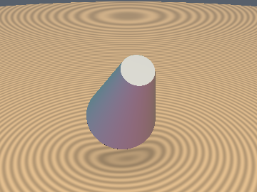
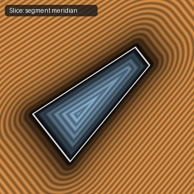

# `sdCappedConeSeg` — Exact 3D Arbitrary-Segment Capped Cone

| 3D Surface ($f(p) = 0$) | 2D Cross-Section Slice |
| :---: | :---: |
|  |  |

| Property | Value |
| :--- | :--- |
| **Author / Discoverer** | **Inigo Quilez** |
| **Source** | [https://iquilezles.org/articles/distfunctions/](https://iquilezles.org/articles/distfunctions/) |
| **Category** | `primitives3d` |
| **GLSL File** | [`glsl/primitives3d/sdCappedConeSeg.glsl`](../../glsl/primitives3d/sdCappedConeSeg.glsl) |
| **Exact Euclidean SDF?** | Yes |

---

## Mathematical Overview

Computes the exact Euclidean distance to a conical frustum between endpoints $a$ and $b$ with radii $r_a, r_b$.

---

## GLSL Implementation

```glsl
float sdCappedConeSeg( vec3 p, vec3 a, vec3 b, float ra, float rb )
{
    float rba  = rb - ra;
    float baba = dot(b - a, b - a);
    float papa = dot(p - a, p - a);
    float paba = dot(p - a, b - a)/baba;
    float x = sqrt( papa - paba*paba*baba );
    float cax = max(0.0, x - ((paba < 0.5) ? ra : rb));
    float cay = abs(paba - 0.5) - 0.5;
    float k = rba*rba + baba;
    float f = clamp( (rba*(x - ra) + paba*baba)/k, 0.0, 1.0 );
    float cbx = x - ra - f*rba;
    float cby = paba - f;
    float s = (cbx < 0.0 && cay < 0.0) ? -1.0 : 1.0;
    return s*sqrt( min(cax*cax + cay*cay*baba, cbx*cbx + cby*cby*baba) );
}
```
