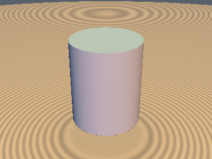
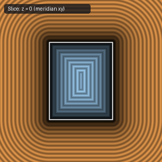

# `sdCappedCylinder` — 0/1/2-Sqrt Exact 3D Vertical Capped Cylinder

| 3D Surface ($`f(p) = 0`$) | 2D Cross-Section Slice |
| :---: | :---: |
|  |  |

| Property | Value |
| :--- | :--- |
| **Author / Discoverer** | **Inigo Quilez — upgraded to 0/1/2 `sqrt`s via Cap-Voronoi Radius Theorem using Gemini 4 Argon (sdf-gems, 2026)** |
| **Source** | [https://iquilezles.org/articles/distfunctions/](https://iquilezles.org/articles/distfunctions/) |
| **Category** | `primitives3d` |
| **GLSL File** | [`glsl/primitives3d/sdCappedCylinder.glsl`](../../glsl/primitives3d/sdCappedCylinder.glsl) |
| **Exact Euclidean SDF?** | Yes (`\|\|grad d\|\| = 1`, `0` `sqrt`s in cap zones, `1` in wall zone, `2` in rim wedge) |

---

## Mathematical Overview

By the **Unified Cap-Voronoi Radius Theorem**, let $`r_2 = p_x^2 + p_z^2`$, $`w_y = |p_y| - h`$, and $`r_c = r + \min(w_y, 0)`$. Across all of $`\mathbb{R}^3`$ (both exterior $`w_y \ge 0`$ and interior $`w_y < 0`$), $`p`$ lies in the flat-cap Voronoi zone if and only if $`r_c \ge 0 \land r_2 \le r_c^2`$, where the exact signed distance is $`w_y`$ with **0 `sqrt`s**. Outside this zone, if $`w_y \le 0`$ (cylindrical wall Voronoi zone), the exact signed distance is $`\sqrt{r_2} - r`$ (**1 `sqrt`**); only the exterior circular rim wedge ($`w_y > 0 \land r_2 > r^2`$) requires **2 `sqrt`s**.

---

## GLSL Implementation

```glsl
float sdCappedCylinder( vec3 p, float h, float r )
{
    float r2 = dot(p.xz, p.xz), wy = abs(p.y) - h, rc = r + min(wy, 0.0);
    if( rc >= 0.0 && r2 <= rc * rc ) return wy;
    float wx = sqrt(r2) - r;
    return (wy <= 0.0) ? wx : sqrt(wx * wx + wy * wy);
}
```
