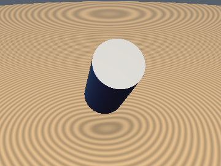
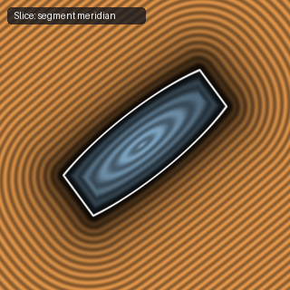

# `sdCappedCylinderSeg` — Exact 3D Arbitrary-Segment Capped Cylinder

| 3D Surface ($f(p) = 0$) | 2D Cross-Section Slice |
| :---: | :---: |
|  |  |

| Property | Value |
| :--- | :--- |
| **Author / Discoverer** | **Inigo Quilez** |
| **Source** | [https://iquilezles.org/articles/distfunctions/](https://iquilezles.org/articles/distfunctions/) |
| **Category** | `primitives3d` |
| **GLSL File** | [`glsl/primitives3d/sdCappedCylinderSeg.glsl`](../../glsl/primitives3d/sdCappedCylinderSeg.glsl) |
| **Exact Euclidean SDF?** | Yes |

---

## Mathematical Overview

Computes the exact Euclidean distance to a cylinder between endpoints $a$ and $b$ of radius $r$.

---

## GLSL Implementation

```glsl
float sdCappedCylinderSeg( vec3 p, vec3 a, vec3 b, float r )
{
    vec3  ba = b - a;
    vec3  pa = p - a;
    float baba = dot(ba,ba);
    float paba = dot(pa,ba);
    float x = length(pa*baba - ba*paba) - r*baba;
    float y = abs(paba - baba*0.5) - baba*0.5;
    float x2 = x*x;
    float y2 = y*y*baba;
    float d = (max(x,y) < 0.0) ? -min(x2,y2) : (((x > 0.0) ? x2 : 0.0) + ((y > 0.0) ? y2 : 0.0));
    return sign(d)*sqrt(abs(d))/baba;
}
```
