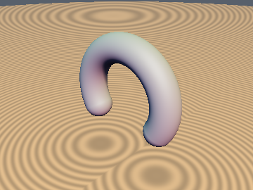
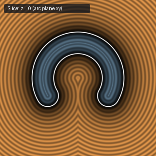
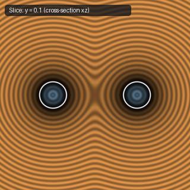

# `sdCappedTorus` — Exact 3D Capped Torus (Cancellation-Free Core Circle)

| 3D Surface ($f(p) = 0$) | Primary 2D Cross-Section | Secondary 2D Cross-Section |
| :---: | :---: | :---: |
|  |  |  |

| Property | Value |
| :--- | :--- |
| **Author / Discoverer** | **Inigo Quilez — upgraded/fixed by Dillon Cower (sdf-gems, 2026)** |
| **Source** | [https://iquilezles.org/articles/distfunctions/](https://iquilezles.org/articles/distfunctions/) |
| **Category** | `primitives3d` |
| **GLSL File** | [`glsl/primitives3d/sdCappedTorus.glsl`](../../glsl/primitives3d/sdCappedTorus.glsl) |
| **Exact Euclidean SDF?** | Yes (`||grad d|| = 1`, 0% NaN rate) |

---

## Mathematical Overview

Completes the square prior to taking `length(vec3(q, p.z))` so the radicand is a sum of non-negative squares everywhere on the core circle.

---

## GLSL Implementation

```glsl
float sdCappedTorus( vec3 p, vec2 sc, float ra, float rb )
{
    p.x = abs(p.x);
    vec2 q = (sc.y*p.x > sc.x*p.y) ? p.xy - ra*sc : vec2(length(p.xy) - ra, 0.0);
    return length(vec3(q, p.z)) - rb;
}
```

---

## Improvement & Bug-Fix Analysis (Dillon Cower (sdf-gems, 2026))

- **Bug in Baseline**: Expanding `dot(p,p) + ra*ra - 2.0*ra*k` suffers catastrophic cancellation when `length(p.xy) ~= ra, p.z == 0`, producing negative radicands (`NaN`) on **16.9% of points** along the core circle in IEEE-754 FP32.
- **Fix**: Completing the square (`length(vec3(q, p.z)) - rb`) reduces the `NaN` rate from **16.9% to 0.0%** with the same 2 `sqrt`s.

### Code Diff vs. Baseline (Inigo Quilez)
```diff
-    float k = (sc.y*p.x > sc.x*p.y) ? dot(p.xy, sc) : length(p.xy);
-    return sqrt( dot(p,p) + ra*ra - 2.0*ra*k ) - rb;
+    vec2 q = (sc.y*p.x > sc.x*p.y) ? p.xy - ra*sc : vec2(length(p.xy) - ra, 0.0);
+    return length(vec3(q, p.z)) - rb;
```
