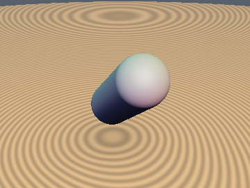
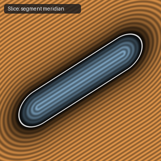

# `sdCapsule` — Exact 3D Capsule / Swept Sphere

| 3D Surface ($f(p) = 0$) | 2D Cross-Section Slice |
| :---: | :---: |
|  |  |

| Property | Value |
| :--- | :--- |
| **Author / Discoverer** | **Inigo Quilez** |
| **Source** | [https://iquilezles.org/articles/distfunctions/](https://iquilezles.org/articles/distfunctions/) |
| **Category** | `primitives3d` |
| **GLSL File** | [`glsl/primitives3d/sdCapsule.glsl`](../../glsl/primitives3d/sdCapsule.glsl) |
| **Exact Euclidean SDF?** | Yes (`||grad d|| = 1`) |

---

## Mathematical Overview

Projects $p$ onto the line segment $[a, b]$ and subtracts radius $r$ in a single `sqrt`.

---

## GLSL Implementation

```glsl
float sdCapsule( vec3 p, vec3 a, vec3 b, float r )
{
    vec3 pa = p - a, ba = b - a;
    float h = clamp( dot(pa,ba)/dot(ba,ba), 0.0, 1.0 );
    return length( pa - ba*h ) - r;
}
```
