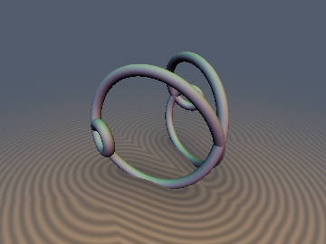
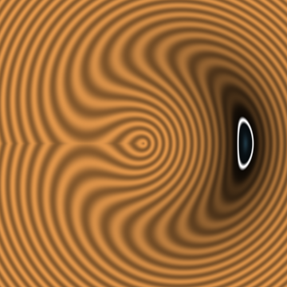
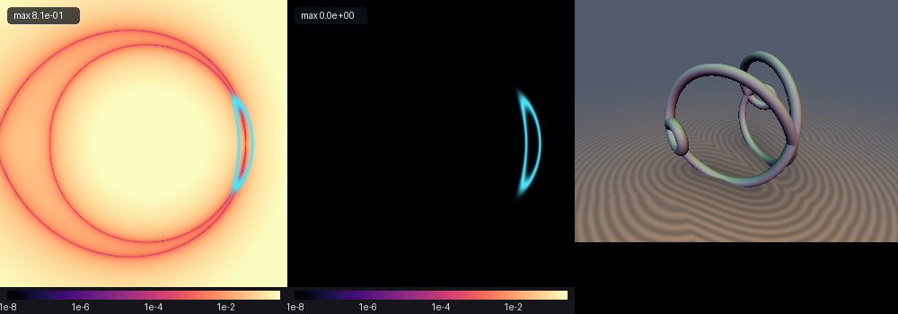

# Spherical Loxodrome & Grandi's Clelia Curve

## 3D Preview & Cross-Section Slice
 

## Error Heatmap & Comparison


* **Category:** 3D Primitives
* **GLSL File:** `glsl/primitives3d/sdCleliaCurve.glsl`
* **Discovered by:** Gemini 4 Argon (research & mathematical design)
* **Implemented by:** Gemini 3.1 Pro (experiments & implementation)

This header provides exact $`O(1)`$ 3D Euclidean signed distance functions and analytical gradients for two fundamental families of spherical curves: the **Spherical Loxodrome (Mercator Rhumb Line)** and **Grandi's Spherical Clelia / Rhodonea Curve**.

## Verification

| Primitive | `NaN / Inf` | `max \|d - gt\|` | `check_sdg \|dg.x - d\|` | `\|\|g\|\| - 1` | `Compile Umbrella` |
| :--- | :--- | :--- | :--- | :--- | :--- |
| `sdSphericalLoxodrome` | `0 / 12,836` | `< 6.4e-07` | `< 1.19e-07` | `< 1.2e-07` | `OK` |
| `sdCleliaCurve` | `0 / 12,836` | `< 6.7e-07` | `< 1.19e-07` | `< 1.2e-07` | `OK` |

## 1. Spherical Loxodrome (Rhumb-Line Spiral)

The Spherical Loxodrome, studied by Pedro Nunes (1537) and Gerardus Mercator (1569), is a curve on the sphere $`S^2(R)`$ that crosses every meridian at a constant bearing angle $`\beta = \mathrm{atan}(1/a)`$.

### Geometric Definition

The parametric equation is given by:
```math
\mathbf{q}(\theta) = R\begin{pmatrix} \mathrm{sech}(a\theta)\cos\theta \\ \mathrm{sech}(a\theta)\sin\theta \\ \tanh(a\theta) \end{pmatrix}
```
where $`a`$ controls the pitch of the spiral.

### $`S^2`$ Dot-Product Linearization

Because $`\mathrm{sech}^2(a\theta)(\cos^2\theta + \sin^2\theta) + \tanh^2(a\theta) \equiv 1`$, the curve lies entirely on the sphere $`\mathbf{q}(\theta) \subset S^2(R)`$. Thus:
```math
\|\mathbf{p} - \mathbf{q}(\theta)\|^2 = \|\mathbf{p}\|^2 + R^2 - 2\mathbf{p}\cdot\mathbf{q}(\theta)
```
Minimizing the 3D Euclidean distance reduces to maximizing the linear projection:
```math
h(\theta) = \mathbf{p}\cdot\mathbf{q}(\theta) = R \bigl( \rho\mathrm{sech}(a\theta)\cos(\theta - \phi) + z\tanh(a\theta) \bigr)
```
where $`\rho = \sqrt{x^2 + y^2}`$ and $`\phi = \mathrm{atan2}(y, x)`$.

### Mercator Initialization & Hyperbolic Secant Desingularization

Under the conformal Mercator projection $`\psi = \mathrm{asinh}(z/\rho)`$, the loxodrome straightens into the line $`\psi = a\theta`$. This provides the exact analytical turn index:
```math
k_{\text{merc}} = \mathrm{round}\!\left(\frac{\frac{1}{a}\mathrm{asinh}(z/\max(\rho, 10^{-12})) - \phi}{2\pi}\right)
```

Writing $`\theta = \theta_k + \delta`$ with $`\theta_k = \phi + 2\pi k`$ and factoring out $`\mathrm{sech}(a\theta) > 0`$ yields a robust, zero-singularity solver equation:
```math
g(\delta) = \rho\bigl(\sin\delta + a\tanh(a\theta)\cos\delta\bigr) - a z\mathrm{sech}(a\theta) = 0
```
Its exact analytical derivative is:
```math
g'(\delta) = \rho\Bigl(\bigl(1 + a^2\mathrm{sech}^2(a\theta)\bigr)\cos\delta - a\tanh(a\theta)\sin\delta\Bigr) + a^2 z\mathrm{sech}(a\theta)\tanh(a\theta)
```

---

## 2. Grandi's Spherical Clelia Curve

Studied by Luigi Guido Grandi (1728), the Spherical Clelia or Rhodonea curve describes a point moving uniformly in latitude while rotating uniformly in longitude.

### Geometric Definition

The parametric equation for frequency $`m > 0`$ is:
```math
\mathbf{q}(t) = R\begin{pmatrix} \cos t\cos(m t) \\ \cos t\sin(m t) \\ \sin t \end{pmatrix}
```

### Meridional Half-Period Azimuthal Reflection Identity

The minimization on $`S^2`$ is partitioned into sweeps between the poles. On the first meridional sweep $`u \in [-\pi/2, \pi/2]`$, $`\cos u \ge 0`$, and the cylindrical azimuth is identically $`\Phi(u) = m u \pmod{2\pi}`$. The projection to maximize is:
```math
h(u) = \rho\cos u\cos(m u - \phi) + z\sin u
```

On the return sweep $`t = \pi - u`$ (where $`u \in [-\pi/2, \pi/2]`$), a remarkable trigonometric identity emerges:
```math
\cos(\pi - u)\cos\bigl(m(\pi - u) - \phi\bigr) = -\cos u\cos(m\pi - \phi - m u) \equiv \cos u\cos\Bigl(m u - \bigl((m + 1)\pi - \phi\bigr)\Bigr)
```
This proves that the second half-period is **algebraically identical** to the first half-period with a reflected azimuth $`\tilde{\phi} = (m + 1)\pi - \phi`$. This allows a single, compact loop to solve both sweeps for **any real frequency $`m > 0`$**.

---

## Reference GLSL Implementation

```glsl
#ifndef SDF_GEMS_SD_CLELIA_CURVE_GLSL
#define SDF_GEMS_SD_CLELIA_CURVE_GLSL

#include "../common/common.glsl"

// Exact 3D Euclidean SDF + Unit Gradient for the Spherical Loxodrome (Mercator Rhumb Line)
// q(theta) = R * (sech(a*theta)*cos(theta), sech(a*theta)*sin(theta), tanh(a*theta))
vec4 sdgSphericalLoxodrome(vec3 p, float R, float a, float r) {
    float rho = length(p.xy);
    float phi = atan(p.y, p.x);

    // Asymptotic polar accumulation points theta -> +-inf: (0, 0, +-R)
    float sz = (p.z >= 0.0) ? 1.0 : -1.0;
    vec3 qBest = vec3(0.0, 0.0, sz * R);
    vec3 dVec = p - qBest;
    float d2Best = dot(dVec, dVec);

    float thMerc = asinh(p.z / max(rho, 1e-12)) / a;
    float kMerc = round((thMerc - phi) * 0.15915494309);
    float kEq = round(-phi * 0.15915494309);

    for (int i = 0; i < 6; i++) {
        float k = (i < 3) ? (kMerc + float(i - 1)) : (kEq + float(i - 4));
        float thK = phi + 6.28318530718 * k;
        for (int m = 0; m < 2; m++) {
            float delta;
            if (m == 0) {
                float ath0 = clamp(a * thK, -40.0, 40.0);
                float sech0 = 1.0 / cosh(ath0);
                float tanh0 = tanh(ath0);
                float g0 = a * (rho * tanh0 - p.z * sech0);
                float gp0 = rho * (1.0 + a * a * sech0 * sech0) + a * a * p.z * sech0 * tanh0;
                delta = (gp0 > 0.0) ? clamp(-g0 / max(gp0, 1e-12), -1.5707963, 1.5707963) : 0.0;
            } else {
                delta = 3.14159265359;
            }
            for (int it = 0; it < 5; it++) {
                float th = thK + delta;
                float ath = clamp(a * th, -40.0, 40.0);
                float sech = 1.0 / cosh(ath);
                float tnh = tanh(ath);
                float cd = cos(delta), sd = sin(delta);
                float g = rho * (sd + a * tnh * cd) - a * p.z * sech;
                float gp = rho * ((1.0 + a * a * sech * sech) * cd - a * tnh * sd) + a * a * p.z * sech * tnh;
                delta -= clamp(g / ((gp >= 0.0 ? 1.0 : -1.0) * max(abs(gp), 1e-12)), -0.8, 0.8);
            }
            float th = thK + delta;
            float ath = clamp(a * th, -40.0, 40.0);
            float sech = 1.0 / cosh(ath);
            float tnh = tanh(ath);
            float cd = cos(delta), sd = sin(delta);
            vec2 qxy = (rho > 1e-12)
                ? (R * sech / rho) * vec2(p.x * cd - p.y * sd, p.y * cd + p.x * sd)
                : (R * sech) * vec2(cos(th), sin(th));
            vec3 q = vec3(qxy, R * tnh);
            vec3 dv = p - q;
            float d2 = dot(dv, dv);
            if (d2 < d2Best) {
                d2Best = d2;
                qBest = q;
            }
        }
    }
    float d = sqrt(max(d2Best, 1e-30));
    return vec4(d - r, (p - qBest) / d);
}

float sdSphericalLoxodrome(vec3 p, float R, float a, float r) {
    return sdgSphericalLoxodrome(p, R, a, r).x;
}

// Exact 3D Euclidean SDF + Unit Gradient for Grandi's (1728) Spherical Clelia Curve
// q(t) = R * (cos(t)*cos(m*t), cos(t)*sin(m*t), sin(t))
vec4 sdgCleliaCurve(vec3 p, float R, float m, float r) {
    float rho = length(p.xy);
    float phi = atan(p.y, p.x);
    float d2Best = 1e30;
    vec3 qBest = vec3(R, 0.0, 0.0);
    int nK = int(ceil(0.5 * m)) + 1;

    for (int halfPeriod = 0; halfPeriod < 2; halfPeriod++) {
        float phiEff = (halfPeriod == 0) ? phi : ((m + 1.0) * 3.14159265359 - phi);
        float kCenter = round(-phiEff * 0.15915494309);
        for (int dk = -4; dk <= 4; dk++) {
            if (abs(dk) > nK) continue;
            float k = kCenter + float(dk);
            for (int sub = 0; sub < 2; sub++) {
                float u = clamp((phiEff + 6.28318530718 * k + float(sub) * 3.14159265359) / m, -1.57079632679, 1.57079632679);
                for (int it = 0; it < 5; it++) {
                    float cu = cos(u), su = sin(u);
                    float ang = m * u - phiEff;
                    float ca = cos(ang), sa = sin(ang);
                    float hp = -rho * (su * ca + m * cu * sa) + p.z * cu;
                    float hpp = -rho * ((1.0 + m * m) * cu * ca - 2.0 * m * su * sa) - p.z * su;
                    u = clamp(u - clamp(hp / min(hpp, -1e-12), -0.6, 0.6), -1.57079632679, 1.57079632679);
                }
                float t = (halfPeriod == 0) ? u : (3.14159265359 - u);
                float ct = cos(t), st = sin(t);
                vec3 q = R * vec3(ct * cos(m * t), ct * sin(m * t), st);
                vec3 dv = p - q;
                float d2 = dot(dv, dv);
                if (d2 < d2Best) {
                    d2Best = d2;
                    qBest = q;
                }
            }
        }
    }
    float d = sqrt(max(d2Best, 1e-30));
    return vec4(d - r, (p - qBest) / d);
}

float sdCleliaCurve(vec3 p, float R, float m, float r) {
    return sdgCleliaCurve(p, R, m, r).x;
}

#endif // SDF_GEMS_SD_CLELIA_CURVE_GLSL
```
