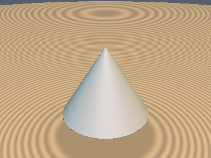
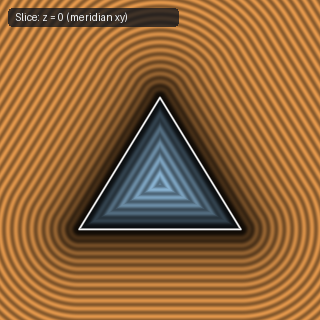

# `sdCone` — Exact 3D Cone

| 3D Surface ($f(p) = 0$) | 2D Cross-Section Slice |
| :---: | :---: |
|  |  |

| Property | Value |
| :--- | :--- |
| **Author / Discoverer** | **Inigo Quilez** |
| **Source** | [https://iquilezles.org/articles/distfunctions/](https://iquilezles.org/articles/distfunctions/) |
| **Category** | `primitives3d` |
| **GLSL File** | [`glsl/primitives3d/sdCone.glsl`](../../glsl/primitives3d/sdCone.glsl) |
| **Exact Euclidean SDF?** | Yes (`||grad d|| = 1`) |

---

## Mathematical Overview

Projects the radial 2D coordinates $(\|p_{xz}\|, p_y)$ onto the cone's slanted generatrix and circular base.

---

## GLSL Implementation

```glsl
float sdCone( vec3 p, vec2 c, float h )
{
    vec2 q = h*vec2(c.x/c.y, -1.0);
    vec2 w = vec2( length(p.xz), p.y );
    vec2 a = w - q*clamp( dot(w,q)/dot(q,q), 0.0, 1.0 );
    vec2 b = w - q*vec2( clamp( w.x/q.x, 0.0, 1.0 ), 1.0 );
    float k = sign( q.y );
    float d = min(dot( a, a ), dot(b, b));
    float s = max( k*(w.x*q.y - w.y*q.x), k*(w.y - q.y) );
    return sqrt(d)*sign(s);
}
```
