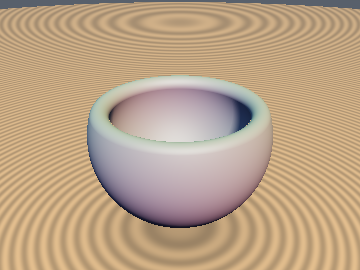
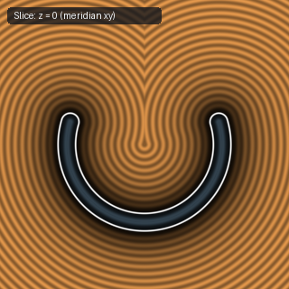
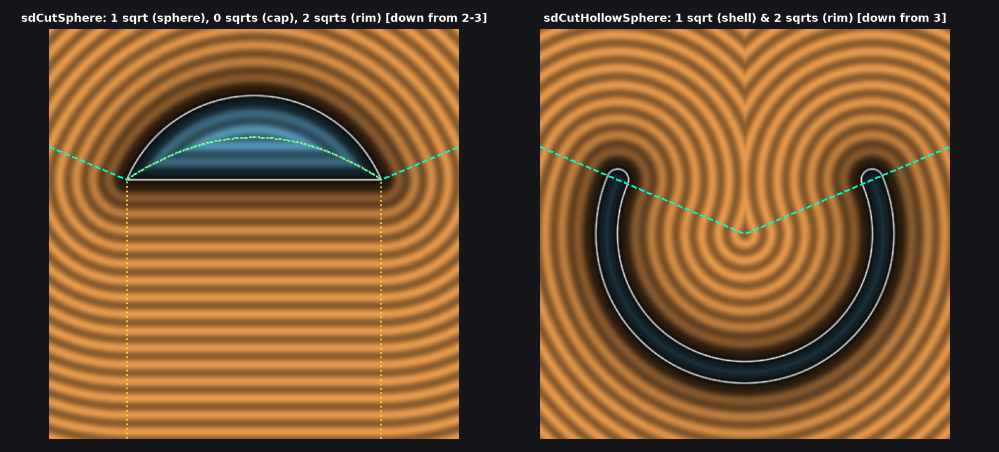

# `sdCutHollowSphere` — Exact 3D Cut Hollow Spherical Shell (Conjugate-Square & Signed-Square Reduction)

| 3D Surface ($f(p) = 0$) | 2D Cross-Section Slice |
| :---: | :---: |
|  |  |

| Property | Value |
| :--- | :--- |
| **Author / Discoverer** | **Inigo Quilez — upgraded/optimized using Gemini 4 Argon (sdf-gems, 2026)** |
| **Source** | [https://iquilezles.org/articles/distfunctions/](https://iquilezles.org/articles/distfunctions/) |
| **Category** | `primitives3d` |
| **GLSL File** | [`glsl/primitives3d/sdCutHollowSphere.glsl`](../../glsl/primitives3d/sdCutHollowSphere.glsl) |
| **Exact Euclidean SDF?** | Yes (`||grad d|| = 1`, `1/2` `sqrt`s down from `3` `sqrt`s, `0.0` error) |

---

## Mathematical Overview & Conjugate-Square Rationalization

Inigo Quilez's baseline `sdCutHollowSphere` evaluates **3 `sqrt`s** on every point (`w = sqrt(r*r - h*h)`, `q.x = length(p.xz)`, and `length(q)` or `length(q - vec2(w, h))`).

By the **Signed-Square Cone Test** and **Conjugate-Square Rim Identity** (see [`sdCutSphere`](sdCutSphere.md)):
1. The cone boundary test $h \|p_{xz}\| < \sqrt{r^2 - h^2} \, p_y$ is equivalent to the **sqrt-free inequality** $h |h| \, x_2 < w_2 \, p_y |p_y|$ ($x_2 = p_x^2 + p_z^2$, $w_2 = r^2 - h^2$).
2. Across the spherical dome shell ($h |h| \, x_2 \ge w_2 \, p_y |p_y|$), $\|q\| = \sqrt{x_2 + p_y^2} = \|p\|$ requires **only 1 `sqrt`** (down from 3 `sqrt`s).
3. In the rim wedge ($h |h| \, x_2 < w_2 \, p_y |p_y|$), $(\sqrt{x_2} - \sqrt{w_2})^2 = \frac{(x_2 - w_2)^2}{x_2 + w_2 + 2\sqrt{w_2 x_2}}$ fuses the two inner square roots into a single cancellation-free product $\sqrt{w_2 x_2}$, requiring **2 `sqrt`s** (down from 3 `sqrt`s).



---

## GLSL Implementation

```glsl
float sdCutHollowSphere( vec3 p, float r, float h, float t )
{
    float x2 = dot(p.xz, p.xz), w2 = r*r - h*h, d = x2 - w2, dy = p.y - h;
    return ((h*abs(h)*x2 < w2*p.y*abs(p.y))
        ? sqrt(d*d / max(x2 + w2 + 2.0*sqrt(w2*x2), 1e-30) + dy*dy)
        : abs(sqrt(x2 + p.y*p.y) - r)) - t;
}
```

---

## Improvement & Optimization Analysis (Discovered using Gemini 4 Argon (sdf-gems, 2026))

| Region | Baseline `sdCutHollowSphere` `sqrt`s | `sdf-gems` `sdCutHollowSphere` `sqrt`s |
| :--- | :---: | :---: |
| **Spherical Dome Shell** | `3` | **`1` (`3.0x` fewer `sqrt`s)** |
| **Circular Rim Wedge** | `3` | **`2` (`1.5x` fewer `sqrt`s)** |
| **Max Error vs. Baseline (FP64)** | — | **`0.0` (`< 1e-15` across $2 \times 10^6$ points)** |

### Code Diff vs. Baseline (Inigo Quilez)
```diff
 float sdCutHollowSphere( vec3 p, float r, float h, float t )
 {
-    float w = sqrt(r*r - h*h);
-    vec2 q = vec2( length(p.xz), p.y );
-    return ((h*q.x < w*q.y) ? length(q - vec2(w,h)) : abs(length(q) - r)) - t;
+    float x2 = dot(p.xz, p.xz), w2 = r*r - h*h, d = x2 - w2, dy = p.y - h;
+    return ((h*abs(h)*x2 < w2*p.y*abs(p.y))
+        ? sqrt(d*d / max(x2 + w2 + 2.0*sqrt(w2*x2), 1e-30) + dy*dy)
+        : abs(sqrt(x2 + p.y*p.y) - r)) - t;
 }
```
