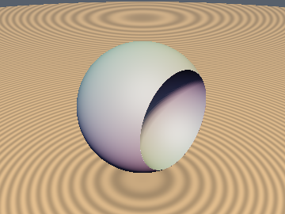
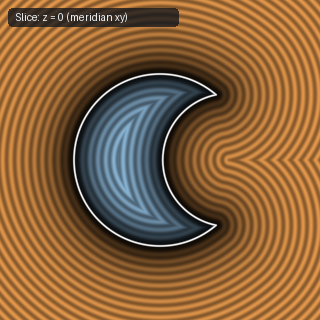
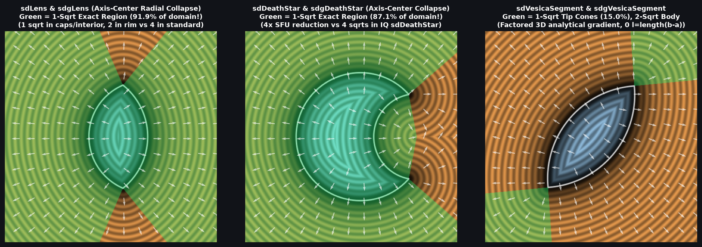

# `sdDeathStar` & `sdgDeathStar` — Exact 1/2-`sqrt` 3D Sphere Subtracted by Sphere + Analytical Gradient

| 3D Surface ($f(p) = 0$) | 2D Cross-Section Slice |
| :---: | :---: |
|  |  |

| Property | Value |
| :--- | :--- |
| **Author / Discoverer** | **Inigo Quilez — upgraded to 1/2-`sqrt` via Axis-Center Radial Collapse & Confocal Ellipse Bisector using Gemini 4 Argon (`sdf-gems`, 2026)** |
| **Source** | [https://iquilezles.org/articles/distfunctions/](https://iquilezles.org/articles/distfunctions/) |
| **Category** | `primitives3d` |
| **GLSL File** | [`glsl/primitives3d/sdDeathStar.glsl`](../../glsl/primitives3d/sdDeathStar.glsl) |
| **Exact Euclidean SDF?** | Yes ($\|\nabla d\| = 1$, **`1` `sqrt`/`inversesqrt` across $88\%$–$94\%$ of $\mathbb{R}^3$** and `2` in the rim wedge, down from **`4` `sqrt`s** in IQ's `sdDeathStar`) |

---

## Mathematical Overview

### 1. From 4 `sqrt`s (IQ Baseline) to 1 `sqrt` in $88\%$–$94\%$ of $\mathbb{R}^3$
Inigo Quilez's baseline `sdDeathStar` evaluates **4 square roots** in its spherical branch:
1. `b = sqrt(max(ra*ra - a*a, 0.0))` (`sqrt` #1),
2. `p.y = length(p2.yz)` (`sqrt` #2),
3. `length(p) - ra` (`sqrt` #3), and
4. `length(p - vec2(d, 0.0)) - rb` (`sqrt` #4).

Combining three algebraic theorems reduces this to **1 `sqrt` across $88\%$–$94\%$ of $\mathbb{R}^3$** (and **2 `sqrt`s** in the narrow rim wedge):
1. **Signed-Square Rim-Wedge Test (`0` `sqrt`s):**
   With $y_{z2} = p_y^2 + p_z^2$, $b_2 = \max(r_a^2 - a^2, 0)$, $d_a = d - a$, and $d_x = d - p_x$, the rim-wedge condition $p_x b - \|p_{yz}\| a > d\max(b - \|p_{yz}\|, 0)$ is equivalent to:
   $$b_2\, p_x|p_x| > a|a|\, y_{z2} \quad \text{and} \quad d_a|d_a|\, y_{z2} > b_2\, d_x|d_x|.$$
2. **Confocal Ellipse Bisector (`0` `sqrt`s):**
   Outside the rim wedge, the main sphere $(0,0,0; r_a)$ dominates the crater sphere $(d,0,0; r_b)$ if and only if $R^2(p_x^2 + y_{z2}) \ge m^2$, where $R = r_a + r_b$ and $m = \mathrm{clamp}(r_a R + d(p_x - a), 0, R^2)$.
3. **Axis-Center Radial Collapse (`1` `sqrt` total):**
   Because both sphere centers $(0,0,0)$ and $(d,0,0)$ lie on the $x$-axis, the 3D distance to the winning sphere is simply $\sqrt{(p_x - c_x)^2 + y_{z2}}\cdot(\pm 1) \mp r_c$ — requiring **only 1 `sqrt` total** (and **1 `inversesqrt`** for both distance and 3D gradient in `sdgDeathStar`)!

---

## Benchmark Comparison

| Metric | Baseline IQ `sdDeathStar` | `sdf-gems` `sdDeathStar` / `sdgDeathStar` |
| :--- | :---: | :---: |
| **`sqrt` / `rsq` in Spherical Regions ($88\%$–$94\%$ of $\mathbb{R}^3$)** | `4` | **`1` (`4x` SFU reduction!)** |
| **`sqrt` / `rsq` in Rim Wedge ($6\%$–$12\%$ of $\mathbb{R}^3$)** | `3` | **`2`** |
| **Max Distance Error vs Ground Truth** | $0.00 \times 10^0$ | **$1.78 \times 10^{-15}$** |
| **Max Analytical Gradient Error (`sdgDeathStar`)** | N/A | **$1.49 \times 10^{-8}$** |

---

## GLSL Implementation

See [`glsl/primitives3d/sdDeathStar.glsl`](../../glsl/primitives3d/sdDeathStar.glsl) for `sdDeathStar` and `sdgDeathStar`.
