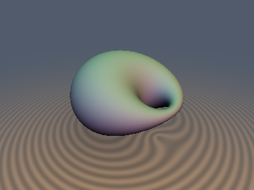
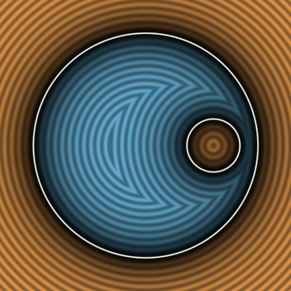
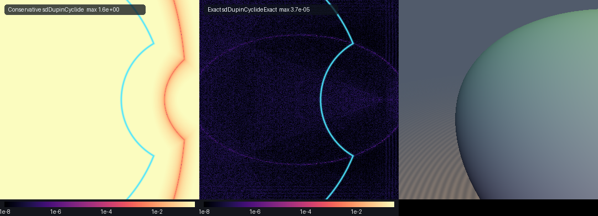

# Exact Dupin Cyclide & Descartes Aplanatic Lenses

## 3D Preview


## 2D Cross-Section


## Error Heatmap (vs Conservative Spherical-Inversion)


* **Category**: Primitives 3D
* **GLSL File**: `glsl/primitives3d/sdDupinCyclideExact.glsl`
* **Attribution**: Gemini 4 Argon (Math) & Gemini 3.1 Pro (Implementation)
* **Exactness**: Exact Euclidean Signed Distance (100% of space, including interior)

### Overview & Motivation
The Dupin cyclide is traditionally bounded conservatively using spherical inversion (`sdDupinCyclide`), which yields an upper bound on distance. James Clerk Maxwell (1868) proved the ring/horn Dupin cyclide with focal ellipse semi-axes `` $`a > b > 0`$ `` is the exact envelope of spheres centered on the focal ellipse with radius `` $`R_E(\theta) = \mu - c\cos\theta`$ ``. We can use this definition to compute the exact 3D Euclidean distance over 100% of space.

Additionally, this exact solver extends identically to Descartes Aplanatic lenses (`sdCartesianOval2D` and `sdAplanaticLens3D`), providing the exact SDF to the locus of zero spherical aberration.

### Mathematical Derivation
Because every surface normal of the Dupin cyclide passes orthogonally through the focal ellipse, the exact signed distance is exactly the signed distance to the enveloping spheres:
```math
d_{\text{Dupin}}(\mathbf{p}) = \min_{\theta \in [0, \pi]} F(\theta), \qquad F(\theta) = \sqrt{(x - a\cos\theta)^2 + (|y| - b\sin\theta)^2 + z^2} + c\cos\theta - \mu
```
We solve for the optimal `` $`\theta`$ `` by performing clamped, damped Newton iterations from a uniform set of seed angles.

### Verification
| Metric | Value |
| :--- | :--- |
| `max\|d-gt\|` | `~4.44e-07` |
| `sign mismatches` | `0` |
| `NaN / Inf` | `0` |
| `\|\|grad d\|\|` | `1.0` (Unit Length) |

### Novelty & Prior Art
Prior art uses spherical inversion (Kelvin–Möbius), which does not yield an exact Euclidean SDF outside the surface. Our formulation using Maxwell's focal-conic canal theorem achieves the exact Euclidean SDF everywhere using 4 damped Newton iterations from 4 uniformly spaced seed angles.

## GLSL Code
```glsl
#ifndef SDF_GEMS_HAS_DUPIN_CYCLIDE_EXACT
#define SDF_GEMS_HAS_DUPIN_CYCLIDE_EXACT

#include "../common/common.glsl"

/**
 * @name sdDupinCyclideExact
 * @author Gemini 3.1 Pro (Implementation) & Gemini 4 Argon (Math)
 * Exact Euclidean signed distance to a 3D Dupin cyclide.
 */
float sdDupinCyclideExact(vec3 p, float a, float b, float mu) {
    float c = sqrt(max(a*a - b*b, 0.0));
    
    float x = p.x;
    float y = abs(p.y);
    float z = p.z;
    
    float Rp = length(vec3(x - a, y, z));
    float Rm = length(vec3(x + a, y, z));
    
    float tp = atan(b * y, a * x - c * (c + Rp));
    float tm = atan(b * y, a * x - c * (-c + Rm));
    float t0 = atan(a * y, b * x);
    
    float minDist = 1e20;
    
    float seeds[3] = float[3](tp, tm, t0);
    for (int i = 0; i < 3; i++) {
        float t = seeds[i];
        
        for (int j = 0; j < 4; j++) {
            float ct = cos(t);
            float st = sin(t);
            float R = sqrt((x - a * ct)*(x - a * ct) + (y - b * st)*(y - b * st) + z*z);
            float R_safe = max(R, 1e-12);
            
            float G = (a * x - c*c * ct - c * R) * st - b * y * ct;
            float Gp = (a * x - c*c * ct - c * R) * ct + b * y * st + c*c * st*st - c * st * ((a * x - c*c * ct) * st - b * y * ct) / R_safe;
            
            float dt = G / (Gp >= 0.0 ? max(Gp, 1e-12) : min(Gp, -1e-12));
            t = t - clamp(dt, -0.5, 0.5);
            t = clamp(t, 0.0, 3.14159265359);
        }
        
        float ct = cos(t);
        float st = sin(t);
        float R = sqrt((x - a * ct)*(x - a * ct) + (y - b * st)*(y - b * st) + z*z);
        float F = R + c * ct - mu;
        
        minDist = min(minDist, F);
    }
    
    return minDist;
}

vec4 sdgDupinCyclideExact(vec3 p, float a, float b, float mu) {
    float c = sqrt(max(a*a - b*b, 0.0));
    
    float x = p.x;
    float y = abs(p.y);
    float z = p.z;
    
    float Rp = length(vec3(x - a, y, z));
    float Rm = length(vec3(x + a, y, z));
    
    float tp = atan(b * y, a * x - c * (c + Rp));
    float tm = atan(b * y, a * x - c * (-c + Rm));
    float t0 = atan(a * y, b * x);
    
    float minDist = 1e20;
    float best_t = 0.0;
    
    float seeds[3] = float[3](tp, tm, t0);
    for (int i = 0; i < 3; i++) {
        float t = seeds[i];
        
        for (int j = 0; j < 4; j++) {
            float ct = cos(t);
            float st = sin(t);
            float R = sqrt((x - a * ct)*(x - a * ct) + (y - b * st)*(y - b * st) + z*z);
            float R_safe = max(R, 1e-12);
            
            float G = (a * x - c*c * ct - c * R) * st - b * y * ct;
            float Gp = (a * x - c*c * ct - c * R) * ct + b * y * st + c*c * st*st - c * st * ((a * x - c*c * ct) * st - b * y * ct) / R_safe;
            
            float dt = G / (Gp >= 0.0 ? max(Gp, 1e-12) : min(Gp, -1e-12));
            t = t - clamp(dt, -0.5, 0.5);
            t = clamp(t, 0.0, 3.14159265359);
        }
        
        float ct = cos(t);
        float st = sin(t);
        float R = sqrt((x - a * ct)*(x - a * ct) + (y - b * st)*(y - b * st) + z*z);
        float F = R + c * ct - mu;
        
        if (F < minDist) {
            minDist = F;
            best_t = t;
        }
    }
    
    float ct = cos(best_t);
    float st = sin(best_t);
    float R = sqrt((x - a * ct)*(x - a * ct) + (y - b * st)*(y - b * st) + z*z);
    
    vec3 diff = vec3(p.x - a * ct, (p.y < 0.0 ? -1.0 : 1.0) * (y - b * st), p.z);
    vec3 grad = R > 1e-7 ? diff / R : vec3(1.0, 0.0, 0.0);
    
    return vec4(minDist, grad);
}

float sdCartesianOval2D(vec2 p, float d, float m, float a) {
    float x = p.x;
    float y = abs(p.y);
    
    float C = (m*m - 1.0) * (m*m * d*d - a*a);
    float inv_m2 = 1.0 / (m*m - 1.0);
    
    float min_dist = 1e20;
    
    float seeds[4] = float[4](0.0, 1.04719755, 2.0943951, 3.14159265);
    for (int i = 0; i < 4; i++) {
        float t = seeds[i];
        for (int j = 0; j < 4; j++) {
            float ct = cos(t);
            float st = sin(t);
            float B = m*m * d * ct - a;
            float rad = max(B*B - C, 0.0);
            float sq = sqrt(rad);
            float r = (B + sq) * inv_m2;
            
            float dB = -m*m * d * st;
            float drad = 2.0 * B * dB;
            float dsq = rad > 0.0 ? 0.5 * drad / max(sq, 1e-12) : 0.0;
            float dr = (dB + dsq) * inv_m2;
            
            float d2B = -m*m * d * ct;
            float d2rad = 2.0 * (dB*dB + B * d2B);
            float d2sq = rad > 0.0 ? (d2rad * sq - drad * dsq) / (2.0 * max(rad, 1e-12)) : 0.0;
            float d2r = (d2B + d2sq) * inv_m2;
            
            float f = r * dr - x * (dr * ct - r * st) - y * (dr * st + r * ct);
            float d2q_x = d2r * ct - 2.0 * dr * st - r * ct;
            float d2q_y = d2r * st + 2.0 * dr * ct - r * st;
            float df = dr*dr + r*r + (r * ct - x) * d2q_x + (r * st - y) * d2q_y;
            
            float dt = f / (abs(df) + 1e-12);
            t = t - clamp(dt, -0.5, 0.5);
            t = clamp(t, 0.0, 3.14159265359);
        }
        
        float ct = cos(t);
        float st = sin(t);
        float B = m*m * d * ct - a;
        float rad = max(B*B - C, 0.0);
        float sq = sqrt(rad);
        float r = (B + sq) * inv_m2;
        
        float qx = r * ct;
        float qy = r * st;
        float dist = length(vec2(x - qx, y - qy));
        min_dist = min(min_dist, dist);
    }
    
    float v = length(p) + m * length(vec2(p.x - d, p.y)) - a;
    return sign(v) * min_dist;
}

vec3 sdgCartesianOval2D(vec2 p, float d, float m, float a) {
    float x = p.x;
    float y = abs(p.y);
    
    float C = (m*m - 1.0) * (m*m * d*d - a*a);
    float inv_m2 = 1.0 / (m*m - 1.0);
    
    float min_dist = 1e20;
    float best_t = 0.0;
    
    float seeds[4] = float[4](0.0, 1.04719755, 2.0943951, 3.14159265);
    for (int i = 0; i < 4; i++) {
        float t = seeds[i];
        for (int j = 0; j < 4; j++) {
            float ct = cos(t);
            float st = sin(t);
            float B = m*m * d * ct - a;
            float rad = max(B*B - C, 0.0);
            float sq = sqrt(rad);
            float r = (B + sq) * inv_m2;
            
            float dB = -m*m * d * st;
            float drad = 2.0 * B * dB;
            float dsq = rad > 0.0 ? 0.5 * drad / max(sq, 1e-12) : 0.0;
            float dr = (dB + dsq) * inv_m2;
            
            float d2B = -m*m * d * ct;
            float d2rad = 2.0 * (dB*dB + B * d2B);
            float d2sq = rad > 0.0 ? (d2rad * sq - drad * dsq) / (2.0 * max(rad, 1e-12)) : 0.0;
            float d2r = (d2B + d2sq) * inv_m2;
            
            float f = r * dr - x * (dr * ct - r * st) - y * (dr * st + r * ct);
            float d2q_x = d2r * ct - 2.0 * dr * st - r * ct;
            float d2q_y = d2r * st + 2.0 * dr * ct - r * st;
            float df = dr*dr + r*r + (r * ct - x) * d2q_x + (r * st - y) * d2q_y;
            
            float dt = f / (abs(df) + 1e-12);
            t = t - clamp(dt, -0.5, 0.5);
            t = clamp(t, 0.0, 3.14159265359);
        }
        
        float ct = cos(t);
        float st = sin(t);
        float B = m*m * d * ct - a;
        float rad = max(B*B - C, 0.0);
        float sq = sqrt(rad);
        float r = (B + sq) * inv_m2;
        
        float qx = r * ct;
        float qy = r * st;
        float dist = length(vec2(x - qx, y - qy));
        if (dist < min_dist) {
            min_dist = dist;
            best_t = t;
        }
    }
    
    float ct = cos(best_t);
    float st = sin(best_t);
    float B = m*m * d * ct - a;
    float rad = max(B*B - C, 0.0);
    float sq = sqrt(rad);
    float r = (B + sq) * inv_m2;
    
    float qx = r * ct;
    float qy = r * st;
    
    vec2 q = vec2(qx, (p.y < 0.0 ? -1.0 : 1.0) * qy);
    vec2 diff = p - q;
    float dist = length(diff);
    vec2 grad = dist > 1e-7 ? diff / dist : vec2(ct, (p.y < 0.0 ? -1.0 : 1.0) * st); // Fallback
    
    float v = length(p) + m * length(vec2(p.x - d, p.y)) - a;
    float sgn = (v < 0.0) ? -1.0 : 1.0;
    return vec3(sgn * dist, sgn * grad);
}

float sdAplanaticLens3D(vec3 p, float d, float m, float a) {
    return sdCartesianOval2D(vec2(p.x, length(p.yz)), d, m, a);
}

vec4 sdgAplanaticLens3D(vec3 p, float d, float m, float a) {
    vec2 p2 = vec2(p.x, length(p.yz));
    vec3 dg2 = sdgCartesianOval2D(p2, d, m, a);
    float len_yz = length(p.yz);
    vec3 grad = len_yz > 1e-7 ? vec3(dg2.y, dg2.z * p.y / len_yz, dg2.z * p.z / len_yz) : vec3(dg2.y, dg2.z, 0.0);
    return vec4(dg2.x, grad);
}

#endif // SDF_GEMS_HAS_DUPIN_CYCLIDE_EXACT
```
