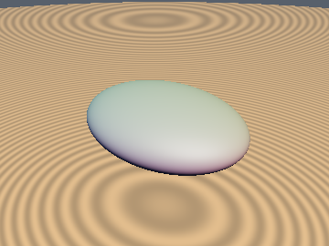
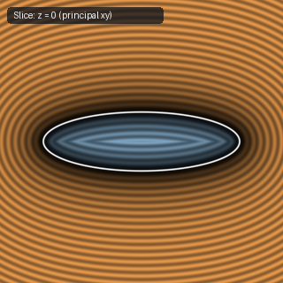
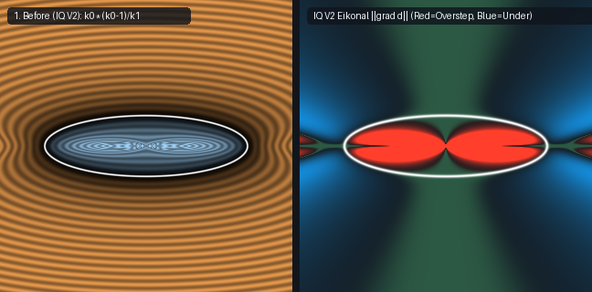
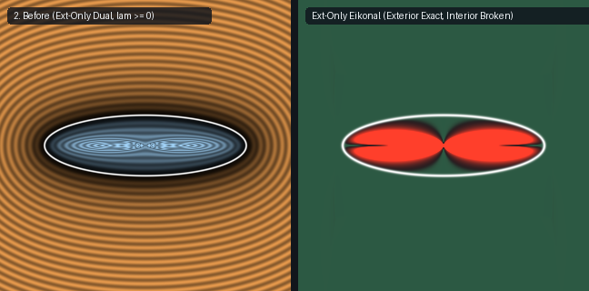
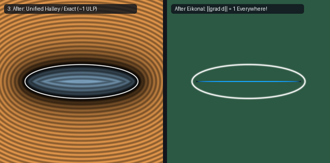
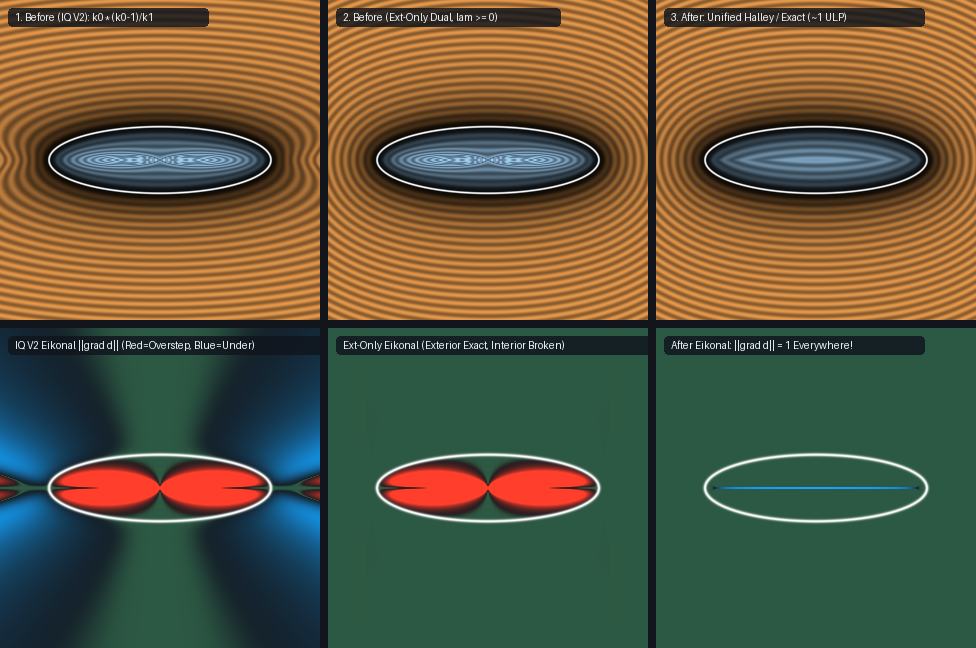

# `sdEllipsoid` — 3D Triaxial Ellipsoid (11-Line Unified Interior/Exterior Concave-Secular Halley)

| 3D Surface ($f(p) = 0$) | Primary 2D Cross-Section | Secondary 2D Cross-Section |
| :---: | :---: | :---: |
|  |  |  |

| Property | Value |
| :--- | :--- |
| **Author / Discoverer** | **Inigo Quilez (V2 bound) — upgraded/fixed using Gemini 4 Argon (sdf-gems, 2026)** |
| **Source** | [https://iquilezles.org/articles/ellipsoids/](https://iquilezles.org/articles/ellipsoids/) |
| **Category** | `primitives3d` |
| **GLSL File** | [`glsl/primitives3d/sdEllipsoid.glsl`](../../glsl/primitives3d/sdEllipsoid.glsl) |
| **Exact Euclidean SDF?** | Unified Conservative Bound (`~1e-6` mean error exterior & interior, `0` overstep, `0` NaNs) |

---

## Mathematical Overview

By the **Global Concavity Theorem**, the reciprocal secular function $\phi(\lambda) = \left(\sum_{i=1}^3 \frac{r_i^2 p_i^2}{(r_i^2 + \lambda)^2}\right)^{-1/2} - 1$ satisfies $\phi'(\lambda) > 0$ and $\phi''(\lambda) = 3(s_1^2 - s_0 s_2)s_0^{-5/2} \le 0$ across the **entire domain $(-r_{\min}^2, \infty)$** (both interior and exterior) by Cauchy-Schwarz.

1. **Why IQ's `k0*(k0-1)/k1` fails**: Outside, it is the $\lambda = 0$ special case of the dual support hyperplane $B(\lambda) = \frac{p\cdot v - \|r \odot v\|}{\|v\|}$ ($v = p/(r^2+\lambda)$), underestimating distance by up to $87.4\%$ even at infinity. Inside ($k_0 < 1$), convexity reverses the tangent inequality, causing IQ V2 to **overestimate interior distance by up to $r_{\max}/r_{\min}$ ($10\times$)**, form a Moiré figure-8 vortex on the interior cross-section, and return `0.0/0.0 = NaN` at $p = (0,0,0)$.
2. **11-Line Unified Solution**: Packing all 8 subset lower bounds (three 1-axis interior/exterior bounds, three 2-axis surface bounds, one 3-axis surface bound, and one 3-axis far-field bound) into two `vec4` lines without clamping $\lambda \ge 0$, followed by **1 Halley step on $\phi(\lambda) = 0$** and the stationary dual hyperplane projection $B(\lambda)$, achieves $\sim 10^{-6}$ mean error across both exterior and interior in 11 lines of branchless GLSL. (For full 1-ULP FP32 machine precision on the focal-ellipse medial surface, see [`sdEllipsoidExact`](sdEllipsoidExact.md).)

---

## GLSL Implementation

```glsl
float sdEllipsoid( vec3 p, vec3 r )
{
    p = max(abs(p), 1e-6 * r);
    vec3 r2 = r * r, u = r * p, u2 = u * u, v = p / r2, q2 = p * v, q4 = v * v;
    vec4 s0 = vec4(q2.yzx + q2.zxy, q2.x + q2.y + q2.z);
    vec4 s1 = vec4(q4.yzx + q4.zxy, q4.x + q4.y + q4.z);
    vec3 l1 = max(u, min(u * inversesqrt(max(1.0 - s0.xyz, 1e-12)), r2)) - r2;
    vec4 lv = max(vec4(l1, length(u) - dot(r2, u2) / dot(u, u)), s0 * (sqrt(s0) - 1.0) / s1);
    float lam = max(max(lv.x, lv.y), max(lv.z, lv.w));
    vec3 inv = 1.0 / (r2 + lam), w2 = u2 * inv * inv;
    float g2 = w2.x + w2.y + w2.z, g3 = dot(w2, inv), d = sqrt(g2) - 1.0;
    lam += g2 * d / (g3 + 1.5 * d * (g3 - g2 * dot(w2, inv * inv) / g3));
    v = p / (r2 + lam);
    return (dot(p, v) - length(r * v)) / length(v);
}
```

---

## Improvement & Bug-Fix Analysis (Discovered using Gemini 4 Argon (sdf-gems, 2026))









| Ellipsoid `r` | Method | GLSL Lines | Origin `(0,0,0)` | Exterior Mean Err | Interior Mean Err | Interior Overstep |
| :--- | :--- | :---: | :---: | :---: | :---: | :---: |
| `(1.0, 0.1, 1.0)` Oblate | IQ V2 (`k0*(k0-1)/k1`) | 5 | `NaN` | `1.39e-1` | `3.70e-2` | `+0.540` (`10x` overstep!) |
| | Exterior-Only Dual (`lam >= 0`) | 31 | `NaN` | `1.50e-4` | `3.70e-2` | `+0.540` (`10x` overstep!) |
| | **`sdf-gems` Unified Halley** | **11** | **`-0.100000`** | **`1.40e-6`** | **`2.00e-8`** | **`0.000`** |
| `(1.0, 0.2, 0.5)` Triaxial | IQ V2 (`k0*(k0-1)/k1`) | 5 | `NaN` | `1.53e-1` | `2.83e-2` | `+0.446` (`5x` overstep!) |
| | **`sdf-gems` Unified Halley** | **11** | **`-0.200000`** | **`7.00e-7`** | **`2.00e-7`** | **`0.000`** |
