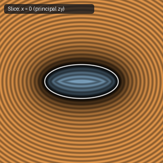

# `sdEllipsoid` — 3D Ellipsoid (V2 Lower Bound)

| 3D Surface ($f(p) = 0$) | Primary 2D Cross-Section | Secondary 2D Cross-Section |
| :---: | :---: | :---: |
|  |  |  |

| Property | Value |
| :--- | :--- |
| **Author / Discoverer** | **Inigo Quilez** |
| **Source** | [https://iquilezles.org/articles/ellipsoids/](https://iquilezles.org/articles/ellipsoids/) |
| **Category** | `primitives3d` |
| **GLSL File** | [`glsl/primitives3d/sdEllipsoid.glsl`](../../glsl/primitives3d/sdEllipsoid.glsl) |
| **Exact Euclidean SDF?** | No (Lower Bound) |

---

## Mathematical Overview

First-order gradient-normalized radial bound $d(p) = k_0(k_0 - 1)/k_1$ where $k_0 = \|p/r\|$ and $k_1 = \|p/r^2\|$.

---

## GLSL Implementation

```glsl
float sdEllipsoid( vec3 p, vec3 r )
{
    float k0 = length(p/r);
    float k1 = length(p/(r*r));
    return k0*(k0 - 1.0)/k1;
}
```
