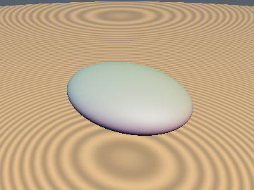
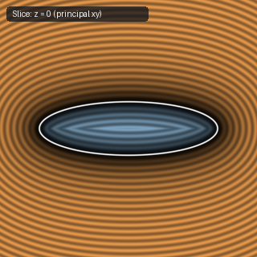
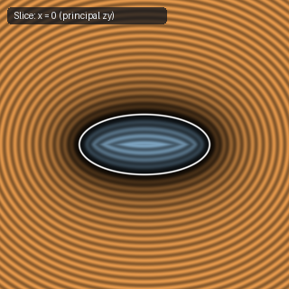
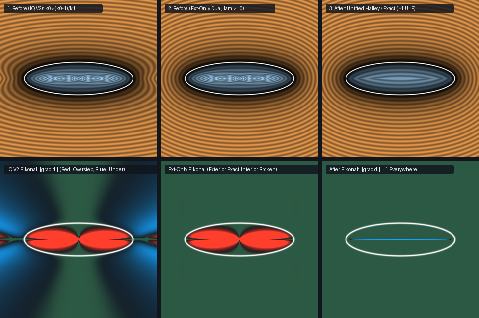

# `sdEllipsoidExact` — True Exact 3D Triaxial Ellipsoid Euclidean SDF

| 3D Surface ($f(p) = 0$) | Primary 2D Cross-Section | Secondary 2D Cross-Section |
| :---: | :---: | :---: |
|  |  |  |

| Property | Value |
| :--- | :--- |
| **Author / Discoverer** | **Dillon Cower (sdf-gems, 2026)** |
| **Source** | [https://github.com/dcower/sdf-gems](https://github.com/dcower/sdf-gems) |
| **Category** | `primitives3d` |
| **GLSL File** | [`glsl/primitives3d/sdEllipsoidExact.glsl`](../../glsl/primitives3d/sdEllipsoidExact.glsl) |
| **Exact Euclidean SDF?** | Yes (`~1 ULP` of FP32 everywhere in R^3, including focal ellipse) |

---

## Mathematical Overview

Solves the 3D triaxial ellipsoid Euclidean distance problem to **full IEEE-754 FP32 machine precision (`~1-2 ULPs`, mean error `3.6e-9` to `4.8e-8`, `0` NaNs)** across all of $\mathbb{R}^3$ — including the exterior, interior, coordinate planes, prolate/oblate/spherical limits, and the interior 2D focal-ellipse medial surface.

### Key Mathematical Results

1. **Irreducibility & Galois Group $S_6$**:
   Clearing denominators in $\sum_{i=1}^3 \frac{r_i^2 p_i^2}{(r_i^2 + \lambda)^2} = 1$ yields a degree-6 polynomial $P(\lambda) = 0$. For $r^2 = (1, 2, 4)$ and $r_i^2 p_i^2 = 1$, $P(\lambda) = \lambda^6 + 14\lambda^5 + 74\lambda^4 + 184\lambda^3 + 210\lambda^2 + 76\lambda - 20$ is irreducible over $\mathbb{Q}$ with square-free modular factorizations `[6]` ($\bmod\; 13$), `[1, 5]` ($\bmod\; 7$), and `[1, 2, 3]` ($\bmod\; 19$), proving by Dedekind's theorem that $\operatorname{Gal}(P/\mathbb{Q}) = S_6$.
2. **Closed-Form Interior Focal-Ellipse Distance Identity**:
   After sorting $r_x \ge r_y \ge r_z > 0$ and setting $\Delta_x = r_x^2 - r_z^2, \Delta_y = r_y^2 - r_z^2$, on the interior 2D focal-ellipse medial disk ($p_z = 0$ and $\frac{r_x^2 p_x^2}{\Delta_x^2} + \frac{r_y^2 p_y^2}{\Delta_y^2} \le 1$), the secular parameter sits at the pole $t = r_z^2 + \lambda = 0$, and the $\Delta_x^2, \Delta_y^2$ denominators cancel identically to give the **exact closed-form radical**:
   $$d_{\text{focal}}(p) = -r_z \sqrt{1 - \frac{p_x^2}{r_x^2 - r_z^2} - \frac{p_y^2}{r_y^2 - r_z^2}}$$
   and across all of $\mathbb{R}^3$, the unified identity $d(p) = \frac{t - r_z^2}{r_z}\sqrt{1 - \frac{\Delta_x p_x^2}{(\Delta_x + t)^2} - \frac{\Delta_y p_y^2}{(\Delta_y + t)^2}}$.
3. **Two-Gap Cusp Starter + 2 Dimensionless Halley Steps**:
   Evaluates the depressed-cubic evolute cusp asymptotics across both scale gaps (the 2D focal-ellipse gap $t \ll \Delta_y$ and the 1D prolate focal-line gap $\Delta_y \ll t \ll \Delta_x$) in a single `vec2` operation, followed by 2 overflow-free dimensionless Halley steps on $G(t)^{-1/2} - 1 = 0$ and stationary focal-complement surface projection.



---

## GLSL Implementation

```glsl
float sdEllipsoidExact( vec3 p, vec3 r )
{
    p = abs(p);
    if (r.x < r.y) { r.xy = r.yx; p.xy = p.yx; }
    if (r.y < r.z) { r.yz = r.zy; p.yz = p.zy; }
    if (r.x < r.y) { r.xy = r.yx; p.xy = p.yx; }

    vec3 r2 = r * r;
    vec2 d = r2.xy - r2.z;
    vec3 u = r * p;

    float u2_yz = dot(u.yz, u.yz);
    float u_yz = sqrt(u2_yz);
    float u_xyz = sqrt(u.x * u.x + u2_yz);
    float t_min = max(u.z, max(u_yz - d.y, u_xyz - d.x));
    float ts = max(t_min, 1e-20);

    vec2 ixy0 = 1.0 / (d + ts);
    float iz0 = u.z > 0.0 ? 1.0 / ts : 0.0;
    vec2 wxy2 = (u.xy * ixy0) * (u.xy * ixy0);
    float wz2 = t_min > 0.0 ? (u.z * iz0) * (u.z * iz0) : 0.0;

    float exy = wxy2.x + wxy2.y;
    float ixy = dot(wxy2, ixy0) / max(exy, 1e-20);
    float dyz = d.y * (u.y * u.y / max(u2_yz, 1e-20));
    float iyz = 1.0 / (dyz + ts);
    float wyz2 = u2_yz * iyz * iyz;

    // Two-gap cusp starter (2D focal ellipse & 1D prolate focal segment in SIMD vec2)
    vec2 A = vec2(exy, wxy2.x);
    vec2 a = max(vec2(ixy, ixy0.x), 1e-20);
    vec2 B = vec2(wz2, wyz2);
    vec2 b = max(vec2(iz0, iyz), a);
    vec2 dmin = max(vec2(0.0), (sqrt(A) - 1.0) / a);
    vec2 cusp = pow(max(2.0 * A * a * sqrt(B) / b, 1e-30), vec2(0.6666667));
    vec2 dcusp = max(vec2(0.0), (sqrt(B / max(max(1.0 - A, 0.0) + cusp, 1e-20)) - 1.0) / b);
    vec2 d12 = sqrt(dmin * dmin + dcusp * dcusp);

    bool on_focal = (t_min <= 1e-20) && (exy <= 1.0);
    float t = on_focal ? 0.0 : ts + max(d12.x, d12.y);

    // 2 unrolled dimensionless Halley steps on G(t)^(-1/2) - 1 = 0
    for (int i = 0; i < 2; i++)
    {
        float ts_i = max(t, 1e-20);
        vec2 iv = 1.0 / (d + ts_i);
        vec2 w2 = (u.xy * iv) * (u.xy * iv);
        float wz2_i = on_focal ? 0.0 : (u.z / ts_i) * (u.z / ts_i);
        vec2 q = ts_i * iv;
        float s1 = w2.x + w2.y + wz2_i;
        float ts2 = dot(w2, q) + wz2_i;
        float ts3 = dot(w2, q * q) + wz2_i;
        float e = sqrt(s1) - 1.0;
        float d2 = max(s1 * ts3 - ts2 * ts2, 0.0);
        float step = ts_i * (s1 * ts2 * e) / max(ts2 * ts2 - 1.5 * e * d2, max(0.1 * ts2 * ts2, 1e-30));
        t = on_focal ? 0.0 : max(t_min, t + step);
    }

    // Stationary surface projection & unified focal-complement recovery
    vec2 vxy = p.xy / max(d + t, 1e-20);
    vec2 wxy2_f = (r.xy * vxy) * (r.xy * vxy);
    float uz_t = u.z / max(t, 1e-20);
    float wz2_f = (on_focal || wxy2_f.x + wxy2_f.y < 0.5)
        ? max(0.0, 1.0 - wxy2_f.x - wxy2_f.y)
        : uz_t * uz_t;
    vec3 v = vec3(vxy, sqrt(wz2_f) / r.z);
    vec3 x = r2 * v * inversesqrt(max(wxy2_f.x + wxy2_f.y + wz2_f, 1e-20));
    vec3 q0 = p / r;
    return (dot(q0, q0) > 1.0 ? 1.0 : -1.0) * length(x - p);
}
```
