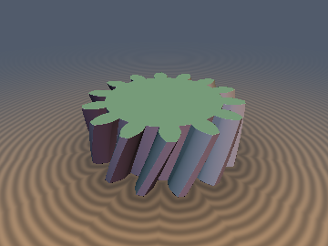
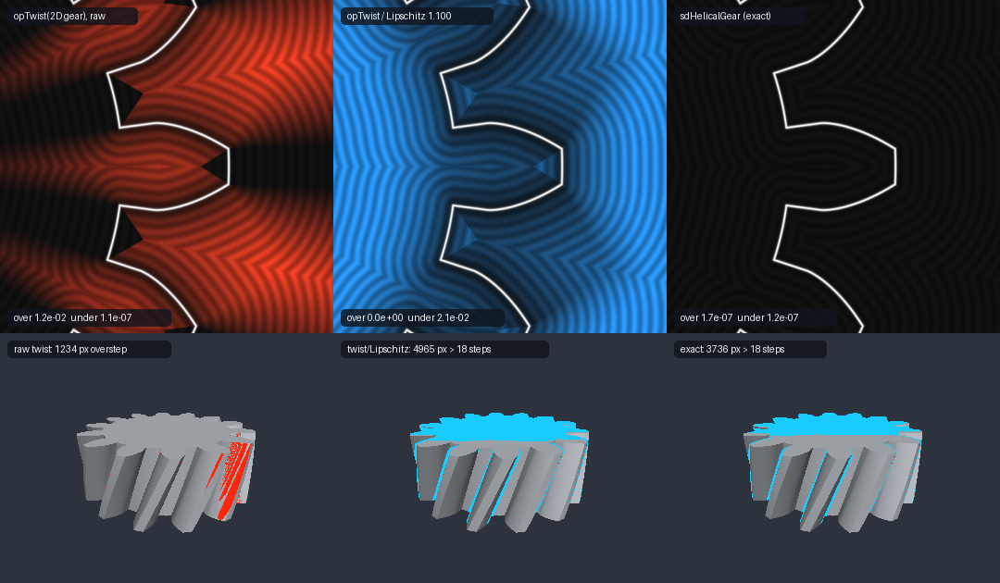

# `sdHelicalGear` — Exact Closed-Form Involute Helical Gear (Involute-Helicoid Parallel-Offset Theorem)

<p align="center">
  
  
</p>

<p align="center">
  
</p>

- **Category**: `primitives3d`
- **GLSL File**: [`glsl/primitives3d/sdHelicalGear.glsl`](../../glsl/primitives3d/sdHelicalGear.glsl)
- **Attribution**: Discovered and derived using Claude Opus 5.5 (`sdf-gems`, 2026)
- **Exactness**: **Exact Euclidean SDF & analytical 3D gradient** for the infinitely long helical gear (`sdHelicalGear`, `sdInvoluteHelicoidGear`, `sdgInvoluteHelicoidGear`). GPU FP32 max error `3.3e-7` against FP64 brute force; the FP64 port agrees with the brute-force reference to within that reference's resolution (≤ `2e-7`, typically `1e-8`). Helix angles tested from 0° to 70°. The flank term is closed form. The two helix edges and the radial root strip each need one fixed 2-step Householder solve of $`a\sin x + x = c`$. **Finite face width** (`sdHelicalGearCapped`): exact inside. Outside it is exact wherever the nearest point is on the lateral surface inside the slab or on an end face (about 90% of the test volume). In a thin region beyond the end planes near the end-face edges it returns a **conservative lower bound**.

---

## Overview & Motivation

Helical gears are spur gears whose transverse involute profile turns steadily along the axis. Every shader helical gear we found builds it with a domain twist:

```glsl
// Usual approach: twist the 2D gear profile, then divide by a Lipschitz factor
vec2  q = rot(-tau * p.z) * p.xy;
float d = max(sdGear2D(q), abs(p.z) - h) / sqrt(1.0 + tau*tau*R*R);
```

Without the division, the twisted transverse distance **oversteps**. It measures distance inside the slice, but the true nearest point is usually at a different height, so the twisted value is too large (`+0.012` for the gear shown, about 13% of the module). Dividing by the Lipschitz factor $`\sqrt{1+\tau^2R^2}`$ makes it safe for $`\rho \le R`$, but then it **underestimates everywhere** (`-0.021`). Sphere tracing gets slower, and offsets, shells and normals come out distorted.

The idea behind this file is that the twist does not need to be approximated. A helical tooth flank is an **involute helicoid**, and its distance field is as simple as the 2D involute's.

---

## Mathematical Derivation

Axis $`z`$, base cylinder radius $`r_b`$, base helix angle $`\beta_b`$, twist rate $`\tau = \tan\beta_b / r_b`$. Write the untwisted angle as $`\varphi' = \varphi - \tau z`$. The transverse flank is $`\varphi' = \psi(\rho) = \psi_b - \mathrm{inv}(\arccos(r_b/\rho))`$ with $`\mathrm{inv}(a) = \tan a - a`$.

### 1. Involute-Helicoid Parallel-Offset Theorem

```math
f(\mathbf{p}) = r_b\cos\beta_b\,\bigl(\varphi' - \psi(\rho)\bigr)
```

is the **exact signed distance to the flank helicoid** wherever its foot point lies on the flank.

*Proof.* In 2D, $`r_b(\varphi - \psi(\rho))`$ has unit gradient, and that gradient is the base-circle tangent $`(-\sin\theta, \cos\theta)`$ with $`\theta = \varphi - \arccos(r_b/\rho)`$. Adding the twist gives $`\nabla(\varphi' - \psi) = \nabla_{2D}(\varphi - \psi) - \tau\,\mathbf{e}_z`$. Its norm is $`\sqrt{1/r_b^2 + \tau^2} = 1/(r_b\cos\beta_b)`$, so $`|\nabla f| = 1`$.

The gradient $`\mathbf{n} = (\cos\beta_b\,\mathbf{t}_\theta, -\sin\beta_b)`$ is constant along the line through $`\mathbf{p}`$ in the plane tangent to the base cylinder along $`\theta`$. The helicoid cuts that plane in a straight generator (the involute helicoid is the tangent developable of the base helix). Writing that plane in coordinates (roll length $`s`$, height $`z`$), the flank rotated by $`\delta`$ is the line $`s - r_b\tau z = r_b(\psi_b + \delta - \theta)`$, so all rotated copies are parallel lines.

So **rotating the helicoid by $`\delta`$ produces a parallel surface at normal offset $`r_b\cos\beta_b\,\delta`$**, and $`f`$ is the signed distance from $`\mathbf{p}`$ to its line in that plane. The foot point is $`\mathbf{p} - f\mathbf{n}`$. Its roll parameter is

```math
t_q = \sqrt{\rho^2 - r_b^2}/r_b - \cos^2\beta_b\,(\varphi' - \psi(\rho)),
```

and the candidate is valid if $`t_q \in [t_{lo}, t_a]`$. No root finding is needed. For $`\beta_b = 0`$ this reduces to the 2D Involute Parallel-Offset Theorem of [`sdInvoluteGear2D`](../primitives2d/sdInvoluteGear2D.md).

### 2. Orbit-space dihedral fold

A helical gear has **no mirror symmetry** because it is chiral. So the 2D $`D_n`$ fold cannot be reused directly. Its isometries are:

- the screw motion (rotate $`\tau\,dz`$, translate $`dz`$);
- the rotation by $`2\pi/n`$;
- the half-turn $`(\varphi', z) \to (-\varphi', -z)`$.

First screw $`\mathbf{p}`$ to $`z = 0`$, which makes the distance a function of $`(\rho, \varphi')`$ alone. The distance between screw orbits,

```math
\min_z \sqrt{\rho_1^2 + \rho_2^2 - 2\rho_1\rho_2\cos(\Delta + \tau z) + z^2},
```

is **monotone in $`|\Delta\varphi'|`$**. Its derivative is $`2\rho_1\rho_2\sin w`$, where $`w + \rho_1\rho_2\tau^2\sin w = \Delta`$, and $`w \in [0, \Delta]`$ by the `sdHelix` lemma. So the usual reflection argument still works in orbit space: the nearest point can always be found among the features of the chamber $`\varphi' \in [0, \pi/n]`$.

### 3. The six chamber features

| Feature | Distance |
| :--- | :--- |
| Tip cylinder ($`\varphi' \le \psi_a`$) | $`\lvert\rho - r_a\rvert`$ |
| Root cylinder ($`\varphi' \ge \psi_l`$) | $`\lvert\rho - r_f\rvert`$ |
| Involute flank | $`\lvert f \rvert`$ (Theorem 1) |
| Tip-edge helix $`(r_a, \psi_a)`$, convex, so exterior only | $`w + a\sin w = \psi_a - \varphi'`$, $`a = \rho r_a \tau^2`$ |
| Root-edge helix $`(r_f, \psi_l)`$, concave, so interior only | same equation with $`r_f`$, $`\psi_l`$ |
| Straight-helicoid strip $`r\in[r_f, r_b]`$ at $`\psi_b`$ (radial flank, if $`r_f < r_b`$) | $`v + a\sin v = 2(\psi_b - \varphi')`$, $`v = 2w`$, $`a = \rho^2\tau^2`$ |

For the strip, eliminating the optimal radius $`r = \rho\cos w`$ turns $`\rho^2\sin^2 w + z^2`$ into **exactly the helix functional**. So all three non-trivial features share one Kepler-type solver. The axial offset of each foot point is computed without division: $`\Delta z = -\rho R\tau\sin w`$ for a helix and $`\Delta z = -\rho^2\tau\sin w\cos w`$ for the strip. This makes $`\beta = 0`$ (a spur gear) an exact special case.

The strip and the involute flank meet tangentially at the base helix: both normals equal $`\cos\beta_b\,\mathbf{e}_\varphi - \sin\beta_b\,\mathbf{e}_z`$. So that seam needs no extra feature. Every candidate is the true distance to an actual surface point, which makes taking the minimum safe.

### 4. Finite face width (`sdHelicalGearCapped`)

- **Inside**: `max(d_inf, |z| - h)` is exact.
- **Outside**: the result is `min(dF, dL)`. Here `dF` is the exact distance to the nearer end face. It equals the 2D gear SDF in the end plane, which is the same core with $`\tau = 0`$.
  - If the infinite gear's foot point lies in the slab, then `dL = |d_inf|`, which is exact.
  - Otherwise `dL` is replaced by a provable lower bound: $`\max(|d_\infty|, |z| - h)`$ and, beyond the end plane, a cone bound. The transverse profile distance is $`\tau\rho`$-Lipschitz in $`z`$, so it is at least $`d_2 - \tau\rho(h - |z_q|)`$. That gives $`(d_2 + \tau\rho\,(|z|-h))/\sqrt{1+\tau^2\rho^2}`$, and the result is exact whenever $`\tau\rho\,d_2 \le |z| - h`$.

The result is exact in about 90% of the test volume and never larger than the true distance.

---

## Numerical Verification

Ground truth: FP64 brute force over the *full* gear, with no symmetry assumed. It computes

```math
d^2 = \min_z \left[d_C\bigl(R(-\tau z)\,\mathbf{p}_{xy}\bigr)^2 + (z - z_p)^2\right],
```

where $`d_C`$ is the distance to a dense polyline of the full transverse profile (spacing $`2.5\cdot10^{-5}`$, KD-tree plus point-segment distance). The $`z`$-minimisation uses a 96 to 1200 sample scan followed by golden-section refinement. Sign comes from a transverse 2D inside test. GPU numbers come from the literal `.glsl` evaluated through OpenGL 4.1 transform feedback in FP32.

| Test | Result |
| :--- | :--- |
| `sdInvoluteHelicoidGear`, 6 gears (n = 6–50, β = −25°…45°, $`r_f \lessgtr r_b`$), 24k pts each (uniform + near-surface) | FP64 port max `1.9e-7` (median config `8e-9`; limited by the reference), GPU FP32 max `3.3e-7`, 0 sign errors |
| Extreme helix angles β = 60° and 70°, n = 5 with 25° pressure angle; far field to $`3r_a`$ (5k–15k pts each, 600–1200-sample $`z`$ scan) | β = 60°: FP64 `1.9e-10`, GPU `4.4e-7` (relative `3.1e-7`, $`\lvert d\rvert`$ up to 2.5). n = 5: GPU `4.5e-7`. β = 70°: largest deviation `6.6e-6`, at a far-field point where the reference missed a basin; a 6000-sample reference agrees to all digits |
| `sdgInvoluteHelicoidGear` (5 gears × 40k pts) | `\|dg.x − d\| ≤ 1.7e-7`, `\| \|g\| − 1 \| ≤ 3.1e-7`, cosine vs central differences ≥ `0.999996` |
| C⁰ / Lipschitz (6 gears × 200k pairs, $`\epsilon = 10^{-5}`$) | max $`\lvert d(p+\epsilon u) - d(p-\epsilon u)\rvert`$ = `2.000e-5` = $`2\epsilon`$ (1-Lipschitz, no seam jumps) |
| Eikonal (central differences, FP64 port) | median $`\lvert\lvert\nabla d\rvert - 1\rvert`$ = `3e-11`, 99.9th percentile ≤ `2e-7` (only medial seams deviate) |
| NaN / Inf (origin, axes, axis $`\rho = 0`$, $`z = 10^3`$, on-surface points, β = 0) | `0` |
| Self-projection $`\lvert d(\mathbf{p} - d\,\nabla d)\rvert`$ with `sdgHelicalGear` (5 gears; 40k box + 20k near-surface + ~4–6k points *exactly on* the surface, then re-projected) | max `5.6e-7`, median `≈ 3e-8`. This caught and fixed an FP32 rounding-shell bug: with constant-folded parameters, `sqrt(rb*rb - rb*rb)` could round to `sqrt(-ε)` = NaN, so `(r - rb)(r + rb)` is used instead. Patch validity tests now also accept candidates that are provably on the far side of the boundary, so on-surface points can never fall through. |
| `sdHelicalGearCapped` self-projection (FP64 port, FD gradient, 40k box) | exact region: ≤ `2e-10`; bound region (10–24% of the box, beyond the end planes): `> 0` as expected. GLSL matches the FP64 port within `3.1e-7`. Spur case (β = 0): 100% exact |
| `sdHelicalGearCapped`, 3 gears × 20k pts | exact region ≈ 89–92%: GPU max `2.5e-7` (one `2.3e-6` outlier was traced to the coarse reference; a finer reference agrees to `1e-11`); elsewhere a conservative bound, max overshoot ≤ `0` (−2e-9), max under `0.037` (naive `max(d, \|z\|-h)`: `0.102`) |
| Single-translation-unit umbrella compile (forward + reverse) | OK |

### Before / after (14 teeth, $`m_n`$ = 0.0912, $`\alpha_n`$ = 20°, β = 22°)

| Method | Max overstep of $`\lvert d\rvert`$ (unsafe) | Max understep | 3D sphere tracing |
| :--- | :---: | :---: | :--- |
| `opTwist` of exact 2D gear (raw) | `+1.2e-2` | — | 1234 px hit *inside* the gear |
| `opTwist` / Lipschitz `1.100` | `0` (for $`\rho \le r_a`$) | `−2.1e-2` | 4965 px need > 18 steps |
| **`sdHelicalGear` (exact)** | `1.7e-7` | `1.3e-7` | 3736 px need > 18 steps (−25%) |

The top row of the comparison image shows signed $`\lvert d\rvert`$ error maps on the transverse slice $`z = 0`$: red means overstep and blue means understep, both at the same scale. The bottom row shows sphere-tracing diagnostics for the finite gear.

---

## Prior Art & Novelty

- The parallel-flank property is **classical gear metrology**: the *normal base pitch* $`p_{bn} = p_{bt}\cos\beta_b`$ and span (base tangent length) measurement across $`k`$ teeth both rely on it. We found no prior use of it as a **closed-form signed distance field**.
- Shader and SDF helical gears we found (Shadertoy-style snippets, tutorials, GitHub) all twist a 2D profile, often a fake sine or trapezoid profile, and rescale by a Lipschitz factor or a relaxation constant.
- New in this file:
  1. $`f = r_b\cos\beta_b(\varphi' - \psi(\rho))`$ as an exact 3D distance, with its validity test in closed form.
  2. The orbit-space dihedral fold for a chiral object, justified by the monotonicity lemma.
  3. Reduction of both helix edges *and* the radial straight-helicoid strip to the single `sdHelix` Kepler equation.
  4. A finite-width version with honest exact and conservative regions.

---

## GLSL Implementation

See [`glsl/primitives3d/sdHelicalGear.glsl`](../../glsl/primitives3d/sdHelicalGear.glsl).

```glsl
float sdHelicalGear( vec3 p, float n, float mn, float pan, float beta );            // infinite, exact
float sdHelicalGearCapped( vec3 p, float n, float mn, float pan, float beta, float h ); // |z| <= h
vec4  sdgHelicalGear( vec3 p, float n, float mn, float pan, float beta );           // (d, grad)
float sdInvoluteHelicoidGear( vec3 p, float n, float rb, float ra, float rf, float psib, float tbb );
```

Here `mn` is the normal module, `pan` the normal pressure angle, and `beta` the pitch helix angle (> 0 means right-hand). The raw form takes the base radius `rb`, tip radius `ra`, root radius `rf`, base tooth half-angle `psib`, and `tbb = tan(base helix angle)`. Cost of the core:

- 2 `atan` (the fold and the pressure angle) and 1 `sqrt`;
- one Kepler solve for the active edge helix (2 Householder steps, about 5 `sin`/`cos`);
- one more solve when $`r_f < r_b`$.
