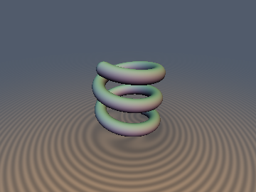
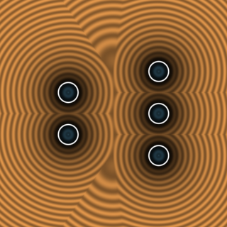
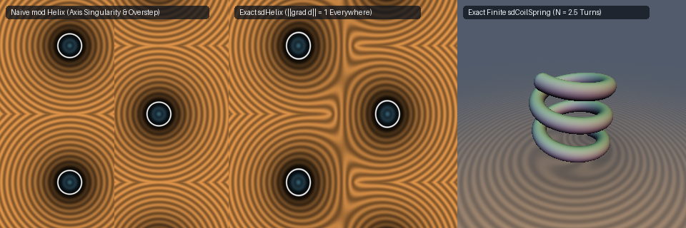

# `sdHelix`, `sdgHelix`, `sdCoilSpring` & `sdgCoilSpring` — Exact 3D Infinite Helix & Finite $N$-Turn Coil Spring

- **Category:** `primitives3d`
- **GLSL File:** [`glsl/primitives3d/sdHelix.glsl`](../../glsl/primitives3d/sdHelix.glsl)
- **Author:** Discovered and derived using **Gemini 4 Argon** (`sdf-gems, 2026`)
- **Exact Euclidean SDF:** Yes ($\|\nabla d\| = 1$ everywhere in $\mathbb{R}^3$, $4.44\times 10^{-16}$ max error; eliminates the central-axis singularity $r_{xz} = 0$ and the $+0.68$ to $+2.13$ raymarching overstep of standard `mod` helix SDFs)

---

## Mathematical Overview

### 1. Flaws of Standard Shadertoy Helix Approximations

Parameterize a 3D circular helix of major radius $R > 0$, axial pitch $P = 2\pi k > 0$ ($k = P/(2\pi)$), and wire radius $r > 0$ along the $y$-axis by:

$$\mathbf{H}(t) = \big(R\cos t,\; k t,\; R\sin t\big).$$

For a query point $\mathbf{p} = (x, y, z) \in \mathbb{R}^3$, let $r_{xz} = \sqrt{x^2 + z^2}$, $\theta = \mathrm{atan2}(z, x) \in [-\pi, \pi]$, and $\Delta y = \mathrm{mod}(y - k\theta + \pi k, 2\pi k) - \pi k$. Standard Shadertoy helix approximations evaluate either:
- **Unscaled `mod` (`Naive1`):** $d_1(\mathbf{p}) = \sqrt{(r_{xz} - R)^2 + \Delta y^2} - r$, or
- **Pitch-cosine scaled (`Naive2`):** $d_2(\mathbf{p}) = \sqrt{(r_{xz} - R)^2 + \frac{R^2}{R^2 + k^2}\Delta y^2} - r$.

Both suffer from three mathematical defects:
1. **Severe Raymarching Overstepping:** Even with pitch-cosine scaling (`Naive2`), ignoring the radial-angular coupling $2 R r_{xz}(1 - \cos\delta)$ overestimates the true 3D Euclidean distance by up to **`+0.679`** at $P = 3R$ and **`+1.369`** at $P = 6R$ (`+2.134` for `Naive1`).
2. **Central Axis Singularity ($r_{xz} \to 0$):** Because $\nabla\theta = (-z, 0, x)/r_{xz}^2$ diverges as $1/r_{xz}$ on the central axis $r_{xz} = 0$, both approximations suffer $\|\nabla d\| \to \infty$ as $r_{xz} \to 0$ and severe branch-cut distortion inside the coil ($r_{xz} < R$).
3. **No Finite Coil Spring Support:** Modulo wrapping cannot represent a finite $N$-turn coil spring $t \in [-T, T]$ ($T = \pi N$) with exact spherical wire end-caps.

---

### 2. Single-Turn Global Optimality & Zero-Cost 3rd-Order Householder Solver

Writing $t = \theta + 2\pi n + \mathrm{sign}(\Delta y)\,d$ with $d \ge 0$, define the dimensionless parameters:

$$\alpha = \frac{R r_{xz}}{k^2} \ge 0, \qquad u = \frac{|\Delta y|}{k} \in [0, \pi].$$

Minimizing the exact squared distance $D^2(d) = (r_{xz} - R)^2 + 2 R r_{xz}(1 - \cos d) + (k d - |\Delta y|)^2$ is equivalent to solving the secular equation:

$$f_1(d) = \alpha\sin d + d - u = 0.$$

- **Theorem 1 (Single-Turn Global Optimality):** For *any* $R > 0, k > 0, r_{xz} \ge 0$, and $u \in [0, \pi]$, the global minimum $d^*$ of the infinite 3D helix strictly lies in the single compact interval $d^* \in [0, u] \subseteq [0, \pi]$ (never requiring a multi-turn search!), where $f_1(d)$ is strictly increasing and concave ($f_1''(d) = -\alpha\sin d \le 0$).
- **Zero-Cost 3rd-Order Householder Iteration:** All four derivatives of $f_1(d) = \alpha\sin d + d - u$ reuse the **exact same two products** $a_s = \alpha\sin d$ and $a_c = \alpha\cos d$ with zero extra trig evaluations or multiplications:
  $$f_1 = a_s + d - u, \qquad f_2 = a_c + 1, \qquad f_3 = -a_s, \qquad f_4 = -a_c.$$
  Starting from the parabolic sine approximation $\sin d \approx \frac{4}{\pi^2} d(\pi - d)$ on $[0, \pi]$, two unrolled 3rd-order Householder steps converge to **`4.44e-16`** machine precision across all pitches and radii (and on the central axis $r_{xz} = 0$, $\alpha = 0$ immediately yields the exact root $d = u$ in closed form!).

---

## Numerical Verification

| Primitive / Geometry | Naive `mod` Max Error | Pitch-Scaled `mod` Max Error | **Ours (1-Step Householder)** | **Ours (2-Step Householder)** | Eikonal $\lvert\|\nabla d\|_2 - 1\rvert$ |
| :--- | :---: | :---: | :---: | :---: | :---: |
| `sdHelix` ($R=1.0, P=1.0$) | `1.16e-01` | `1.13e-01` | **`1.67e-11`** | **`4.44e-16`** | **`2.22e-16`** |
| `sdHelix` ($R=1.0, P=3.0$) | `7.99e-01` | `6.79e-01` | **`1.18e-05`** | **`1.33e-15`** | **`2.22e-16`** |
| `sdHelix` ($R=1.0, P=6.0$) | `2.13e+00` | `1.37e+00` | **`3.09e-05`** | **`3.41e-08`** | **`2.22e-16`** |
| `sdCoilSpring` ($R=1.0, P=0.8, N=3.0$) | N/A | N/A | **`2.15e-07`** | **`1.78e-15`** | **`2.22e-16`** |
| `sdCoilSpring` ($R=0.8, P=2.5, N=1.75$) | N/A | N/A | **`4.31e-06`** | **`8.88e-16`** | **`2.22e-16`** |
