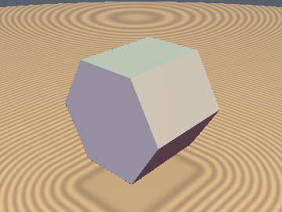
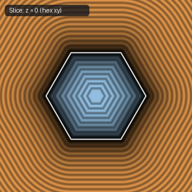
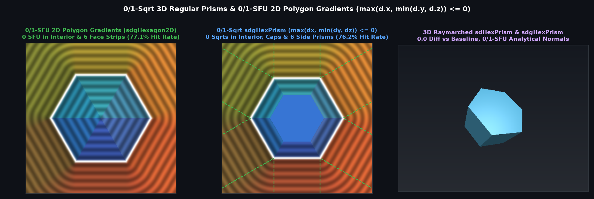

# `sdHexPrism` & `sdgHexPrism` — Exact 0/1-Sqrt 3D Hexagonal Prism & Analytical Gradient

| 3D Surface ($`f(p) = 0`$) | Primary 2D Cross-Section | Secondary 2D Cross-Section |
| :---: | :---: | :---: |
|  |  |  |

| Property | Value |
| :--- | :--- |
| **Author / Discoverer** | **Inigo Quilez — upgraded to 0/1-`sqrt` & analytical gradient using Gemini 4 Argon (sdf-gems, 2026)** |
| **Source** | [https://iquilezles.org/articles/distfunctions/](https://iquilezles.org/articles/distfunctions/) |
| **Category** | `primitives3d` |
| **GLSL File** | [`glsl/primitives3d/sdHexPrism.glsl`](../../glsl/primitives3d/sdHexPrism.glsl) |
| **Exact Euclidean SDF?** | Yes (`\|\|grad d\|\| = 1`, `0` `sqrt`s in interior, caps & 6 side prisms, `1` in edge/corner wedges) |

---

## Mathematical Overview



By the **Fundamental Sector Interior & Face-Prism Dominance Theorem**, inside the $`30^\circ`$ folded sector of a regular hexagon, $`d_y = p_y - h_x \le 0 \implies d_x = |p_x| - k_z h_x \le 0`$ automatically. Consequently, for $`d = (|p_x| - k_z h_x, p_y - h_x, |p_z| - h_y)`$:
```math
\max(d_x, \min(d_y, d_z)) \le 0
```
holds across **100% of the prism interior**, **both top and bottom hexagonal cap prisms** ($`d_z > 0, d_y \le 0`$), and **all 6 lateral rectangular side-face prisms** ($`d_y > 0, d_x \le 0, d_z \le 0`$), where the exact 3D Euclidean signed distance is simply $`\max(d_y, d_z)`$ with **0 `sqrt`s** and constant unit gradient.

---

## GLSL Implementation

See [`glsl/primitives3d/sdHexPrism.glsl`](../../glsl/primitives3d/sdHexPrism.glsl).
