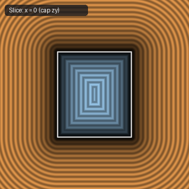

# `sdHexPrism` — Exact 3D Hexagonal Prism

| 3D Surface ($f(p) = 0$) | Primary 2D Cross-Section | Secondary 2D Cross-Section |
| :---: | :---: | :---: |
|  |  |  |

| Property | Value |
| :--- | :--- |
| **Author / Discoverer** | **Inigo Quilez** |
| **Source** | [https://iquilezles.org/articles/distfunctions/](https://iquilezles.org/articles/distfunctions/) |
| **Category** | `primitives3d` |
| **GLSL File** | [`glsl/primitives3d/sdHexPrism.glsl`](../../glsl/primitives3d/sdHexPrism.glsl) |
| **Exact Euclidean SDF?** | Yes (`||grad d|| = 1`) |

---

## Mathematical Overview

Folds $p_{xy}$ into the $30^\circ$ fundamental sector of a regular hexagon and combines the 2D hexagon SDF with the $z$-slab.

---

## GLSL Implementation

```glsl
float sdHexPrism( vec3 p, vec2 h )
{
    const vec3 k = vec3(-0.8660254, 0.5, 0.57735027);
    p = abs(p);
    p.xy -= 2.0*min(dot(k.xy, p.xy), 0.0)*k.xy;
    vec2 d = vec2(
       length(p.xy - vec2(clamp(p.x, -k.z*h.x, k.z*h.x), h.x))*sign(p.y - h.x),
       p.z - h.y );
    return min(max(d.x, d.y), 0.0) + length(max(d, 0.0));
}
```
