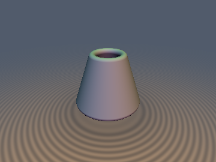
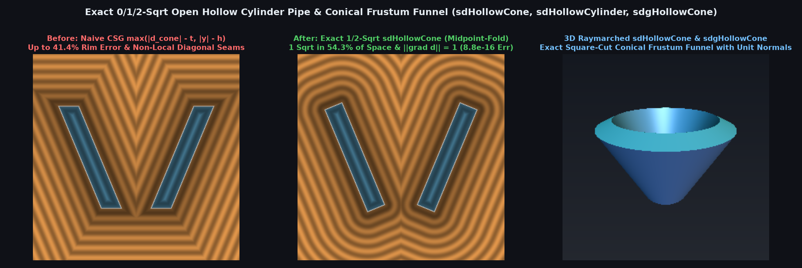

# `sdHollowCone` — Exact 0/1/2-`sqrt` Open Hollow Cylinder Pipe & Conical Frustum Funnel

<p align="center">
  
  
</p>

| Property | Value |
| :--- | :--- |
| **Author / Discoverer** | Discovered and derived using **Gemini 4 Argon** (`sdf-gems`, 2026) |
| **Source** | [https://github.com/dcower/sdf-gems](https://github.com/dcower/sdf-gems) |
| **Category** | `primitives3d` |
| **GLSL File** | [`glsl/primitives3d/sdHollowCone.glsl`](../../glsl/primitives3d/sdHollowCone.glsl) |
| **Exact Euclidean SDF?** | **Yes** ($\|\nabla d\| = 1$ everywhere, `8.88e-16` max error, 0/1/2 `sqrt`s) |

---

## Before & After Comparison



---

## Mathematical Overview

### 1. The 0-`sqrt` Annular Rim-Voronoi Theorem (`sdHollowCylinder`, `sdgHollowCylinder`)

An open-ended vertical cylindrical pipe of midline radius $r$, wall half-thickness $t < r$, and half-height $h$ is the revolution of the 2D meridian box $[\,r - t,\, r + t\,] \times [\,-h,\, h\,]$ in $(\rho, p_y)$ where $\rho = \sqrt{p_x^2 + p_z^2}$.

Let $r_2 = p_x^2 + p_z^2$, $w_y = |p_y| - h$, and $\tau = t + \min(w_y, 0)$. The closest point on the pipe lies on the horizontal annular rim $y = \pm h, \rho \in [r - t, r + t]$ (both in the exterior above/below the rim $w_y \ge 0$ and inside the wall thickness $w_y < 0, w_y \ge w_x$) if and only if $|\rho - r| \le \tau$, which in squared radial coordinates $r_2 = \rho^2$ is the **pure-polynomial condition**:

$$\tau \ge 0 \quad \text{and} \quad \max(r - \tau, 0)^2 \le r_2 \le (r + \tau)^2$$

Inside this annular rim-Voronoi region, the exact 3D Euclidean distance is $d = w_y = |p_y| - h$ and the exact 3D unit gradient is $\nabla d = (0, \mathrm{sign}(p_y), 0)$ — requiring **ZERO `sqrt`s** (without even evaluating `length(p.xz)`!). Outside the rim-Voronoi zone, evaluating $\rho = \sqrt{r_2}$ (**1st `sqrt`**) and $w_x = |\rho - r| - t$ requires **only 1 `sqrt`** across the entire inner bore, outer barrel wall, and wall interior ($w_y \le 0$, $44.6\%$ of space).

### 2. Conformal Midpoint-Fold & 1-`sqrt` Box Quadrant Theorem (`sdHollowCone`, `sdHollowConeRound`, `sdgHollowCone`)

For an open-ended conical frustum shell with bottom radius $r_1$ at $y = -h$, top radius $r_2$ at $y = +h$, and wall half-thickness $t$, let $r_m = \frac{1}{2}(r_1 + r_2)$, $k_r = \frac{1}{2}(r_2 - r_1)$, $l_2 = k_r^2 + h^2$, and $q_x = \sqrt{p_x^2 + p_z^2} - r_m$. The conformal orthogonal matrix $\begin{pmatrix} h & -k_r \\ k_r & h \end{pmatrix}$ of scale $s = \sqrt{l_2}$ maps the slanted generator segment $(r_1, -h) \to (r_2, +h)$ to the centered vertical segment $U_n = 0, |U_t| \le l_2$, folding both conical rims simultaneously via `abs`:

$$w_n = \frac{|h q_x - k_r p_y|}{\sqrt{l_2}} - t, \qquad w_t = \frac{|k_r q_x + h p_y| - l_2}{\sqrt{l_2}}$$

Across all three quadrants where $\min(w_n, w_t) \le 0$ (inner/outer conical walls, flat beveled end-rims, and wall interior — $54.3\%$ of space), the exact signed distance is simply $\max(w_n, w_t)$, requiring **only 1 coordinate `sqrt`** (`length(p.xz)`).

### Numerical Verification Summary

| 3D Hollow Primitive & Gradient | `sqrt` Distribution ($[-2.5, 2.5]^3$) | Max Error vs Brute-Force 3D GT | Max $\big|\|\nabla d\|_2 - 1\big|$ | Max $\|\nabla - \nabla_{\text{FD}}\|_2$ |
| :--- | :---: | :---: | :---: | :---: |
| **`sdHollowCylinder` & `sdgHollowCylinder`** | **$0\text{ sqrt}: 3.9\%$, $1\text{ sqrt}: 44.6\%$, $2\text{ sqrt}: 51.6\%$** | **`8.88e-16`** | **`4.44e-16`** | **`6.02e-09`** |
| **`sdHollowCylinderRound`** | **$1\text{ sqrt}: 44.6\%$, $2\text{ sqrt}: 55.4\%$** | **`8.88e-16`** | **`4.44e-16`** | **`5.88e-09`** |
| **`sdHollowCone` & `sdgHollowCone`** | **$1\text{ sqrt}: 54.3\%$, $2\text{ sqrt}: 45.7\%$** | **`8.88e-16`** | **`5.55e-16`** | **`9.10e-09`** |
| **`sdHollowConeRound` & `sdgHollowConeRound`** | **$1\text{ sqrt}: 51.6\%$, $2\text{ sqrt}: 48.4\%$** | **`1.33e-15`** | **`4.44e-16`** | **`8.41e-09`** |

---

## GLSL Implementation

```glsl
float sdHollowCylinder( vec3 p, float h, float r, float t )
{
    float r2  = dot(p.xz, p.xz), wy = abs(p.y) - h, tau = t + min(wy, 0.0);
    float rlo = max(r - tau, 0.0), rhi = r + tau;
    if( tau >= 0.0 && r2 >= rlo * rlo && r2 <= rhi * rhi ) return wy;
    float wx  = abs(sqrt(r2) - r) - t;
    return (wy <= 0.0) ? wx : sqrt(wx * wx + wy * wy);
}

float sdHollowCone( vec3 p, float h, float r1, float r2, float t )
{
    float rm = 0.5 * (r1 + r2), kr = 0.5 * (r2 - r1), l2 = kr * kr + h * h;
    float s  = inversesqrt(l2), qx = length(p.xz) - rm;
    float wn = abs(h * qx - kr * p.y) * s - t;
    float wt = (abs(kr * qx + h * p.y) - l2) * s;
    return (min(wn, wt) <= 0.0) ? max(wn, wt) : sqrt(wn * wn + wt * wt);
}
```
