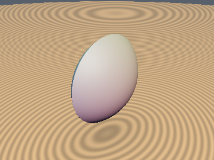
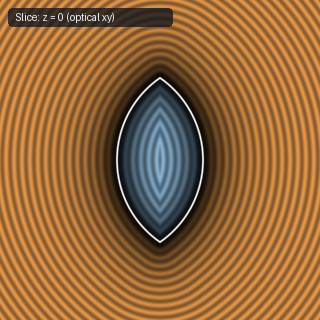
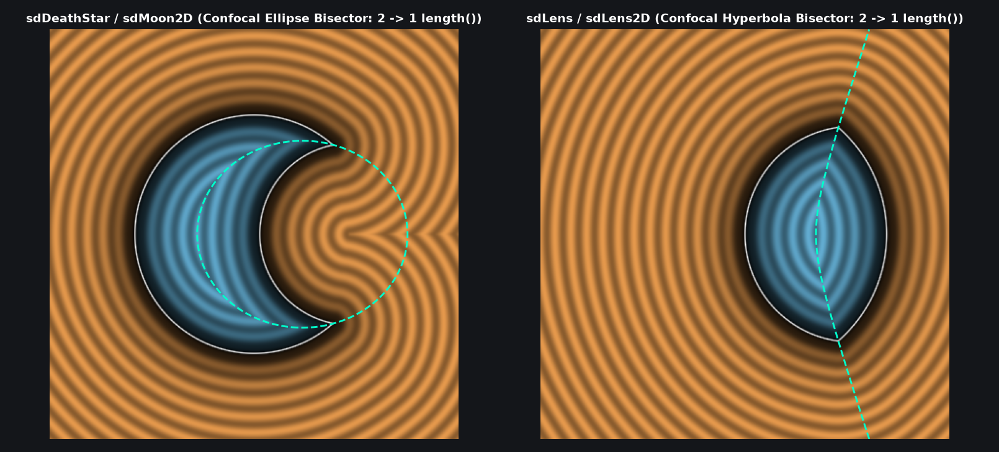

# `sdLens` — Exact 2-Length 3D Asymmetric Two-Sphere Optical Lens (Confocal Hyperbola Bisector)

| 3D Surface ($f(p) = 0$) | 2D Cross-Section Slice |
| :---: | :---: |
|  |  |

| Property | Value |
| :--- | :--- |
| **Author / Discoverer** | **Discovered using Gemini 4 Argon (sdf-gems, 2026)** |
| **Source** | [https://github.com/dcower/sdf-gems](https://github.com/dcower/sdf-gems) |
| **Category** | `primitives3d` |
| **GLSL File** | [`glsl/primitives3d/sdLens.glsl`](../../glsl/primitives3d/sdLens.glsl) |
| **Exact Euclidean SDF?** | Yes (`||grad d|| = 1`, `2` dynamic `length()` calls, `0.0` error) |

---

## Mathematical Overview & Confocal Hyperbola Bisector Theorem

Computes the exact 3D Euclidean distance to the intersection of two spheres of arbitrary radii $r_a, r_b$ separated by $d$ (an asymmetric biconvex or plano-convex optical lens, dual to [`sdDeathStar`](sdDeathStar.md)).

By the **Confocal Conic Bisector Theorem**, the Voronoi bisector between the two spherical caps where $\|p\| - r_a = \|p - (d, 0)\| - r_b$ is the **confocal hyperbola branch** $\|p\| - \|p - (d, 0)\| = R$ ($R = r_a - r_b \in [-d, d]$). Squaring $(r_1 - R)^2 \ge r_2^2$ cancels $r_1^2$ identically via $r_1^2 - r_2^2 = 2 d p_x - d^2$ and $2 d a = r_a^2 - r_b^2 + d^2$, yielding the **sqrt-free signed-quadratic test**:
$$\boxed{\|p\| - r_a \ge \|p - (d, 0)\| - r_b \iff R |R| \|p\|^2 \le m |m|, \qquad m = r_a R + d(p_x - a).}$$
Because all three Voronoi regions (the circular rim, Sphere $A$, and Sphere $B$) have positive distance sign $+1$ on the shifted `length(p - c.xy)`, the entire 3D lens SDF collapses to selecting a single center-and-radius triple `c = vec3(cx, cy, r_win)` and evaluating **`length(p - c.xy) - c.z` once**.



---

## GLSL Implementation

```glsl
float sdLens( vec3 p2, float ra, float rb, float d )
{
    float a = (ra*ra - rb*rb + d*d)/(2.0*d);
    float b = sqrt(max(ra*ra - a*a, 0.0));
    vec2  p = vec2( p2.x, length(p2.yz) );
    float k = p.x*b - p.y*a, r = ra - rb, m = ra*r + d*(p.x - a);
    vec3  c = (k < 0.0 && k > d*(b - p.y)) ? vec3(a, b, 0.0) :
              (r*abs(r)*dot(p, p) <= m*abs(m)) ? vec3(0.0, 0.0, ra) : vec3(d, 0.0, rb);
    return length(p - c.xy) - c.z;
}
```
