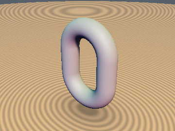
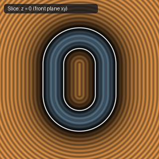
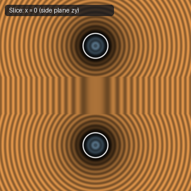

# `sdLink` — Exact 3D Chain Link

| 3D Surface ($f(p) = 0$) | Primary 2D Cross-Section | Secondary 2D Cross-Section |
| :---: | :---: | :---: |
|  |  |  |

| Property | Value |
| :--- | :--- |
| **Author / Discoverer** | **Inigo Quilez** |
| **Source** | [https://iquilezles.org/articles/distfunctions/](https://iquilezles.org/articles/distfunctions/) |
| **Category** | `primitives3d` |
| **GLSL File** | [`glsl/primitives3d/sdLink.glsl`](../../glsl/primitives3d/sdLink.glsl) |
| **Exact Euclidean SDF?** | Yes (`||grad d|| = 1`) |

---

## Mathematical Overview

Elongates a torus along the $y$-axis by half-length $l_e$ via $q_y = \max(|p_y| - l_e, 0)$.

---

## GLSL Implementation

```glsl
float sdLink( vec3 p, float le, float r1, float r2 )
{
    vec3 q = vec3( p.x, max(abs(p.y) - le, 0.0), p.z );
    return length(vec2(length(q.xy) - r1, q.z)) - r2;
}
```
