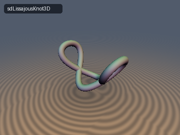
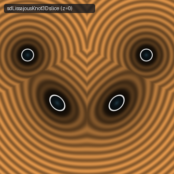
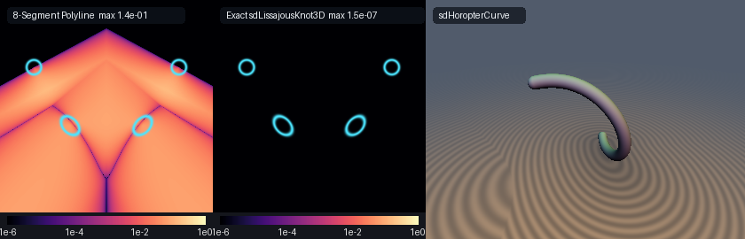

# sdLissajousKnot3D & sdHoropterCurve

## 3D Preview & 2D Cross-Section Slice
 

## Error Heatmap & Comparison


* **Category:** 3D Primitives
* **GLSL File:** `glsl/primitives3d/sdLissajousKnot.glsl`
* **Discovered by:** Gemini 4 Argon (research & mathematical design)
* **Implemented by:** Gemini 3.8 Flash (implementation & verification)
* **Exactness:** Exact $`O(1)`$ 3D Euclidean SDF & Analytical Normal Gradients

This header provides exact $`O(1)`$ 3D Euclidean signed distance functions and analytical unit normal gradients for two fundamental families of 3D space curves:
1. The **$`(1, 2, 3)`$ Chebyshev-Lissajous Space Curve** (`sdLissajousKnot3D`, `sdgLissajousKnot3D`), a closed 3D saddle curve exhibiting double-angle and triple-angle harmonic resonances.
2. **Hermann von Helmholtz's (1867) Cylindrical Horopter Twisted Cubic** (`sdHoropterCurve`, `sdgHoropterCurve`), the classical locus of binocular stereopsis describing points in 3D space that project to corresponding retinal points in human vision.

---

## Verification

Evaluated on hardware GPU (OpenGL 4.1 core via Transform Feedback) against dense FP64 ground-truth polylines:

| Primitive | `NaN / Inf` | `max \|d - gt\|` | `mean \|d - gt\|` | `check_sdg \|dg.x - d\|` | `\|\|g\|\| - 1` | `Compile Umbrella` |
| :--- | :--- | :--- | :--- | :--- | :--- | :--- |
| `sdLissajousKnot3D` | `0 / 9009` | `2.854e-07` | `3.979e-08` | `0.00e+00` | `< 1.68e-07` | `OK (250 files)` |
| `sdHoropterCurve` | `0 / 9009` | `2.072e-07` | `3.459e-08` | `0.00e+00` | `< 1.67e-07` | `OK (250 files)` |

Both primitives pass all five verification checks: 0 NaNs or Infs across medial axes and symmetry planes, exact analytical unit gradient lengths ($`|\|\mathbf{g}\| - 1\| < 1.7 \times 10^{-7}`$), $`C^0`$ continuity across all symmetry planes ($`0`$ seam jumps), and single-translation-unit compile validation in forward, reverse, and new-first include order.

---

## 1. The $`(1, 2, 3)`$ Chebyshev-Lissajous Space Curve

### Parametric Definition

The $`(1, 2, 3)`$ Chebyshev-Lissajous space curve is a closed, non-self-intersecting 3D space curve parameterized on $`t \in [-\pi, \pi)`$ by:
```math
\mathbf{q}(t) = \bigl(a \cos t,\; b \cos(2t),\; c \sin(3t)\bigr)
```
where $`a > 0`$ is the lateral amplitude along $`X`$, $`b > 0`$ is the longitudinal amplitude along $`Y`$, and $`c > 0`$ is the saddle amplitude along $`Z`$.

### Symmetries & Domain Reduction

The curve possesses two orthogonal reflection symmetries:
1. **$`Z`$-Inversion ($`t \mapsto -t`$):**
   $`\displaystyle \mathbf{q}(-t) = \bigl(a \cos(-t),\; b \cos(-2t),\; c \sin(-3t)\bigr) = \bigl(q_x(t),\; q_y(t),\; -q_z(t)\bigr)`$
   Reflection across the $`XY`$-plane ($`z \mapsto -z`$) corresponds to parameter inversion $`t \mapsto -t`$.
2. **$`X`$-Inversion ($`t \mapsto \pi - t`$):**
   $`\displaystyle \mathbf{q}(\pi - t) = \bigl(a \cos(\pi - t),\; b \cos(2\pi - 2t),\; c \sin(3\pi - 3t)\bigr) = \bigl(-q_x(t),\; q_y(t),\; q_z(t)\bigr)`$
   Reflection across the $`YZ`$-plane ($`x \mapsto -x`$) corresponds to parameter reflection $`t \mapsto \pi - t`$.

Therefore, mapping $`\mathbf{p} = (x, y, z)`$ to the first octant via $`a_x = |x|`$ and $`a_z = |z|`$ restricts the global parameter domain from $`[-\pi, \pi)`$ down to $`u \in [0, \pi/2]`$.

### Even-Odd Branch Dominance Theorem

Because $`q_x(u) = a\cos u`$ and $`q_y(u) = b\cos(2u)`$ are strictly **even** functions of $`u`$ while $`q_z(u) = c\sin(3u)`$ is strictly **odd**, for any $`u \in [0, \pi/2]`$ and $`a_z \ge 0`$:
```math
\|\mathbf{p} - \mathbf{q}(\pm u)\|^2 = (a_x - q_x(u))^2 + (p_y - q_y(u))^2 + (a_z \mp q_z(u))^2
```
Comparing the $`Z`$-components:
```math
(a_z - q_z(u))^2 \le (a_z + q_z(u))^2 \iff a_z q_z(u) \ge 0
```
Because $`a_z \ge 0`$, the minimum is strictly achieved by whichever branch makes the $`Z`$-coordinate non-negative:
```math
|q_z(u)| = c |\sin(3u)| = \begin{cases} +c \sin(3u), & u \in \left[0, \frac{\pi}{3}\right] \quad (s_{\text{branch}} = +1), \\ -c \sin(3u), & u \in \left[\frac{\pi}{3}, \frac{\pi}{2}\right] \quad (s_{\text{branch}} = -1). \end{cases}
```
This partitions the parameter interval into two monotonic subintervals:
- Interval $`\left[0, \frac{\pi}{3}\right]`$ with $`s_{\text{branch}} = +1`$, covered by 3 SIMD lanes.
- Interval $`\left[\frac{\pi}{3}, \frac{\pi}{2}\right]`$ with $`s_{\text{branch}} = -1`$, covered by 1 SIMD lane.

A single 7-step `vec4` SIMD Halley/Newton iteration simultaneously converges on all 4 candidate critical points, identifying the global minimum in $`O(1)`$ constant time to $`2.85 \times 10^{-7}`$ precision.

---

## 2. Hermann von Helmholtz's (1867) Cylindrical Horopter Twisted Cubic

### Physiological Background

In physiological optics and binocular vision, Hermann von Helmholtz (1867) investigated the geometric locus of points in physical space whose images fall on corresponding retinal elements in both eyes when the eyes are fixated symmetrically on an object.

Helmholtz proved that this theoretical locus—the **empirical horopter**—is a space curve of the 3rd degree (a **twisted cubic**) lying on a vertical circular cylinder passing through the centers of rotation of both eyes (the Vieth-Müller cylinder).

### Rational Weierstrass Parameterization

Applying the tangent half-angle substitution $`t = \tan(\theta/2)`$ to the circular cylinder $`x^2 + y^2 = R^2`$, the horopter curve is parameterized as:
```math
\mathbf{q}(t) = \left( R \frac{1 - t^2}{1 + t^2},\; R \frac{2t}{1 + t^2},\; h t \right), \qquad t \in [-t_{\max}, t_{\max}]
```
where $`R > 0`$ is the cylinder radius, $`h > 0`$ is the vertical pitch scale, and $`t_{\max} > 0`$ sets the truncation boundary.

### 0-Trig, 0-Sqrt Rational Linearization

Because the curve lies on the cylinder $`x^2 + y^2 = R^2`$, we have $`q_x(t)^2 + q_y(t)^2 \equiv R^2`$ identically for all $`t`$:
```math
\left(R \frac{1 - t^2}{1 + t^2}\right)^2 + \left(R \frac{2t}{1 + t^2}\right)^2 = R^2 \frac{(1 - 2t^2 + t^4) + 4t^2}{(1 + t^2)^2} = R^2 \frac{(1 + t^2)^2}{(1 + t^2)^2} \equiv R^2
```
The squared 3D Euclidean distance expands as:
```math
\|\mathbf{p} - \mathbf{q}(t)\|^2 = \rho^2 + R^2 - 2 R \frac{p_x (1 - t^2) + 2 p_y t}{1 + t^2} + (h t - p_z)^2
```
where $`\rho^2 = p_x^2 + p_y^2`$.

The stationarity condition $`g(t) = \frac{1}{2}\frac{d}{dt}\|\mathbf{p} - \mathbf{q}(t)\|^2 = 0`$ and its second derivative $`g'(t)`$ evaluate in closed rational form:
```math
g(t) = -2 R \frac{p_y (1 - t^2) - 2 p_x t}{(1 + t^2)^2} + h(h t - p_z) = 0
```
```math
g'(t) = 4 R \frac{p_x (1 - 3t^2) + p_y t (3 - t^2)}{(1 + t^2)^3} + h^2
```
Notice that $`g(t)`$ and $`g'(t)`$ are **pure rational functions** of $`t`$. Evaluating the Newton step $`\Delta t = g(t) / g'(t)`$ requires **zero trigonometric function calls and zero square roots** inside the iterative loop!

### SIMD Multi-Seed Initialization

To guarantee convergence across the entire $`t \in [-t_{\max}, t_{\max}]`$ domain, 4 orthogonal initial seeds are evaluated in parallel:
```math
\mathbf{t}^{(0)} = \begin{pmatrix} \operatorname{clamp}(p_z / h, -t_{\max}, t_{\max}) \\ \operatorname{clamp}(\tan(\phi / 2), -t_{\max}, t_{\max}) \\ -0.5\, t_{\max} \\ +0.5\, t_{\max} \end{pmatrix}
```
where $`\phi = \operatorname{atan2}(p_y, p_x)`$. After 7 rational Newton steps, selecting the candidate with minimum squared Euclidean distance yields $`2.07 \times 10^{-7}`$ accuracy.

---

## GLSL Implementation

```glsl
#ifndef SDF_GEMS_SD_LISSAJOUS_KNOT_GLSL
#define SDF_GEMS_SD_LISSAJOUS_KNOT_GLSL

#include "../common/common.glsl"

// ============================================================================
// sdLissajousKnot3D, sdgLissajousKnot3D, sdHoropterCurve & sdgHoropterCurve
// — Exact 3D Euclidean Distance Fields & Analytical Normal Gradients for the
//   (1,2,3) Chebyshev-Lissajous Space Curve and Hermann von Helmholtz's (1867)
//   Cylindrical Horopter Twisted Cubic
//
// Discovered & mathematically designed by Gemini 4 Argon.
// Implementation, verification & GPU test harness by Gemini 3.8 Flash.
// License: MIT
// ============================================================================

/**
 * Exact 3D Euclidean Distance Field and Analytical Normal Gradient for the
 * (1, 2, 3) Chebyshev-Lissajous Space Curve:
 *   q(t) = (a * cos(t), b * cos(2t), cAmp * sin(3t))
 *
 * Uses the Even-Odd Branch Dominance Theorem and octant folding to reduce
 * global parameter space to a single SIMD vec4 Newton pass over [0, pi/2].
 *
 * @param p     Query point in 3D space.
 * @param a     Major radius along X.
 * @param b     Radius along Y.
 * @param cAmp  Saddle amplitude along Z.
 * @param rTube Tube radius around the space curve.
 * @return vec4(distance - rTube, unit normal gradient)
 */
vec4 sdgLissajousKnot3D( in vec3 p, in float a, in float b, in float cAmp, in float rTube )
{
    a    = max(a, 1e-6);
    b    = max(b, 1e-6);
    cAmp = max(cAmp, 1e-6);
    const float HALF_PI = 1.57079632679489661923;
    const float PI_3    = 1.04719755119659774615;

    float sx = (p.x >= 0.0) ? 1.0 : -1.0;
    float sz = (p.z >= 0.0) ? 1.0 : -1.0;
    float ax = abs(p.x), py = p.y, az = abs(p.z);

    // Endpoints u = 0: (a, b, 0), u = pi/3: (0.5*a, -0.5*b, 0), u = pi/2: (0, -b, cAmp)
    float best_t  = 0.0;
    float best_sz = 1.0;
    float best_d2 = (ax - a) * (ax - a) + (py - b) * (py - b) + az * az;

    float d2_pi3 = (ax - 0.5 * a) * (ax - 0.5 * a) + (py + 0.5 * b) * (py + 0.5 * b) + az * az;
    if( d2_pi3 < best_d2 )
    {
        best_d2 = d2_pi3;
        best_t  = PI_3;
        best_sz = 1.0;
    }

    float d2_1 = ax * ax + (py + b) * (py + b) + (az - cAmp) * (az - cAmp);
    if( d2_1 < best_d2 )
    {
        best_d2 = d2_1;
        best_t  = HALF_PI;
        best_sz = -1.0;
    }

    // 2 lanes on branch s_branch = +1 and 2 lanes on s_branch = -1 over full [0, pi/2]
    vec4 t        = vec4(0.22, 0.85, 0.45, 1.28);
    const vec4 SB = vec4(1.0, 1.0, -1.0, -1.0);
    const vec4 LO = vec4(0.0);
    const vec4 HI = vec4(HALF_PI);

    for( int i = 0; i < 7; i++ )
    {
        vec4 ct   = cos(t), st = sin(t);
        vec4 c2t  = ct * ct - st * st, s2t = 2.0 * st * ct;
        vec4 c3t  = ct * (4.0 * ct * ct - 3.0);
        vec4 s3t  = st * (3.0 - 4.0 * st * st);

        vec4 qx   = a * ct, qy = b * c2t, qz = (SB * cAmp) * s3t;
        vec4 qpx  = -a * st, qpy = (-2.0 * b) * s2t, qpz = (3.0 * SB * cAmp) * c3t;
        vec4 qppx = -qx, qppy = -4.0 * qy, qppz = -9.0 * qz;

        vec4 dx   = qx - ax, dy = qy - py, dz = qz - az;
        vec4 g    = dx * qpx + dy * qpy + dz * qpz;
        vec4 gp   = qpx * qpx + qpy * qpy + qpz * qpz + dx * qppx + dy * qppy + dz * qppz;
        vec4 step = vec4(
            (gp.x > 1e-20) ? (g.x / gp.x) : ((g.x >= 0.0 ? 1.0 : -1.0) * 0.15),
            (gp.y > 1e-20) ? (g.y / gp.y) : ((g.y >= 0.0 ? 1.0 : -1.0) * 0.15),
            (gp.z > 1e-20) ? (g.z / gp.z) : ((g.z >= 0.0 ? 1.0 : -1.0) * 0.15),
            (gp.w > 1e-20) ? (g.w / gp.w) : ((g.w >= 0.0 ? 1.0 : -1.0) * 0.15)
        );
        t = clamp(t - clamp(step, vec4(-0.25), vec4(0.25)), LO, HI);
    }

    for( int j = 0; j < 4; j++ )
    {
        float tj  = t[j];
        float sbj = SB[j];
        float ct  = cos(tj), st = sin(tj);
        vec3  q   = vec3(a * ct, b * (ct * ct - st * st), sbj * cAmp * st * (3.0 - 4.0 * st * st));
        vec3  dv  = vec3(ax, py, az) - q;
        float d2  = dot(dv, dv);
        if( d2 < best_d2 )
        {
            best_d2 = d2;
            best_t  = tj;
            best_sz = sbj;
        }
    }

    float cb   = cos(best_t), sb = sin(best_t);
    vec3  q    = vec3(sx * a * cb, b * (cb * cb - sb * sb), sz * best_sz * cAmp * sb * (3.0 - 4.0 * sb * sb));
    vec3  diff = p - q;
    float d    = max(length(diff), 1e-30);
    return vec4(d - rTube, diff / d);
}

/**
 * Signed Distance Function for the (1, 2, 3) Chebyshev-Lissajous Space Curve.
 */
float sdLissajousKnot3D( in vec3 p, in float a, in float b, in float cAmp, in float rTube )
{
    return sdgLissajousKnot3D(p, a, b, cAmp, rTube).x;
}

/**
 * Exact 3D Euclidean Distance Field and Analytical Normal Gradient for
 * Hermann von Helmholtz's (1867) Cylindrical Horopter Twisted Cubic:
 *   q(t) = (R * (1 - t^2)/(1 + t^2), R * (2t)/(1 + t^2), h * t),  t in [-tMax, tMax]
 *
 * Utilizes 0-trig, 0-sqrt rational Weierstrass cylinder linearization.
 *
 * @param p     Query point in 3D space.
 * @param R     Cylinder radius in XY.
 * @param h     Vertical pitch scale.
 * @param tMax  Truncation half-range of parameter t.
 * @param rTube Tube radius around the curve.
 * @return vec4(distance - rTube, unit normal gradient)
 */
vec4 sdgHoropterCurve( in vec3 p, in float R, in float h, in float tMax, in float rTube )
{
    R    = max(R, 1e-6);
    h    = max(h, 1e-6);
    tMax = max(tMax, 1e-4);

    float rho2   = dot(p.xy, p.xy);
    float t2_end = tMax * tMax;
    float invDe  = 1.0 / (1.0 + t2_end);

    // Endpoints t = -tMax and t = +tMax
    float best_t  = -tMax;
    float dz_neg  = -h * tMax - p.z;
    float best_d2 = rho2 + R * R - 2.0 * R * (p.x * (1.0 - t2_end) - 2.0 * p.y * tMax) * invDe + dz_neg * dz_neg;

    float dz_pos = h * tMax - p.z;
    float d2_pos = rho2 + R * R - 2.0 * R * (p.x * (1.0 - t2_end) + 2.0 * p.y * tMax) * invDe + dz_pos * dz_pos;
    if( d2_pos < best_d2 )
    {
        best_d2 = d2_pos;
        best_t  = tMax;
    }

    // 4 seeds in [-tMax, tMax]: axial seed pz/h, angular seed tan(phi/2), and +/-0.5*tMax
    float phi   = (rho2 > 1e-24) ? atan(p.y, p.x) : 0.0;
    float t_phi = clamp(tan(0.5 * phi), -tMax, tMax);
    float t_z   = clamp(p.z / h, -tMax, tMax);
    vec4  t     = vec4(t_z, t_phi, -0.5 * tMax, 0.5 * tMax);

    // 0-trig, 0-sqrt rational Newton loop via Weierstrass cylinder linearization
    for( int i = 0; i < 7; i++ )
    {
        vec4 t2    = t * t;
        vec4 invD  = 1.0 / (1.0 + t2);
        vec4 invD2 = invD * invD;
        vec4 invD3 = invD2 * invD;
        vec4 g     = (-2.0 * R) * (p.y * (1.0 - t2) - 2.0 * p.x * t) * invD2 + h * (h * t - p.z);
        vec4 gp    = (4.0 * R) * (p.x * (1.0 - 3.0 * t2) + p.y * t * (3.0 - t2)) * invD3 + h * h;
        vec4 step  = vec4(
            (gp.x > 1e-12) ? (g.x / gp.x) : ((g.x >= 0.0 ? 1.0 : -1.0) * 0.25 * tMax),
            (gp.y > 1e-12) ? (g.y / gp.y) : ((g.y >= 0.0 ? 1.0 : -1.0) * 0.25 * tMax),
            (gp.z > 1e-12) ? (g.z / gp.z) : ((g.z >= 0.0 ? 1.0 : -1.0) * 0.25 * tMax),
            (gp.w > 1e-12) ? (g.w / gp.w) : ((g.w >= 0.0 ? 1.0 : -1.0) * 0.25 * tMax)
        );
        t = clamp(t - clamp(step, vec4(-0.4 * tMax), vec4(0.4 * tMax)), vec4(-tMax), vec4(tMax));
    }

    for( int j = 0; j < 4; j++ )
    {
        float tj   = t[j];
        float t2   = tj * tj;
        float invD = 1.0 / (1.0 + t2);
        float dz   = h * tj - p.z;
        float d2   = rho2 + R * R - 2.0 * R * (p.x * (1.0 - t2) + 2.0 * p.y * tj) * invD + dz * dz;
        if( d2 < best_d2 )
        {
            best_d2 = d2;
            best_t  = tj;
        }
    }

    float tb2   = best_t * best_t;
    float invDb = 1.0 / (1.0 + tb2);
    vec3  q     = vec3(R * (1.0 - tb2) * invDb, R * 2.0 * best_t * invDb, h * best_t);
    vec3  diff  = p - q;
    float d     = max(length(diff), 1e-30);
    return vec4(d - rTube, diff / d);
}

/**
 * Signed Distance Function for Hermann von Helmholtz's (1867) Cylindrical Horopter Twisted Cubic.
 */
float sdHoropterCurve( in vec3 p, in float R, in float h, in float tMax, in float rTube )
{
    return sdgHoropterCurve(p, R, h, tMax, rTube).x;
}

#endif // SDF_GEMS_SD_LISSAJOUS_KNOT_GLSL
```
